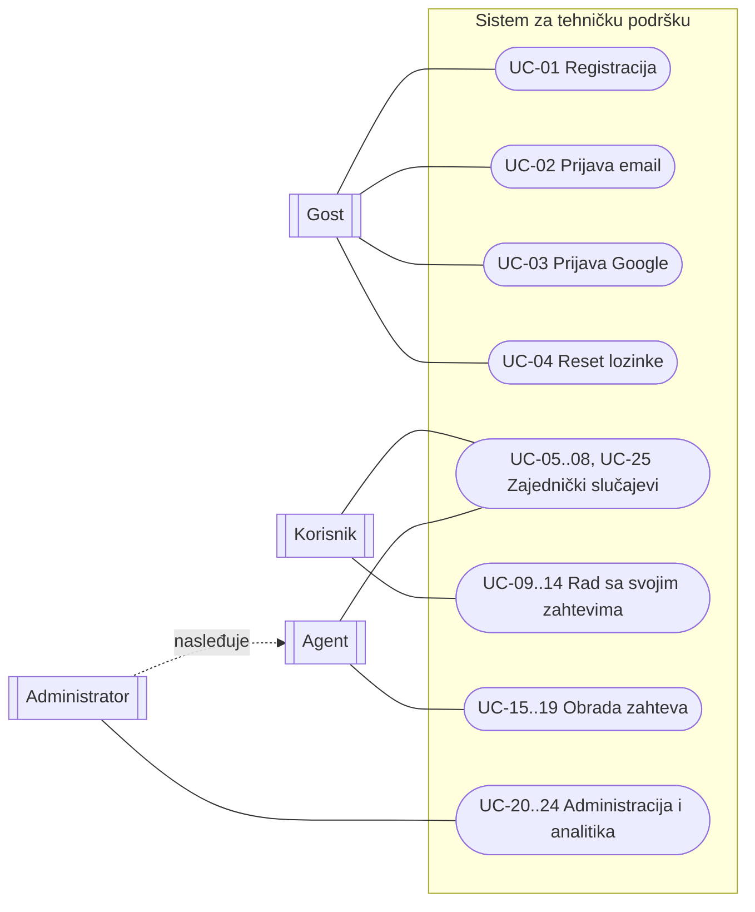
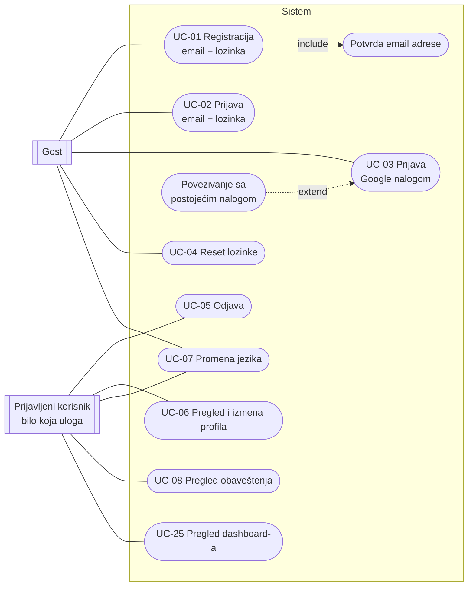
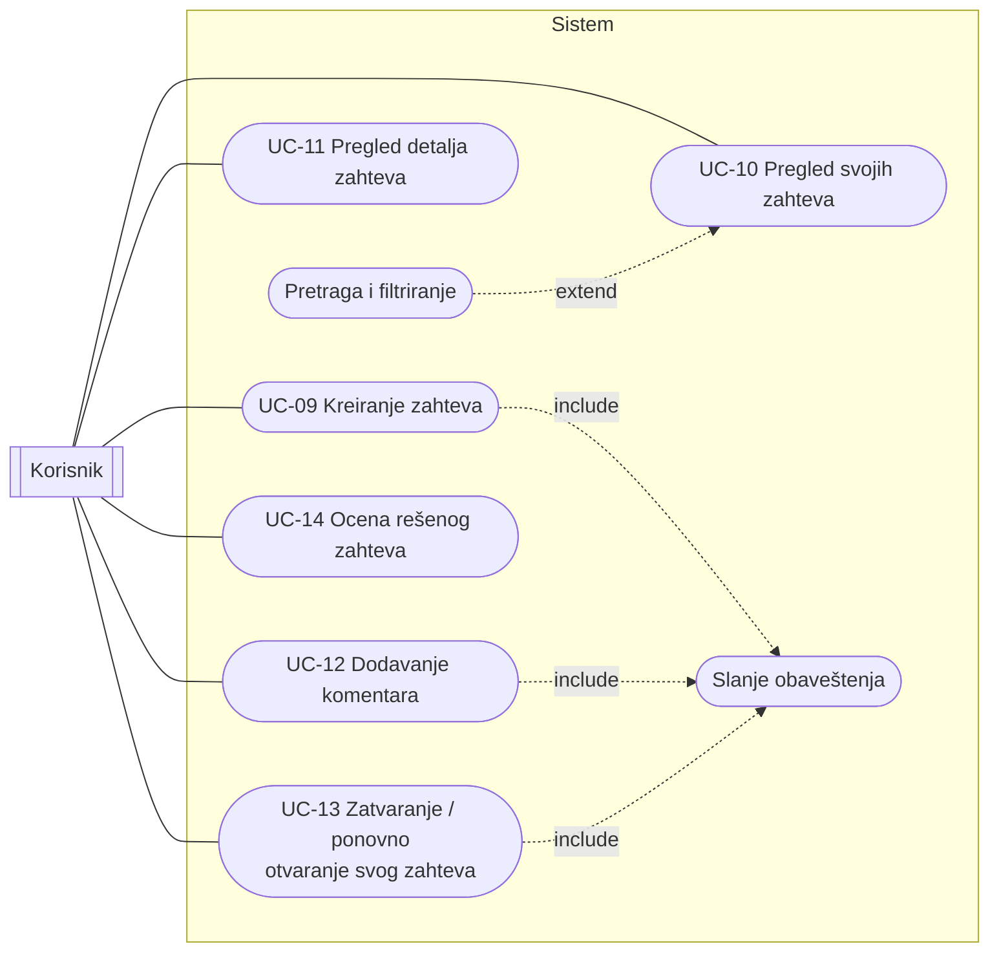
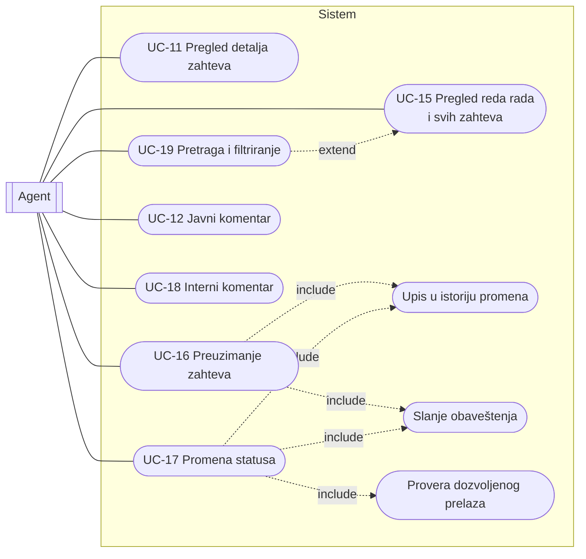
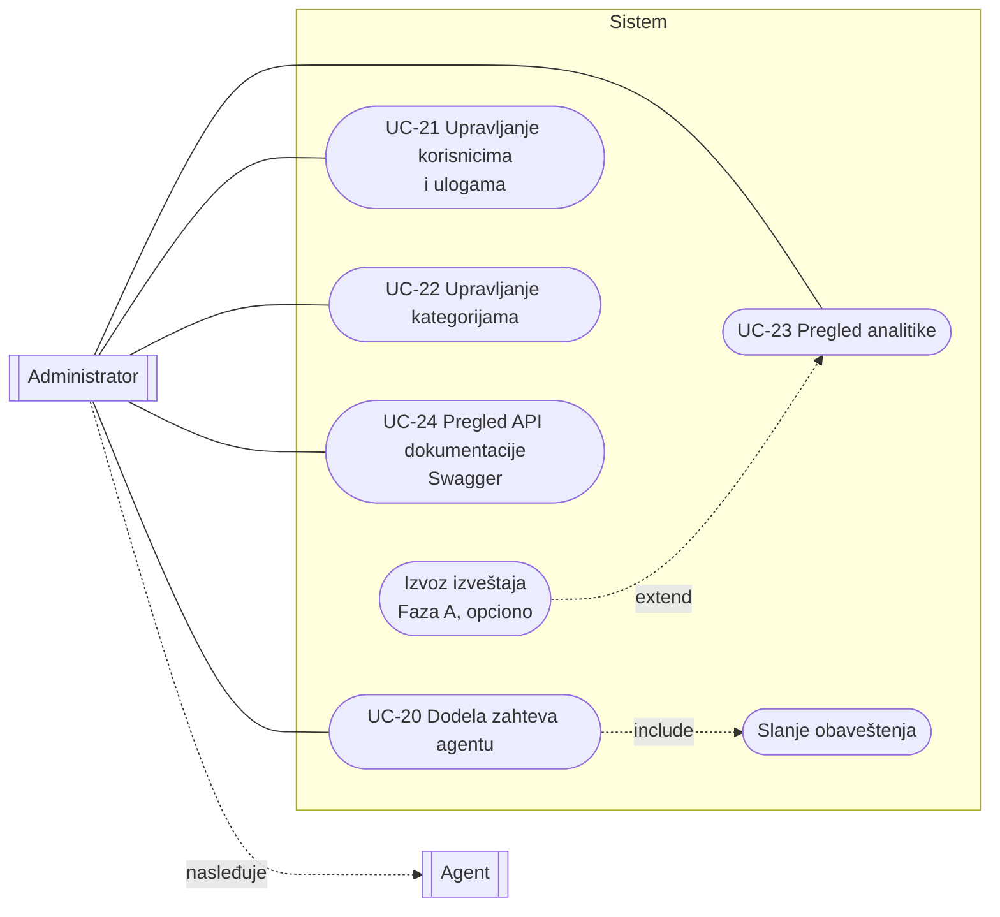

# 01 — Slučajevi korišćenja (Use Case)

Ovaj dokument definiše aktere sistema, dijagrame slučajeva korišćenja i specifikaciju svakog slučaja korišćenja. Služi kao osnova za poglavlje rada _Implementacija → Slučajevi korišćenja sistema_ i kao spisak funkcionalnosti koje kod mora da pokrije.

## 1. Akteri

| Akter                       | Vrednost u bazi (`user_role`) | Opis                                                                                                    |
| --------------------------- | ----------------------------- | ------------------------------------------------------------------------------------------------------- |
| **Gost**                    | — (nije prijavljen)           | Posetilac bez naloga. Može samo da se registruje, prijavi ili resetuje lozinku.                         |
| **Korisnik**                | `customer`                    | Spoljni klijent koji se sam registrovao (email ili Google). Prijavljuje probleme i prati svoje zahteve. |
| **Agent**                   | `agent`                       | Član tima podrške. Rešava zahteve, menja statuse, piše javne i interne komentare.                       |
| **Administrator**           | `admin`                       | Sve što može agent, plus upravljanje korisnicima, ulogama, kategorijama, dodela zahteva i analitika.    |
| **Sistem (vreme / okidač)** | —                             | Sporedni akter: šalje real-time obaveštenja, beleži istoriju promena.                                   |

Odnos uloga: **Administrator nasleđuje sve slučajeve korišćenja Agenta.** Agent i Korisnik **ne** nasleđuju jedan drugog (agent ne kreira zahteve u ime sebe kao korisnik).

Svi prijavljeni akteri (Korisnik, Agent, Administrator) dele zajedničke slučajeve: odjava, profil, promena jezika, obaveštenja i dashboard.

Notacija u dijagramima: `include` strelica ide od osnovnog slučaja ka uključenom (uvek se izvršava), a `extend` strelica ide od proširenja ka osnovnom slučaju (izvršava se samo pod uslovom), po UML standardu.

## 2. Pregledni dijagram (svi akteri)

## 3. Dijagrami po akterima

### 3.1 Gost i zajednički slučajevi

### 3.2 Korisnik

### 3.3 Agent

### 3.4 Administrator

## 4. Spisak slučajeva korišćenja

| ID    | Naziv                                       | Akteri                                       | API (vidi `06-api-i-stranice.md`)                                                                 | Stranica                                                        |
| ----- | ------------------------------------------- | -------------------------------------------- | ------------------------------------------------------------------------------------------------- | --------------------------------------------------------------- |
| UC-01 | Registracija (email + lozinka)              | Gost                                         | `POST /api/auth/register`                                                                         | `/register`                                                     |
| UC-02 | Prijava (email + lozinka)                   | Gost                                         | `POST /api/auth/login`                                                                            | `/login`                                                        |
| UC-03 | Prijava Google nalogom                      | Gost                                         | `GET /api/auth/google`, `GET /api/auth/callback`                                                  | `/login`, `/register`                                           |
| UC-04 | Reset lozinke                               | Gost                                         | `POST /api/auth/password/forgot`, `POST /api/auth/password/reset`                                 | `/forgot-password`, `/reset-password`                           |
| UC-05 | Odjava                                      | Svi prijavljeni                              | `POST /api/auth/logout`                                                                           | meni                                                            |
| UC-06 | Pregled i izmena profila                    | Svi prijavljeni                              | `GET /api/me`, `PATCH /api/me`                                                                    | `/profile`                                                      |
| UC-07 | Promena jezika (EN/SR)                      | Svi (i gost)                                 | — (kolačić `NEXT_LOCALE`) + `PATCH /api/me` za prijavljene                                        | zaglavlje                                                       |
| UC-08 | Pregled obaveštenja                         | Svi prijavljeni                              | `GET /api/notifications`, `POST /api/notifications/{id}/read`, `POST /api/notifications/read-all` | zvonce u zaglavlju, `/notifications`                            |
| UC-09 | Kreiranje zahteva                           | Korisnik                                     | `POST /api/tickets`                                                                               | `/tickets/new`                                                  |
| UC-10 | Pregled svojih zahteva                      | Korisnik                                     | `GET /api/tickets`                                                                                | `/tickets`                                                      |
| UC-11 | Pregled detalja zahteva                     | Korisnik, Agent, Admin                       | `GET /api/tickets/{id}`, `GET /api/tickets/{id}/comments`, `GET /api/tickets/{id}/history`        | `/tickets/[id]`                                                 |
| UC-12 | Dodavanje javnog komentara                  | Korisnik, Agent, Admin                       | `POST /api/tickets/{id}/comments`                                                                 | `/tickets/[id]`                                                 |
| UC-13 | Zatvaranje / ponovno otvaranje svog zahteva | Korisnik                                     | `POST /api/tickets/{id}/status`                                                                   | `/tickets/[id]`                                                 |
| UC-14 | Ocena rešenog zahteva (CSAT)                | Korisnik                                     | `POST /api/tickets/{id}/rating`                                                                   | `/tickets/[id]`                                                 |
| UC-15 | Pregled reda rada i svih zahteva            | Agent, Admin                                 | `GET /api/tickets`                                                                                | `/tickets` (lista ili kanban tabla `?view=board`), `/dashboard` |
| UC-16 | Preuzimanje zahteva                         | Agent, Admin                                 | `POST /api/tickets/{id}/assign` (sebi)                                                            | `/tickets/[id]`, kanban tabla                                   |
| UC-17 | Promena statusa                             | Agent, Admin                                 | `POST /api/tickets/{id}/status`                                                                   | `/tickets/[id]`, kanban tabla                                   |
| UC-18 | Interni komentar                            | Agent, Admin                                 | `POST /api/tickets/{id}/comments` (`isInternal: true`)                                            | `/tickets/[id]`                                                 |
| UC-19 | Pretraga i filtriranje                      | Svi prijavljeni (u okviru vidljivih zahteva) | `GET /api/tickets?status=&priority=&categoryId=&assigneeId=&q=`                                   | `/tickets`                                                      |
| UC-20 | Dodela zahteva agentu                       | Admin                                        | `POST /api/tickets/{id}/assign`                                                                   | `/tickets/[id]`                                                 |
| UC-21 | Upravljanje korisnicima i ulogama           | Admin                                        | `GET /api/admin/users`, `PATCH /api/admin/users/{id}`                                             | `/admin/users`                                                  |
| UC-22 | Upravljanje kategorijama                    | Admin                                        | `GET /api/categories`, `POST /api/admin/categories`, `PATCH /api/admin/categories/{id}`           | `/admin/categories`                                             |
| UC-23 | Pregled analitike                           | Admin                                        | `GET /api/analytics/*`                                                                            | `/analytics`                                                    |
| UC-24 | Pregled API dokumentacije                   | Admin (u demo okruženju i svi)               | `GET /api/openapi`                                                                                | `/api-docs`                                                     |
| UC-25 | Pregled dashboard-a                         | Svi prijavljeni                              | `GET /api/dashboard`                                                                              | `/dashboard`                                                    |

## 5. Specifikacija ključnih slučajeva korišćenja

Format: preduslovi, osnovni tok, alternativni tokovi, postuslovi. Za slučajeve koji nisu ovde detaljno opisani važi isti obrazac; dovoljno je kratko opisati ih u radu.

### UC-01 Registracija (email + lozinka)

- **Akter:** Gost
- **Preduslov:** Gost nije prijavljen.
- **Osnovni tok:**
  1. Gost otvara stranicu `/register`.
  2. Unosi ime i prezime, email, lozinku i potvrdu lozinke.
  3. Sistem validira podatke (Zod: email format, lozinka min. 8 karaktera, lozinke se poklapaju).
  4. Sistem kreira nalog u Supabase Auth i šalje email za potvrdu.
  5. Triger u bazi automatski kreira profil sa ulogom `customer`.
  6. Sistem prikazuje poruku „Proverite email da potvrdite nalog“.
  7. Gost klikne na link u emailu; sistem potvrđuje nalog i preusmerava na `/dashboard`.
- **Alternativni tokovi:**
  - 3a. Podaci nisu ispravni → sistem prikazuje greške pored polja; povratak na korak 2.
  - 4a. Email već postoji → greška `EMAIL_ALREADY_REGISTERED` (prevedena poruka).
- **Postuslov:** Postoji potvrđen nalog sa ulogom `customer`.

### UC-03 Prijava Google nalogom

- **Akter:** Gost
- **Osnovni tok:**
  1. Gost klikne „Nastavi sa Google nalogom“ na `/login` ili `/register`.
  2. Sistem preusmerava na Google prijavu (OAuth preko Supabase Auth).
  3. Gost odobrava pristup; Google vraća korisnika na `/api/auth/callback`.
  4. Sistem razmenjuje kod za sesiju i postavlja kolačić sesije.
  5. Ako profil ne postoji, triger ga kreira sa ulogom `customer`.
  6. Sistem preusmerava na `/dashboard`.
- **Alternativni tokovi:**
  - 5a. Već postoji nalog sa istom email adresom (registrovan emailom) → Supabase povezuje Google identitet sa postojećim nalogom; koristi se isti profil i ista uloga (_extend: Povezivanje sa postojećim nalogom_).
  - 3a. Gost odustane ili Google vrati grešku → povratak na `/login` sa porukom.
- **Postuslov:** Gost je prijavljen.

### UC-09 Kreiranje zahteva

- **Akter:** Korisnik
- **Preduslov:** Korisnik je prijavljen i ima potvrđen email.
- **Osnovni tok:**
  1. Korisnik otvara `/tickets/new`.
  2. Sistem učitava aktivne kategorije.
  3. Korisnik unosi naslov, opis, bira kategoriju i prioritet.
  4. Sistem validira podatke.
  5. Sistem upisuje zahtev sa statusom `open`, upisuje stavku istorije `created`.
  6. Sistem kreira obaveštenje `ticket_created` za sve agente i admine i šalje real-time događaj.
  7. Sistem preusmerava korisnika na detalje novog zahteva (`/tickets/[id]`).
- **Alternativni tokovi:**
  - 4a. Neispravni podaci → greške pored polja.
  - 5a. Greška baze → poruka „Zahtev nije sačuvan, pokušajte ponovo“, podaci u formi ostaju.
- **Postuslov:** Zahtev postoji sa statusom `open`; agenti su obavešteni u realnom vremenu.

### UC-12 / UC-18 Dodavanje komentara (javni / interni)

- **Akteri:** Korisnik (samo javni), Agent i Admin (javni i interni)
- **Preduslov:** Akter vidi zahtev; zahtev nije `closed`.
- **Osnovni tok:**
  1. Akter na stranici zahteva unosi tekst komentara (agent bira „Interni komentar“ ili „Odgovor korisniku“).
  2. Sistem validira tekst (1–5000 karaktera) i proverava da korisnik ne šalje interni komentar.
  3. Sistem upisuje komentar.
  4. Ako je ovo prvi javni komentar agenta, sistem upisuje `first_response_at`.
  5. Ako je zahtev u statusu `waiting_on_customer` i komentar je napisao vlasnik zahteva, status se automatski vraća u `in_progress`.
  6. Sistem kreira obaveštenja: za javni komentar drugoj strani (vlasniku ili dodeljenom agentu); za interni samo agentima/adminima.
  7. Komentar se odmah pojavljuje kod svih koji gledaju zahtev (real-time).
- **Alternativni tokovi:**
  - 2a. Korisnik pokuša `isInternal: true` → `403 FORBIDDEN_INTERNAL_COMMENT`.
  - 2b. Zahtev je zatvoren → `409 TICKET_CLOSED`.
- **Postuslov:** Komentar je sačuvan i vidljiv onima koji smeju da ga vide.

### UC-16 Preuzimanje zahteva i UC-20 Dodela zahteva

- **Akteri:** Agent (dodela sebi), Admin (dodela bilo kom agentu)
- **Osnovni tok:**
  1. Agent na zahtevu klikne „Preuzmi“ (admin bira agenta iz liste).
  2. Sistem proverava ulogu: agent sme da dodeli samo sebi i samo nedodeljen zahtev; admin sme bilo kome i da preusmeri.
  3. Sistem upisuje `assigned_to`; ako je status `open`, menja ga u `in_progress`.
  4. Sistem upisuje istoriju (`assigned`, i `status_changed` ako se status promenio).
  5. Sistem obaveštava dodeljenog agenta i vlasnika zahteva.
- **Alternativni tokovi:**
  - 2a. Agent pokušava da preuzme zahtev koji je već dodeljen drugom agentu → `409 TICKET_ALREADY_ASSIGNED`.
  - 2b. Admin bira korisnika koji nije agent/admin → `400 ASSIGNEE_NOT_AGENT`.

### UC-17 Promena statusa (i UC-13 za korisnika)

- **Akteri:** Agent, Admin, Korisnik (samo određeni prelazi)
- **Osnovni tok:**
  1. Akter klikne dugme prelaza na stranici zahteva ili prevuče karticu na kanban tabli (mišem, dugim pritiskom na telefonu ili tastaturom); sistem nudi **samo dozvoljene prelaze** za njegovu ulogu i trenutni status (vidi tabelu prelaza u `02-baza-podataka.md`).
  2. Sistem proverava prelaz kroz `StatusTransitionPolicy`.
  3. Sistem upisuje novi status i vremenske oznake (`resolved_at`, `closed_at`).
  4. Sistem upisuje istoriju `status_changed` (stari i novi status).
  5. Sistem obaveštava drugu stranu (vlasnika ili dodeljenog agenta).
  6. Ako je novi status `resolved`, korisniku se prikazuje poziv da oceni rešenje.
- **Alternativni tokovi:**
  - 2a. Prelaz nije dozvoljen → `409 INVALID_STATUS_TRANSITION`.
  - 2b. Agent menja status zahteva koji nije dodeljen njemu → `403 NOT_ASSIGNED_AGENT` (admin sme uvek).
  - 1a. Kanban: agent prevuče nedodeljen otvoren zahtev u kolonu „U obradi“ → to je preuzimanje (UC-16), ne promena statusa.
  - 2c. Kanban: ako API odbije prelaz, kartica se vraća u prethodnu kolonu i prikazuje se prevedena greška.

### UC-14 Ocena rešenog zahteva

- **Akter:** Korisnik (vlasnik zahteva)
- **Preduslov:** Zahtev je `resolved` ili `closed` i još nije ocenjen.
- **Osnovni tok:**
  1. Korisnik bira ocenu 1–5 i opciono piše komentar.
  2. Sistem proverava vlasništvo, status i da ocena već ne postoji.
  3. Sistem upisuje ocenu i istoriju `rated`; obaveštava dodeljenog agenta.
- **Alternativni tokovi:** 2a. Već ocenjeno → `409 ALREADY_RATED`. 2b. Pogrešan status → `409 TICKET_NOT_RESOLVED`.

### UC-21 Upravljanje korisnicima i ulogama

- **Akter:** Admin
- **Osnovni tok:**
  1. Admin otvara `/admin/users`, vidi listu sa pretragom po imenu/emailu i filterom po ulozi.
  2. Admin menja ulogu (`customer` ↔ `agent` ↔ `admin`) ili deaktivira nalog.
  3. Sistem upisuje promenu; deaktivirani korisnik više ne može da koristi API (`403 ACCOUNT_DISABLED`).
- **Alternativni tokovi:**
  - 2a. Admin pokuša da sebi oduzme admin ulogu ili da deaktivira sebe → `409 CANNOT_MODIFY_SELF` (sprečava da sistem ostane bez admina).
  - 2b. Agentu koji ima otvorene dodeljene zahteve se oduzima uloga → zahtevi se vraćaju u nedodeljene i upisuje se istorija.

### UC-23 Pregled analitike

- **Akter:** Admin
- **Osnovni tok:**
  1. Admin otvara `/analytics` i bira period (podrazumevano poslednjih 30 dana).
  2. Sistem prikazuje: broj zahteva po statusu, kategoriji i prioritetu; prosečno vreme prvog odgovora; prosečno vreme rešavanja; broj rešenih po agentu; prosečnu CSAT ocenu ukupno i po agentu; trend novih i rešenih zahteva kroz vreme.
  3. Admin menja period; grafikoni se osvežavaju.
- **Postuslov:** Nema promena podataka (samo čitanje).

### UC-25 Pregled dashboard-a

| Uloga    | Šta dashboard prikazuje                                                                                                                            |
| -------- | -------------------------------------------------------------------------------------------------------------------------------------------------- |
| Korisnik | Broj svojih zahteva po statusu, poslednjih 5 zahteva, zahtevi koji čekaju njegov odgovor (`waiting_on_customer`), rešeni zahtevi koji čekaju ocenu |
| Agent    | Moji dodeljeni zahtevi po statusu, nedodeljeni zahtevi (red čekanja), hitni zahtevi, moja prosečna ocena                                           |
| Admin    | Ukupno otvorenih, nedodeljenih, hitnih; opterećenje po agentu; brzi link na analitiku                                                              |

Dashboard se osvežava u realnom vremenu kada stigne obaveštenje.
