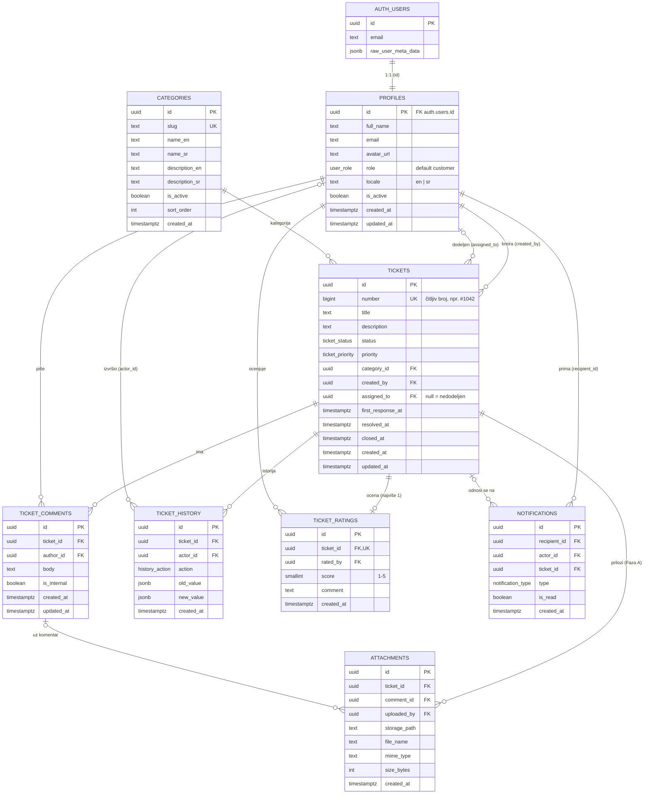
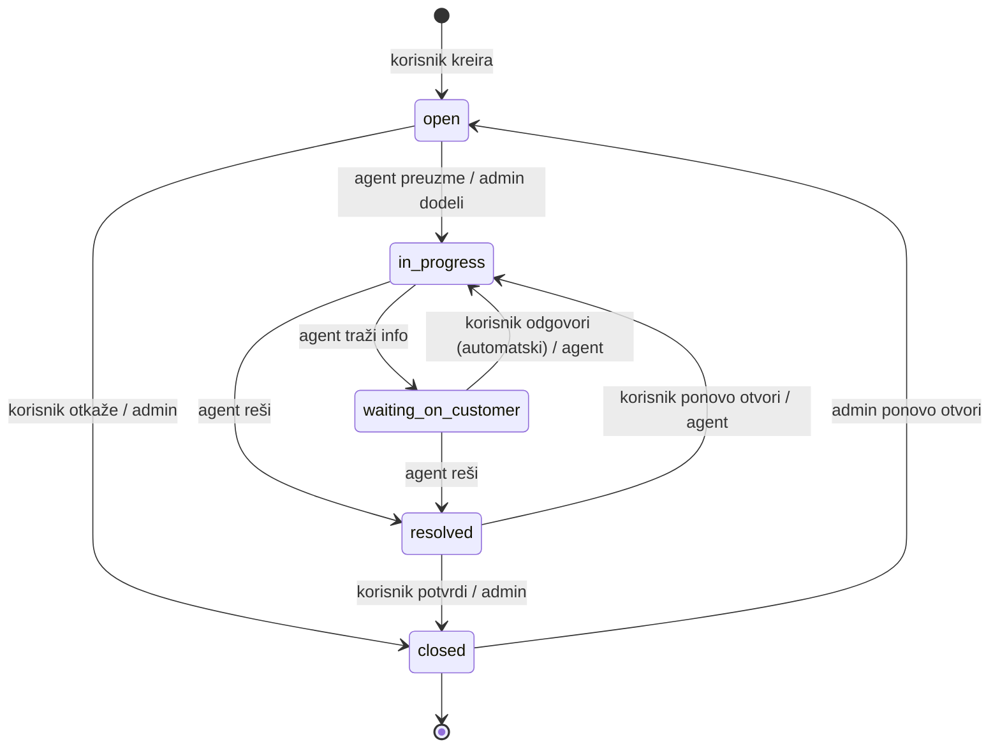

# 02 — Model baze podataka (Supabase / PostgreSQL)

Ovaj dokument je predlog šeme baze: ER dijagram, tabele sa kolonama i ograničenjima, enum tipovi, tok statusa, trigeri, funkcije za analitiku i RLS pravila. Implementira se kroz SQL migracije u `supabase/migrations/`, sa komentarom na srpskom iznad svake tabele, politike i trigera (vidi CLAUDE.md, sekcija 6).

Konvencije: nazivi tabela i kolona na engleskom, `snake_case`, množina za tabele; primarni ključevi `uuid` (`gen_random_uuid()`); sva vremena `timestamptz` u UTC; RLS uključen na **svim** tabelama u šemi `public`.

## 1. ER dijagram

## 2. Enum tipovi

| Enum                | Vrednosti                                                                                                         | Prikaz u UI (sr / en)                                             |
| ------------------- | ----------------------------------------------------------------------------------------------------------------- | ----------------------------------------------------------------- |
| `user_role`         | `customer`, `agent`, `admin`                                                                                      | Korisnik / Customer, Agent / Agent, Administrator / Administrator |
| `ticket_status`     | `open`, `in_progress`, `waiting_on_customer`, `resolved`, `closed`                                                | Otvoren, U obradi, Čeka korisnika, Rešen, Zatvoren                |
| `ticket_priority`   | `low`, `medium`, `high`, `urgent`                                                                                 | Nizak, Srednji, Visok, Hitan                                      |
| `history_action`    | `created`, `status_changed`, `assigned`, `unassigned`, `priority_changed`, `category_changed`, `updated`, `rated` | — (prikazuje se kao rečenica u istoriji)                          |
| `notification_type` | `ticket_created`, `ticket_assigned`, `status_changed`, `comment_added`, `internal_comment_added`, `ticket_rated`  | prevodi u `messages/*.json` pod `notifications.<type>`            |

Vrednosti u bazi su na engleskom (pravilo: identifikatori na engleskom); prevod ide isključivo kroz `next-intl`.

## 3. Tabele

### 3.1 `profiles` — profil i uloga korisnika

Proširuje `auth.users` (Supabase Auth). Jedan red po nalogu, kreira ga triger `handle_new_user`.

| Kolona                     | Tip         | Ograničenja / podrazumevano                  | Napomena                             |
| -------------------------- | ----------- | -------------------------------------------- | ------------------------------------ |
| `id`                       | uuid        | PK, FK → `auth.users(id)` ON DELETE CASCADE  | isti ID kao nalog                    |
| `full_name`                | text        | NOT NULL, 1–100 karaktera                    | iz forme ili iz Google profila       |
| `email`                    | text        | NOT NULL, UNIQUE                             | kopija iz `auth.users` radi pretrage |
| `avatar_url`               | text        | NULL                                         | Google slika ili prazno              |
| `role`                     | user_role   | NOT NULL, default `customer`                 | menja samo admin                     |
| `locale`                   | text        | NOT NULL, default `sr`, CHECK in (`en`,`sr`) | izabrani jezik                       |
| `is_active`                | boolean     | NOT NULL, default `true`                     | deaktivacija naloga (UC-21)          |
| `created_at`, `updated_at` | timestamptz | default `now()`                              | `updated_at` održava triger          |

### 3.2 `categories` — kategorije zahteva

| Kolona                             | Tip         | Ograničenja      | Napomena                             |
| ---------------------------------- | ----------- | ---------------- | ------------------------------------ |
| `id`                               | uuid        | PK               |                                      |
| `slug`                             | text        | NOT NULL, UNIQUE | npr. `network`, `account`, `billing` |
| `name_en`, `name_sr`               | text        | NOT NULL         | naziv na oba jezika                  |
| `description_en`, `description_sr` | text        | NULL             |                                      |
| `is_active`                        | boolean     | default `true`   | neaktivne se ne nude pri kreiranju   |
| `sort_order`                       | int         | default 0        | redosled u listi                     |
| `created_at`                       | timestamptz | default `now()`  |                                      |

Seed kategorije: Tehnički problem, Nalog i prijava, Naplata, Zahtev za funkcionalnost, Ostalo.

### 3.3 `tickets` — zahtevi

| Kolona                     | Tip             | Ograničenja                                  | Napomena                                      |
| -------------------------- | --------------- | -------------------------------------------- | --------------------------------------------- |
| `id`                       | uuid            | PK                                           |                                               |
| `number`                   | bigint          | GENERATED ALWAYS AS IDENTITY, UNIQUE         | čitljiv broj za UI (`#1042`)                  |
| `title`                    | text            | NOT NULL, 5–150 karaktera                    |                                               |
| `description`              | text            | NOT NULL, 10–5000 karaktera                  |                                               |
| `status`                   | ticket_status   | NOT NULL, default `open`                     | menja se samo preko servisa (provera prelaza) |
| `priority`                 | ticket_priority | NOT NULL, default `medium`                   |                                               |
| `category_id`              | uuid            | NOT NULL, FK → `categories(id)`              |                                               |
| `created_by`               | uuid            | NOT NULL, FK → `profiles(id)`                | vlasnik (korisnik)                            |
| `assigned_to`              | uuid            | NULL, FK → `profiles(id)` ON DELETE SET NULL | agent/admin                                   |
| `first_response_at`        | timestamptz     | NULL                                         | prvi **javni** komentar agenta/admina         |
| `resolved_at`              | timestamptz     | NULL                                         | poslednji prelaz u `resolved`                 |
| `closed_at`                | timestamptz     | NULL                                         | prelaz u `closed`                             |
| `created_at`, `updated_at` | timestamptz     | default `now()`                              |                                               |

Indeksi: `(created_by)`, `(assigned_to)`, `(status)`, `(category_id)`, `(created_at desc)`, i GIN indeks za pretragu teksta: `to_tsvector('simple', title || ' ' || description)`.

### 3.4 `ticket_comments` — komentari

| Kolona                     | Tip         | Ograničenja                                    | Napomena                       |
| -------------------------- | ----------- | ---------------------------------------------- | ------------------------------ |
| `id`                       | uuid        | PK                                             |                                |
| `ticket_id`                | uuid        | NOT NULL, FK → `tickets(id)` ON DELETE CASCADE |                                |
| `author_id`                | uuid        | NOT NULL, FK → `profiles(id)`                  |                                |
| `body`                     | text        | NOT NULL, 1–5000 karaktera                     |                                |
| `is_internal`              | boolean     | NOT NULL, default `false`                      | `true` = vide samo agent/admin |
| `created_at`, `updated_at` | timestamptz | default `now()`                                |                                |

Indeks: `(ticket_id, created_at)`.

### 3.5 `ticket_history` — istorija promena (audit log)

| Kolona       | Tip            | Ograničenja                    | Napomena                        |
| ------------ | -------------- | ------------------------------ | ------------------------------- |
| `id`         | uuid           | PK                             |                                 |
| `ticket_id`  | uuid           | NOT NULL, FK ON DELETE CASCADE |                                 |
| `actor_id`   | uuid           | NULL, FK → `profiles(id)`      | `null` = sistem                 |
| `action`     | history_action | NOT NULL                       |                                 |
| `old_value`  | jsonb          | NULL                           | npr. `{"status":"open"}`        |
| `new_value`  | jsonb          | NULL                           | npr. `{"status":"in_progress"}` |
| `created_at` | timestamptz    | default `now()`                |                                 |

Samo upis (INSERT) i čitanje — nikad UPDATE/DELETE. Upisuje ga RPC funkcija u istoj transakciji kao i promenu. `created_at` koristi `clock_timestamp()` (a ne `now()`), da stavke iz iste transakcije imaju ispravan redosled.

### 3.6 `ticket_ratings` — ocene zadovoljstva (CSAT)

| Kolona       | Tip         | Ograničenja                            | Napomena                  |
| ------------ | ----------- | -------------------------------------- | ------------------------- |
| `id`         | uuid        | PK                                     |                           |
| `ticket_id`  | uuid        | NOT NULL, UNIQUE, FK ON DELETE CASCADE | jedna ocena po zahtevu    |
| `rated_by`   | uuid        | NOT NULL, FK → `profiles(id)`          | mora biti vlasnik zahteva |
| `score`      | smallint    | NOT NULL, CHECK 1–5                    |                           |
| `comment`    | text        | NULL, max 1000                         |                           |
| `created_at` | timestamptz | default `now()`                        |                           |

### 3.7 `notifications` — obaveštenja

| Kolona         | Tip               | Ograničenja                    | Napomena              |
| -------------- | ----------------- | ------------------------------ | --------------------- |
| `id`           | uuid              | PK                             |                       |
| `recipient_id` | uuid              | NOT NULL, FK ON DELETE CASCADE | ko prima              |
| `actor_id`     | uuid              | NULL, FK                       | ko je izazvao događaj |
| `ticket_id`    | uuid              | NULL, FK ON DELETE CASCADE     |                       |
| `type`         | notification_type | NOT NULL                       |                       |
| `is_read`      | boolean           | default `false`                |                       |
| `created_at`   | timestamptz       | default `now()`                |                       |

Indeks: `(recipient_id, is_read, created_at desc)`. Tabela je uključena u publikaciju `supabase_realtime` — **ovo je glavni real-time kanal** (vidi 7).

Obaveštenje namerno **ne čuva tekst** komentara ni naslov: UI ga sastavlja iz `type` + podataka dobijenih kroz API, pa nema curenja internog sadržaja.

### 3.8 `attachments` — prilozi (Faza A, opciono)

| Kolona                   | Tip              | Napomena                                                    |
| ------------------------ | ---------------- | ----------------------------------------------------------- |
| `id`                     | uuid PK          |                                                             |
| `ticket_id`              | uuid FK NOT NULL |                                                             |
| `comment_id`             | uuid FK NULL     | prilog uz komentar                                          |
| `uploaded_by`            | uuid FK NOT NULL |                                                             |
| `storage_path`           | text NOT NULL    | putanja u Supabase Storage bucketu `attachments` (privatan) |
| `file_name`, `mime_type` | text NOT NULL    | dozvoljeno: slike, PDF, txt, log                            |
| `size_bytes`             | int NOT NULL     | CHECK ≤ 10 MB                                               |
| `created_at`             | timestamptz      |                                                             |

Tabelu napraviti tek kad se krene na Fazu A; šema je ovde da arhitektura ne bi zatvorila tu mogućnost.

## 4. Tok statusa i dozvoljeni prelazi

Tabela prelaza (izvor istine u kodu: `src/services/policies/status-transitions.ts`; ista tabela ide u rad):

| Iz → U                                | Korisnik (vlasnik)                 | Agent (dodeljen)      | Admin |
| ------------------------------------- | ---------------------------------- | --------------------- | ----- |
| `open` → `in_progress`                | —                                  | da (kroz preuzimanje) | da    |
| `open` → `closed`                     | da (otkazivanje)                   | —                     | da    |
| `in_progress` → `waiting_on_customer` | —                                  | da                    | da    |
| `waiting_on_customer` → `in_progress` | automatski kad vlasnik komentariše | da                    | da    |
| `in_progress` → `resolved`            | —                                  | da                    | da    |
| `waiting_on_customer` → `resolved`    | —                                  | da                    | da    |
| `resolved` → `closed`                 | da (potvrda)                       | —                     | da    |
| `resolved` → `in_progress`            | da (ponovno otvaranje)             | da                    | da    |
| `closed` → `open`                     | —                                  | —                     | da    |

> **Potvrđeno (Faza 2):** korisnik sme da otkaže svoj otvoren zahtev, da potvrdi rešenje (zatvori) i da ponovo otvori rešen zahtev. Zatvoren zahtev ponovo otvara samo admin. Ako Milutin odluči drugačije, menja se samo ova tabela i `status-transitions.ts`.

Pravila vremenskih oznaka: ulazak u `resolved` postavlja `resolved_at = now()`; ulazak u `closed` postavlja `closed_at = now()`; izlazak iz `resolved`/`closed` nazad u rad briše `resolved_at`/`closed_at`. `first_response_at` se postavlja jednom i nikad ne briše.

## 5. Trigeri i funkcije u bazi

Interne pomoćne funkcije su u šemi `private` (nije izložena kroz Supabase API); funkcije koje koriste RLS politike su u `public`. Sve funkcije imaju `set search_path = ''` i pune nazive (`public.tickets`), da se ne mogu prevariti lažnom tabelom u drugoj šemi.

| Naziv                                             | Tip                                          | Šta radi                                                                                                                                                                                  |
| ------------------------------------------------- | -------------------------------------------- | ----------------------------------------------------------------------------------------------------------------------------------------------------------------------------------------- |
| `private.handle_new_user()`                       | triger AFTER INSERT na `auth.users`          | Kreira red u `profiles` sa ulogom `customer`; ime iz `full_name` (forma) ili `name` (Google), inače deo emaila pre `@`; slika iz `avatar_url`; jezik iz `locale` (`en`/`sr`, inače `sr`). |
| `private.sync_profile_email()`                    | triger AFTER UPDATE OF email na `auth.users` | Promenu emaila prepisuje u `profiles.email`.                                                                                                                                              |
| `private.set_updated_at()`                        | triger BEFORE UPDATE                         | Postavlja `updated_at = now()` na `profiles`, `tickets`, `ticket_comments`.                                                                                                               |
| `private.prevent_role_self_change()`              | triger BEFORE UPDATE na `profiles`           | Zabranjuje (`FORBIDDEN`) da prijavljen korisnik sam promeni `role`, `is_active` ili `email` (dodatna zaštita uz prava na kolone).                                                         |
| `current_user_role()`                             | SQL, `security definer`, `stable`            | Uloga prijavljenog korisnika; `null` ako nije prijavljen ili je deaktiviran.                                                                                                              |
| `is_staff()`, `is_admin()`                        | SQL                                          | Skraćenice za politike: agent/admin, odnosno admin (aktivan).                                                                                                                             |
| `can_view_ticket(id)`                             | SQL, `security definer`                      | Da li prijavljeni sme da vidi zahtev (vlasnik ili tim).                                                                                                                                   |
| `can_access_realtime_topic(topic)`                | PL/pgSQL, `security definer`                 | Dozvola za privatne real-time kanale (sekcija 7).                                                                                                                                         |
| `profile_summaries`                               | pogled (view)                                | `id, full_name, avatar_url, role` bez emaila: korisnik vidi sebe i tim podrške (ime agenta uz komentar), tim vidi sve.                                                                    |
| `private.is_status_transition_allowed(...)`       | SQL, `immutable`                             | Tabela prelaza statusa iz sekcije 4.                                                                                                                                                      |
| `private.apply_status_change(...)`                | PL/pgSQL                                     | Promena statusa + vremenske oznake + istorija (+ obaveštenja).                                                                                                                            |
| `private.notify(...)`, `private.log_history(...)` | SQL                                          | Upis obaveštenja (preskače autora događaja i neaktivne) i stavke istorije.                                                                                                                |

**Zašto se poslovna logika (prelazi statusa, istorija, obaveštenja) ne radi u trigerima:** da bi bila vidljiva, testabilna i dokumentovana u servisnom sloju (TypeScript), što je lakše objasniti u radu. Baza garantuje bezbednost (RLS, CHECK, FK), a servis garantuje poslovna pravila. Gde je potrebna atomičnost (promena statusa + istorija + obaveštenja), servis poziva jednu RPC funkciju koja radi sve u jednoj transakciji — spisak u `07-uputstvo-za-implementaciju.md` (Faza 2). Isto pravilo prelaza postoji i u TypeScript-u (`StatusTransitionPolicy`) da bi UI znao koja dugmad da prikaže; baza je poslednja linija odbrane.

## 6. Funkcije za analitiku (RPC)

Migracija `20261021100000_analytics.sql` (Faza 8). Sve primaju period `p_from date, p_to date`: dane po beogradskom vremenu, oba uključena (npr. `2026-10-01 .. 2026-10-31` je ceo oktobar, i uz prelazak na letnje/zimsko vreme). Period je najviše 366 dana, a `p_from` ne sme biti posle `p_to` (`VALIDATION_ERROR`). Funkcije su `security invoker` (važi RLS) i na početku proveravaju da je pozivalac aktivan admin (`FORBIDDEN`); proveru i granice perioda radi pomoćna `analytics_bounds(p_from, p_to)`. Sva vremena se vraćaju u **minutima**.

| Funkcija                                            | Vraća                                                                                                                                                                             |
| --------------------------------------------------- | --------------------------------------------------------------------------------------------------------------------------------------------------------------------------------- |
| `analytics_overview(p_from, p_to)`                  | kreirano, rešeno i zatvoreno u periodu; trenutno nerešenih; prosečno vreme prvog odgovora i rešavanja (min); prosečna CSAT ocena, broj ocena i raspodela ocena 1–5 (`integer[5]`) |
| `analytics_by_dimension(p_from, p_to, p_dimension)` | broj zahteva kreiranih u periodu po `status`, `category` (ključ je ID kategorije) ili `priority`; samo postojeće grupe (nule i nazive dodaje servis)                              |
| `analytics_agents(p_from, p_to)`                    | po članu tima (aktivan ili sa rezultatom): dodeljeno, rešeno, prosečno vreme rešavanja (min), prosečna ocena i broj ocena                                                         |
| `analytics_trend(p_from, p_to, p_bucket)`           | za svaki dan (`day`) ili nedelju od ponedeljka (`week`) u periodu, i one bez zahteva: broj kreiranih i rešenih                                                                    |

Šta se broji:

- „kreirani“: `created_at` u periodu; „rešeni“: `resolved_at` u periodu (zatvoren zahtev zadržava `resolved_at`); „zatvoreni“: `closed_at` u periodu
- vreme prvog odgovora: `created_at → first_response_at`, za zahteve kreirane u periodu; vreme rešavanja: `created_at → resolved_at`, za zahteve rešene u periodu
- CSAT: ocene date u periodu; „trenutno otvoreni“ ne zavise od perioda
- učinak agenta se računa po **trenutno** dodeljenom agentu (ako je zahtev predat drugom, rezultat ide njemu)

Za kontrolni panel (Faza 6, migracija `20261021080000_dashboard.sql`) postoje dve funkcije sa pravima pozivaoca (`security invoker`, važi RLS):

- `ticket_counts()`: broj zahteva po statusu, prioritetu i dodeli (`me`, `unassigned`, `other`). Korisnik broji samo svoje zahteve, a agent i admin sve.
- `agent_dashboard_stats()`: prosečna CSAT ocena, broj ocena i broj rešenih zahteva prijavljenog agenta (ili admina). Korisnik dobija `FORBIDDEN`.

## 7. Real-time u bazi

- U publikaciju `supabase_realtime` se dodaje **samo** tabela `notifications`.
- Klijent se pretplaćuje na `postgres_changes` (INSERT) sa filterom `recipient_id=eq.<moj id>`. Supabase Realtime poštuje RLS, pa korisnik dobija samo svoja obaveštenja.
- Za osvežavanje otvorene stranice zahteva (novi komentar, promena statusa) koristi se **privatni broadcast kanal** `ticket:<id>` sa Realtime Authorization politikom koja dozvoljava pretplatu samo onima koji smeju da vide taj zahtev. Payload je samo `{ ticketId, event }`; klijent posle toga ponovo učitava podatke kroz API.
- Kanali i ko sme na njih (funkcija `can_access_realtime_topic`, politike nad `realtime.messages` za čitanje i slanje): `ticket:<id>` vlasnik i tim, `staff` samo agent/admin, `user:<id>` samo taj korisnik.
- Sve ovo je sakriveno iza `RealtimeProvider` interfejsa (vidi `03-dijagram-klasa.md`).

## 8. RLS matrica (ko šta sme u bazi)

`own` = red pripada prijavljenom korisniku; `staff` = agent ili admin; „RPC" = samo kroz RPC funkciju (`security definer`), koja sama proverava ulogu i pristup — direktan upis u tabelu nije dozvoljen (uloga `authenticated` nema pravo INSERT/UPDATE nad tom tabelom).

| Tabela            | SELECT                                                               | INSERT                                                  | UPDATE                                                                                                         | DELETE                              |
| ----------------- | -------------------------------------------------------------------- | ------------------------------------------------------- | -------------------------------------------------------------------------------------------------------------- | ----------------------------------- |
| `profiles`        | svoj red; staff vidi sve                                             | samo triger                                             | svoj red, samo kolone `full_name`, `avatar_url`, `locale`; uloga i aktivnost samo kroz RPC `admin_update_user` | niko (deaktivacija umesto brisanja) |
| `categories`      | svi prijavljeni (aktivne); admin sve                                 | admin                                                   | admin                                                                                                          | niko (deaktivacija)                 |
| `tickets`         | vlasnik svoje; staff sve                                             | RPC `create_ticket` (samo `customer`)                   | RPC (`update_ticket`, `assign_ticket`, `change_ticket_status`)                                                 | niko                                |
| `ticket_comments` | vlasnik zahteva: javne komentare svog zahteva; staff sve             | RPC `add_comment` (korisnik samo `is_internal = false`) | niko                                                                                                           | niko                                |
| `ticket_history`  | ko vidi zahtev (vlasnik i staff); istorija ne sadrži tekst komentara | RPC                                                     | niko                                                                                                           | niko                                |
| `ticket_ratings`  | ko vidi zahtev (vlasnik i staff)                                     | RPC `rate_ticket` (vlasnik, status `resolved`/`closed`) | niko                                                                                                           | niko                                |
| `notifications`   | `recipient_id = auth.uid()`                                          | RPC                                                     | primalac (samo kolona `is_read`)                                                                               | primalac                            |
| `attachments`     | kao komentar/zahtev uz koji ide                                      | autor sa pristupom zahtevu                              | niko                                                                                                           | autor ili admin                     |

Neaktivan nalog (`is_active = false`): sve politike dodatno zahtevaju da je prijavljeni korisnik aktivan (kroz `current_user_role()` koja vraća `null` za neaktivne), a RPC funkcije vraćaju `ACCOUNT_DISABLED`. Gost (`anon`) nema nikakva prava ni nad jednom tabelom.

Izmena komentara (autor, u roku od 15 min) je odložena kao moguće proširenje.

## 9. Demo podaci (`supabase/seed.sql` + `scripts/seed-demo.mts`)

- `supabase/seed.sql` (Faza 2, lokalni razvoj i testovi): 5 kategorija i 5 naloga sa fiksnim ID-jevima — `admin@helpdesk.test`, `agent@helpdesk.test`, `agent2@helpdesk.test`, `ana@helpdesk.test`, `marko@helpdesk.test`, lozinka `Lozinka123!` (README).
- Isti fajl (Faza 5): 12 demo zahteva (#1001–#1012, fiksni ID-jevi `20000000-...-0000000000NN`) u svim statusima, sa komentarima, internim beleškama, istorijom i jednom ocenom; vremena su relativna u odnosu na `now()`.
- `scripts/seed-demo.mts` (Faza 8, `pnpm seed:demo`, koristi `SUPABASE_SERVICE_ROLE_KEY`): uz naloge iz seed.sql pravi još 2 agenta i 18 korisnika (`ime.prezime@demo.helpdesk.test`, lozinka `Lozinka123!`), ukupno 1 admin, 4 agenta, 20 korisnika. Agenti rade različitom brzinom i imaju različite ocene, da se tabela učinka realno razlikuje. Ponovno pokretanje briše samo zahteve demo korisnika i pravi ih iznova.
- 5 kategorija (sr + en nazivi).
- ~150–175 zahteva raspoređenih kroz poslednjih 6 meseci (radnim danima više, blagi rast kroz vreme; deo zahteva „zastane“ i rešava se nedeljama, pa uvek ima nerešenih), sa realnim odnosom statusa (većina `closed`/`resolved`, deo otvorenih), različitim prioritetima i agentima.
- Za svaki zahtev 1–8 komentara (deo internih), konzistentna istorija i vremenske oznake (`first_response_at` posle `created_at`, `resolved_at` posle toga).
- Ocene za ~60% rešenih zahteva (raspodela pretežno 4–5, nešto 1–3).
- Skripta mora biti deterministička (fiksni seed za generator slučajnih brojeva) da bi grafikoni na odbrani uvek izgledali isto.
