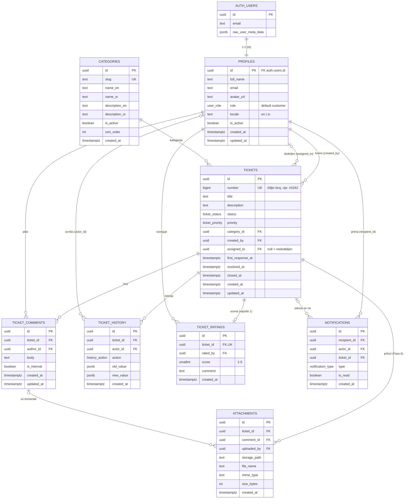
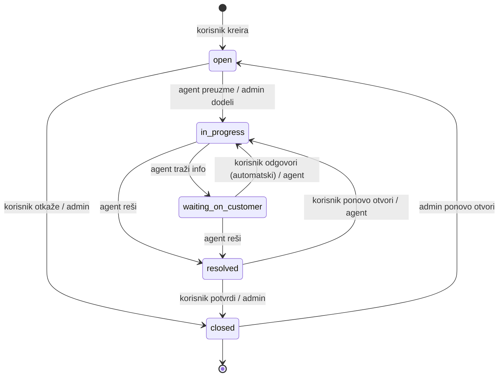

# 02 — Model baze podataka (Supabase / PostgreSQL)

Ovaj dokument je predlog šeme baze: ER dijagram, tabele sa kolonama i ograničenjima, enum tipovi, tok statusa, trigeri, funkcije za analitiku i RLS pravila. Implementira se kroz SQL migracije u `supabase/migrations/`, sa komentarom na srpskom iznad svake tabele, politike i trigera (vidi CLAUDE.md, sekcija 6).

Konvencije: nazivi tabela i kolona na engleskom, `snake_case`, množina za tabele; primarni ključevi `uuid` (`gen_random_uuid()`); sva vremena `timestamptz` u UTC; RLS uključen na **svim** tabelama u šemi `public`.

## 1. ER dijagram

## 2. Enum tipovi

| Enum                | Vrednosti                                                                                                         | Prikaz u UI (sr / en)                                             |
| ------------------- | ----------------------------------------------------------------------------------------------------------------- | ----------------------------------------------------------------- |
| `user_role`         | `customer`, `agent`, `admin`                                                                                      | Korisnik / Customer, Agent / Agent, Administrator / Administrator |
| `ticket_status`     | `open`, `in_progress`, `waiting_on_customer`, `resolved`, `closed`                                                | Otvoren, U obradi, Čeka korisnika, Rešen, Zatvoren                |
| `ticket_priority`   | `low`, `medium`, `high`, `urgent`                                                                                 | Nizak, Srednji, Visok, Hitan                                      |
| `history_action`    | `created`, `status_changed`, `assigned`, `unassigned`, `priority_changed`, `category_changed`, `updated`, `rated` | — (prikazuje se kao rečenica u istoriji)                          |
| `notification_type` | `ticket_created`, `ticket_assigned`, `status_changed`, `comment_added`, `internal_comment_added`, `ticket_rated`  | prevodi u `messages/*.json` pod `notifications.<type>`            |

Vrednosti u bazi su na engleskom (pravilo: identifikatori na engleskom); prevod ide isključivo kroz `next-intl`.

## 3. Tabele

### 3.1 `profiles` — profil i uloga korisnika

Proširuje `auth.users` (Supabase Auth). Jedan red po nalogu, kreira ga triger `handle_new_user`.

| Kolona                     | Tip         | Ograničenja / podrazumevano                  | Napomena                             |
| -------------------------- | ----------- | -------------------------------------------- | ------------------------------------ |
| `id`                       | uuid        | PK, FK → `auth.users(id)` ON DELETE CASCADE  | isti ID kao nalog                    |
| `full_name`                | text        | NOT NULL, 2–100 karaktera                    | iz forme ili iz Google profila       |
| `email`                    | text        | NOT NULL, UNIQUE                             | kopija iz `auth.users` radi pretrage |
| `avatar_url`               | text        | NULL                                         | Google slika ili prazno              |
| `role`                     | user_role   | NOT NULL, default `customer`                 | menja samo admin                     |
| `locale`                   | text        | NOT NULL, default `sr`, CHECK in (`en`,`sr`) | izabrani jezik                       |
| `is_active`                | boolean     | NOT NULL, default `true`                     | deaktivacija naloga (UC-21)          |
| `created_at`, `updated_at` | timestamptz | default `now()`                              | `updated_at` održava triger          |

### 3.2 `categories` — kategorije zahteva

| Kolona                             | Tip         | Ograničenja      | Napomena                             |
| ---------------------------------- | ----------- | ---------------- | ------------------------------------ |
| `id`                               | uuid        | PK               |                                      |
| `slug`                             | text        | NOT NULL, UNIQUE | npr. `network`, `account`, `billing` |
| `name_en`, `name_sr`               | text        | NOT NULL         | naziv na oba jezika                  |
| `description_en`, `description_sr` | text        | NULL             |                                      |
| `is_active`                        | boolean     | default `true`   | neaktivne se ne nude pri kreiranju   |
| `sort_order`                       | int         | default 0        | redosled u listi                     |
| `created_at`                       | timestamptz | default `now()`  |                                      |

Seed kategorije: Tehnički problem, Nalog i prijava, Naplata, Zahtev za funkcionalnost, Ostalo.

### 3.3 `tickets` — zahtevi

| Kolona                     | Tip             | Ograničenja                                  | Napomena                                      |
| -------------------------- | --------------- | -------------------------------------------- | --------------------------------------------- |
| `id`                       | uuid            | PK                                           |                                               |
| `number`                   | bigint          | GENERATED ALWAYS AS IDENTITY, UNIQUE         | čitljiv broj za UI (`#1042`)                  |
| `title`                    | text            | NOT NULL, 5–150 karaktera                    |                                               |
| `description`              | text            | NOT NULL, 10–5000 karaktera                  |                                               |
| `status`                   | ticket_status   | NOT NULL, default `open`                     | menja se samo preko servisa (provera prelaza) |
| `priority`                 | ticket_priority | NOT NULL, default `medium`                   |                                               |
| `category_id`              | uuid            | NOT NULL, FK → `categories(id)`              |                                               |
| `created_by`               | uuid            | NOT NULL, FK → `profiles(id)`                | vlasnik (korisnik)                            |
| `assigned_to`              | uuid            | NULL, FK → `profiles(id)` ON DELETE SET NULL | agent/admin                                   |
| `first_response_at`        | timestamptz     | NULL                                         | prvi **javni** komentar agenta/admina         |
| `resolved_at`              | timestamptz     | NULL                                         | poslednji prelaz u `resolved`                 |
| `closed_at`                | timestamptz     | NULL                                         | prelaz u `closed`                             |
| `created_at`, `updated_at` | timestamptz     | default `now()`                              |                                               |

Indeksi: `(created_by)`, `(assigned_to)`, `(status)`, `(category_id)`, `(created_at desc)`, i GIN indeks za pretragu teksta: `to_tsvector('simple', title || ' ' || description)`.

### 3.4 `ticket_comments` — komentari

| Kolona                     | Tip         | Ograničenja                                    | Napomena                       |
| -------------------------- | ----------- | ---------------------------------------------- | ------------------------------ |
| `id`                       | uuid        | PK                                             |                                |
| `ticket_id`                | uuid        | NOT NULL, FK → `tickets(id)` ON DELETE CASCADE |                                |
| `author_id`                | uuid        | NOT NULL, FK → `profiles(id)`                  |                                |
| `body`                     | text        | NOT NULL, 1–5000 karaktera                     |                                |
| `is_internal`              | boolean     | NOT NULL, default `false`                      | `true` = vide samo agent/admin |
| `created_at`, `updated_at` | timestamptz | default `now()`                                |                                |

Indeks: `(ticket_id, created_at)`.

### 3.5 `ticket_history` — istorija promena (audit log)

| Kolona       | Tip            | Ograničenja                    | Napomena                        |
| ------------ | -------------- | ------------------------------ | ------------------------------- |
| `id`         | uuid           | PK                             |                                 |
| `ticket_id`  | uuid           | NOT NULL, FK ON DELETE CASCADE |                                 |
| `actor_id`   | uuid           | NULL, FK → `profiles(id)`      | `null` = sistem                 |
| `action`     | history_action | NOT NULL                       |                                 |
| `old_value`  | jsonb          | NULL                           | npr. `{"status":"open"}`        |
| `new_value`  | jsonb          | NULL                           | npr. `{"status":"in_progress"}` |
| `created_at` | timestamptz    | default `now()`                |                                 |

Samo upis (INSERT) i čitanje — nikad UPDATE/DELETE. Upisuje ga servisni sloj u istoj transakciji (RPC funkciji) kao i promenu.

### 3.6 `ticket_ratings` — ocene zadovoljstva (CSAT)

| Kolona       | Tip         | Ograničenja                            | Napomena                  |
| ------------ | ----------- | -------------------------------------- | ------------------------- |
| `id`         | uuid        | PK                                     |                           |
| `ticket_id`  | uuid        | NOT NULL, UNIQUE, FK ON DELETE CASCADE | jedna ocena po zahtevu    |
| `rated_by`   | uuid        | NOT NULL, FK → `profiles(id)`          | mora biti vlasnik zahteva |
| `score`      | smallint    | NOT NULL, CHECK 1–5                    |                           |
| `comment`    | text        | NULL, max 1000                         |                           |
| `created_at` | timestamptz | default `now()`                        |                           |

### 3.7 `notifications` — obaveštenja

| Kolona         | Tip               | Ograničenja                    | Napomena              |
| -------------- | ----------------- | ------------------------------ | --------------------- |
| `id`           | uuid              | PK                             |                       |
| `recipient_id` | uuid              | NOT NULL, FK ON DELETE CASCADE | ko prima              |
| `actor_id`     | uuid              | NULL, FK                       | ko je izazvao događaj |
| `ticket_id`    | uuid              | NULL, FK ON DELETE CASCADE     |                       |
| `type`         | notification_type | NOT NULL                       |                       |
| `is_read`      | boolean           | default `false`                |                       |
| `created_at`   | timestamptz       | default `now()`                |                       |

Indeks: `(recipient_id, is_read, created_at desc)`. Tabela je uključena u publikaciju `supabase_realtime` — **ovo je glavni real-time kanal** (vidi 7).

Obaveštenje namerno **ne čuva tekst** komentara ni naslov: UI ga sastavlja iz `type` + podataka dobijenih kroz API, pa nema curenja internog sadržaja.

### 3.8 `attachments` — prilozi (Faza A, opciono)

| Kolona                   | Tip              | Napomena                                                    |
| ------------------------ | ---------------- | ----------------------------------------------------------- |
| `id`                     | uuid PK          |                                                             |
| `ticket_id`              | uuid FK NOT NULL |                                                             |
| `comment_id`             | uuid FK NULL     | prilog uz komentar                                          |
| `uploaded_by`            | uuid FK NOT NULL |                                                             |
| `storage_path`           | text NOT NULL    | putanja u Supabase Storage bucketu `attachments` (privatan) |
| `file_name`, `mime_type` | text NOT NULL    | dozvoljeno: slike, PDF, txt, log                            |
| `size_bytes`             | int NOT NULL     | CHECK ≤ 10 MB                                               |
| `created_at`             | timestamptz      |                                                             |

Tabelu napraviti tek kad se krene na Fazu A; šema je ovde da arhitektura ne bi zatvorila tu mogućnost.

## 4. Tok statusa i dozvoljeni prelazi

Tabela prelaza (izvor istine u kodu: `src/services/tickets/status-transitions.ts`; ista tabela ide u rad):

| Iz → U                                | Korisnik (vlasnik)                 | Agent (dodeljen)      | Admin |
| ------------------------------------- | ---------------------------------- | --------------------- | ----- |
| `open` → `in_progress`                | —                                  | da (kroz preuzimanje) | da    |
| `open` → `closed`                     | da (otkazivanje)                   | —                     | da    |
| `in_progress` → `waiting_on_customer` | —                                  | da                    | da    |
| `waiting_on_customer` → `in_progress` | automatski kad vlasnik komentariše | da                    | da    |
| `in_progress` → `resolved`            | —                                  | da                    | da    |
| `waiting_on_customer` → `resolved`    | —                                  | da                    | da    |
| `resolved` → `closed`                 | da (potvrda)                       | —                     | da    |
| `resolved` → `in_progress`            | da (ponovno otvaranje)             | da                    | da    |
| `closed` → `open`                     | —                                  | —                     | da    |

> **Pretpostavka (čeka Milutinovu potvrdu):** korisnik sme da otkaže svoj otvoren zahtev, da potvrdi rešenje (zatvori) i da ponovo otvori rešen zahtev. Zatvoren zahtev ponovo otvara samo admin. Ako Milutin odluči drugačije, menja se samo ova tabela i `status-transitions.ts`.

Pravila vremenskih oznaka: ulazak u `resolved` postavlja `resolved_at = now()`; ulazak u `closed` postavlja `closed_at = now()`; izlazak iz `resolved`/`closed` nazad u rad briše `resolved_at`/`closed_at`. `first_response_at` se postavlja jednom i nikad ne briše.

## 5. Trigeri i funkcije u bazi

| Naziv                        | Tip                                        | Šta radi                                                                                                                              |
| ---------------------------- | ------------------------------------------ | ------------------------------------------------------------------------------------------------------------------------------------- |
| `handle_new_user()`          | triger AFTER INSERT na `auth.users`        | Kreira red u `profiles` sa ulogom `customer`; ime uzima iz `raw_user_meta_data.full_name` ili `name` (Google), sliku iz `avatar_url`. |
| `set_updated_at()`           | triger BEFORE UPDATE                       | Postavlja `updated_at = now()` na `profiles`, `tickets`, `ticket_comments`.                                                           |
| `current_user_role()`        | SQL funkcija, `security definer`, `stable` | Vraća ulogu prijavljenog korisnika (`auth.uid()`); koriste je RLS politike. Mora da ima `set search_path = public`.                   |
| `is_staff()`                 | SQL funkcija                               | `current_user_role() in ('agent','admin')` — skraćenica za politike.                                                                  |
| `prevent_role_self_change()` | triger BEFORE UPDATE na `profiles`         | Sprečava da korisnik sam sebi promeni `role` ili `is_active` (dodatna zaštita uz RLS).                                                |

**Zašto se poslovna logika (prelazi statusa, istorija, obaveštenja) ne radi u trigerima:** da bi bila vidljiva, testabilna i dokumentovana u servisnom sloju (TypeScript), što je lakše objasniti u radu. Baza garantuje bezbednost (RLS, CHECK, FK), a servis garantuje poslovna pravila. Gde je potrebna atomičnost (promena statusa + istorija + obaveštenja), servis poziva jednu RPC funkciju (`change_ticket_status`, `assign_ticket`, `add_comment`) koja radi sve u jednoj transakciji — tačan spisak u `07-uputstvo-za-implementaciju.md`.

## 6. Funkcije za analitiku (RPC)

Sve primaju period `p_from timestamptz, p_to timestamptz`, dostupne samo adminu (provera `current_user_role() = 'admin'` na početku funkcije).

| Funkcija                                            | Vraća                                                                                                                                                          |
| --------------------------------------------------- | -------------------------------------------------------------------------------------------------------------------------------------------------------------- |
| `analytics_overview(p_from, p_to)`                  | ukupno kreiranih, rešenih, zatvorenih; trenutno otvorenih; prosečno vreme prvog odgovora (min); prosečno vreme rešavanja (h); prosečna CSAT ocena i broj ocena |
| `analytics_by_dimension(p_from, p_to, p_dimension)` | broj zahteva grupisano po `status`, `category` ili `priority`                                                                                                  |
| `analytics_agents(p_from, p_to)`                    | po agentu: dodeljeno, rešeno, prosečno vreme rešavanja, prosečna ocena                                                                                         |
| `analytics_trend(p_from, p_to, p_bucket)`           | po danu/nedelji: broj kreiranih i rešenih                                                                                                                      |

Za agentov dashboard postoji `agent_dashboard_stats()` koja vraća samo podatke prijavljenog agenta.

## 7. Real-time u bazi

- U publikaciju `supabase_realtime` se dodaje **samo** tabela `notifications`.
- Klijent se pretplaćuje na `postgres_changes` (INSERT) sa filterom `recipient_id=eq.<moj id>`. Supabase Realtime poštuje RLS, pa korisnik dobija samo svoja obaveštenja.
- Za osvežavanje otvorene stranice zahteva (novi komentar, promena statusa) koristi se **privatni broadcast kanal** `ticket:<id>` sa Realtime Authorization politikom koja dozvoljava pretplatu samo onima koji smeju da vide taj zahtev. Payload je samo `{ ticketId, event }`; klijent posle toga ponovo učitava podatke kroz API.
- Sve ovo je sakriveno iza `RealtimeProvider` interfejsa (vidi `03-dijagram-klasa.md`).

## 8. RLS matrica (ko šta sme u bazi)

`own` = red pripada prijavljenom korisniku; `staff` = agent ili admin.

| Tabela            | SELECT                                                   | INSERT                                                                         | UPDATE                                                               | DELETE                              |
| ----------------- | -------------------------------------------------------- | ------------------------------------------------------------------------------ | -------------------------------------------------------------------- | ----------------------------------- |
| `profiles`        | svoj red; staff vidi sve                                 | samo triger                                                                    | svoj red (`full_name`, `avatar_url`, `locale`); admin sve            | niko (deaktivacija umesto brisanja) |
| `categories`      | svi prijavljeni (aktivne); admin sve                     | admin                                                                          | admin                                                                | niko (deaktivacija)                 |
| `tickets`         | vlasnik svoje; staff sve                                 | korisnik, `created_by = auth.uid()`, `status = open`, `assigned_to is null`    | samo kroz RPC funkcije (direktan UPDATE zabranjen svima osim admina) | niko                                |
| `ticket_comments` | vlasnik zahteva: javne komentare svog zahteva; staff sve | autor = `auth.uid()`, ima pristup zahtevu; korisnik samo `is_internal = false` | autor, u roku od 15 min (opciono)                                    | niko                                |
| `ticket_history`  | vlasnik zahteva: stavke bez internih detalja; staff sve  | samo RPC funkcije                                                              | niko                                                                 | niko                                |
| `ticket_ratings`  | vlasnik i staff                                          | vlasnik zahteva, status `resolved`/`closed`                                    | niko                                                                 | niko                                |
| `notifications`   | `recipient_id = auth.uid()`                              | samo RPC funkcije                                                              | primalac (samo `is_read`)                                            | primalac                            |
| `attachments`     | kao komentar/zahtev uz koji ide                          | autor sa pristupom zahtevu                                                     | niko                                                                 | autor ili admin                     |

Neaktivan nalog (`is_active = false`): sve politike dodatno zahtevaju da je prijavljeni korisnik aktivan (kroz `current_user_role()` koja vraća `null` za neaktivne).

## 9. Demo podaci (`supabase/seed.sql` + `scripts/seed-demo.ts`)

- 1 admin, 4 agenta, 20 korisnika; lozinke i emailovi demo naloga u README-u.
- 5 kategorija (sr + en nazivi).
- ~150 zahteva raspoređenih kroz poslednjih 6 meseci, sa realnim odnosom statusa (većina `closed`/`resolved`, deo otvorenih), različitim prioritetima i agentima.
- Za svaki zahtev 1–8 komentara (deo internih), konzistentna istorija i vremenske oznake (`first_response_at` posle `created_at`, `resolved_at` posle toga).
- Ocene za ~60% rešenih zahteva (raspodela pretežno 4–5, nešto 1–3).
- Skripta mora biti deterministička (fiksni seed za generator slučajnih brojeva) da bi grafikoni na odbrani uvek izgledali isto.
