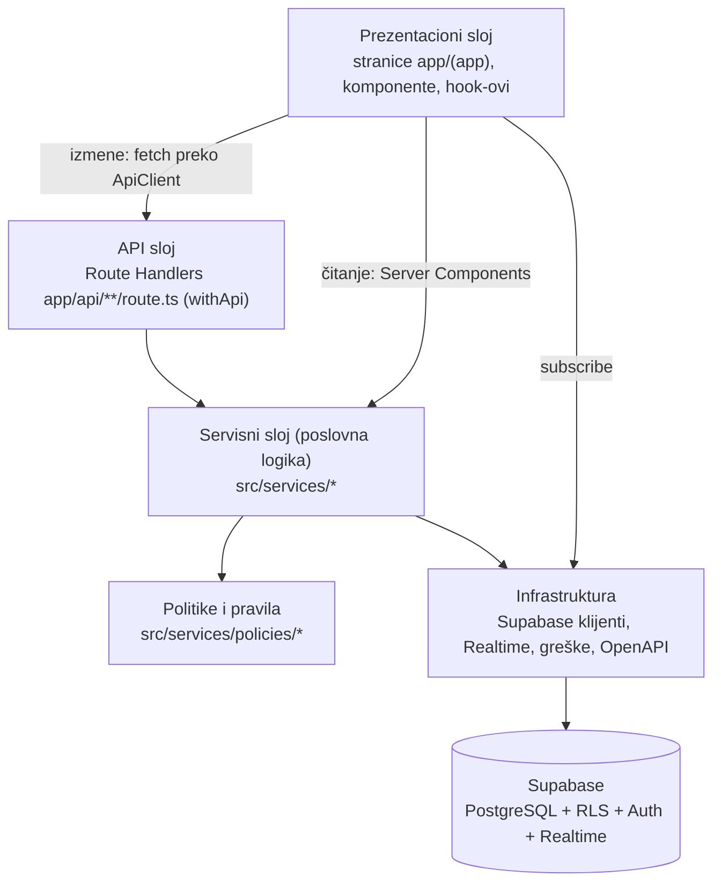
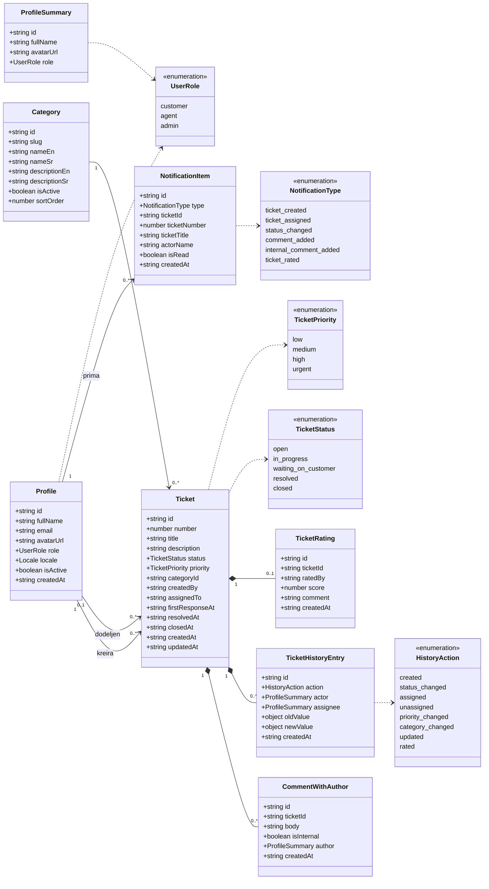

# 03 — Dijagram klasa

Ovaj dokument opisuje klase, interfejse i tipove aplikacije, podeljene po slojevima. Služi za poglavlje _Arhitektura projekta_. Nazivi klasa, metoda i fajlova odgovaraju kodu (usklađeno u Fazi 10).

## 1. Slojevi i pravila zavisnosti

Pravila:

- UI **nikad** ne piše direktno u bazu; svi upisi idu kroz API rute (bez Server Actions).
- Serverske stranice (Server Components) smeju da **čitaju** pozivom istog servisa koji koristi API ruta (npr. `/tickets` i `GET /api/tickets` koriste `TicketService.list`).
- API rute su tanke: `withApi` radi autentifikaciju, proveru uloge, validaciju ulaza (Zod) i pretvaranje greške u HTTP odgovor; ruta samo poziva servis.
- Servisi sadrže poslovnu logiku i ne znaju za HTTP (`Request`/`Response`); bacaju `AppError`.
- Politike (`StatusTransitionPolicy`, `TicketAccessPolicy`) su čiste klase bez pristupa bazi, pa se lako testiraju unit testovima.
- Servisi dobijaju zavisnosti kroz konstruktor (`ServiceContext`: Supabase klijent, `AuthContext`, `RealtimePublisher`), da bi se u testovima mogli zameniti.

## 2. Domenski model (tipovi)

Enumeracije su u `src/types/domain.ts` i izvedene su iz generisanih tipova baze (`src/types/database.ts`, `pnpm db:types`). Oblici podataka koje vraća API su tipovi izvedeni iz Zod šema u `src/lib/validation/*.ts` (`z.infer`), pa su ista šema, TypeScript tip i Swagger dokumentacija uvek usklađeni. Redove iz baze (`snake_case`) u ove tipove (`camelCase`) pretvaraju funkcije u samim servisima (npr. `toProfile` u `profile-service.ts`, `toCategory` u `services/shared/lookups.ts`).

Datumi su u API-ju ISO tekst (`string`), a prikazuju se u zoni `Europe/Belgrade`. Polja koja mogu biti prazna (`assignedTo`, `avatarUrl`, `resolvedAt`...) su `null` kad nemaju vrednost.

Pomoćni tipovi:

| Tip                 | Fajl                              | Sadržaj                                                                                                                                                   |
| ------------------- | --------------------------------- | --------------------------------------------------------------------------------------------------------------------------------------------------------- |
| `Locale`            | `lib/i18n/config.ts`              | `'en' \| 'sr'`                                                                                                                                            |
| `ProfileSummary`    | `lib/validation/common.ts`        | `id`, `fullName`, `avatarUrl`, `role` (bez emaila; čita se iz pogleda `profile_summaries`)                                                                |
| `TicketListItem`    | `lib/validation/tickets.ts`       | Red liste: `id`, `number`, `title`, `status`, `priority`, datumi + `category`, `creator`, `assignee`                                                      |
| `TicketDetail`      | `lib/validation/tickets.ts`       | `Ticket` + `category` + `creator` + `assignee` + `rating: TicketRating \| null` + `permissions: TicketPermissions`                                        |
| `TicketPermissions` | `lib/validation/tickets.ts`       | `allowedTransitions`, `canComment`, `canCommentInternal`, `canAssign`, `canRate`, `canEdit` — po njima UI prikazuje dugmad                                |
| `TicketListQuery`   | `lib/validation/tickets.ts`       | `status?` (i `unresolved`), `priority?`, `categoryId?`, `assigneeId?` (`'me'` \| `'unassigned'` \| id), `q?` (`#1042` = broj), `page`, `pageSize`, `sort` |
| `Paginated<T>`      | `lib/validation/common.ts`        | `items: T[]`, `page`, `pageSize`, `total`                                                                                                                 |
| `NotificationList`  | `lib/validation/notifications.ts` | `Paginated<NotificationItem>` + `unreadCount`                                                                                                             |
| `AdminUser`         | `lib/validation/admin.ts`         | `Profile` + `openAssignedCount` (broj nerešenih zahteva dodeljenih tom članu tima)                                                                        |
| `DashboardData`     | `lib/validation/dashboard.ts`     | Unija po polju `kind`: `customer`, `agent`, `admin` (različiti brojevi i liste po ulozi)                                                                  |
| `DateRange`         | `lib/analytics/period.ts`         | `from`, `to` — datumi (dani po Beogradu, oba uključena, najviše 366 dana)                                                                                 |

## 3. Servisni sloj

```mermaid
classDiagram
    direction TB

    class ServiceContext {
        <<interface>>
        +DbClient db
        +AuthContext auth
        +RealtimePublisher publisher
    }
    class AuthContext {
        +string userId
        +UserRole role
        +Locale locale
        +isStaff() boolean
        +isAdmin() boolean
        +hasRole(roles) boolean
    }

    class AuthService {
        +register(input: RegisterInput, locale) Promise~void~
        +login(input: LoginInput, uiLocale) Promise~LoginResult~
        +logout(accessToken) Promise~void~
        +getGoogleOAuthUrl(next: string) Promise~string~
        +completeCallback(query: CallbackQuery, uiLocale) Promise~Profile~
        +requestPasswordReset(email: string) Promise~void~
        +resetPassword(password: string, accessToken) Promise~void~
    }
    class ProfileService {
        +getMe() Promise~Profile~
        +updateMe(input: UpdateProfileInput) Promise~Profile~
    }
    class TicketService {
        +list(query: TicketListQuery) Promise~Paginated~TicketListItem~~
        +getById(id) Promise~TicketDetail~
        +create(input: CreateTicketInput) Promise~TicketDetail~
        +update(id, input: UpdateTicketInput) Promise~TicketDetail~
        +changeStatus(id, to: TicketStatus) Promise~TicketDetail~
        +assign(id, assigneeId: string|null) Promise~TicketDetail~
        +getHistory(id) Promise~TicketHistoryEntry[]~
    }
    class CommentService {
        +list(ticketId) Promise~CommentWithAuthor[]~
        +add(ticketId, input: AddCommentInput) Promise~CommentWithAuthor~
    }
    class RatingService {
        +rate(ticketId, input: RateTicketInput) Promise~TicketRating~
    }
    class NotificationService {
        +list(query: NotificationListQuery) Promise~NotificationList~
        +countUnread() Promise~number~
        +markRead(id) Promise~void~
        +markAllRead() Promise~void~
    }
    class CategoryService {
        +listActive() Promise~Category[]~
        +listAll() Promise~Category[]~
        +create(input: CreateCategoryInput) Promise~Category~
        +update(id, input: UpdateCategoryInput) Promise~Category~
    }
    class UserAdminService {
        +list(query: UserListQuery) Promise~Paginated~AdminUser~~
        +update(id, input: AdminUpdateUserInput) Promise~AdminUser~
        +listAgents() Promise~AgentSummary[]~
    }
    class AnalyticsService {
        +overview(range: Partial~DateRange~) Promise~AnalyticsOverview~
        +byDimension(range, dimension) Promise~DimensionItem[]~
        +agents(range) Promise~AgentStats[]~
        +trend(range, bucket?) Promise~TrendPoint[]~
    }
    class DashboardService {
        +getForCurrentUser() Promise~DashboardData~
    }

    class StatusTransitionPolicy {
        <<policy>>
        +canTransition(from, to, actor: TransitionActor) boolean
        +allowedTargets(from, actor: TransitionActor) TicketStatus[]
        +assertTransition(from, to, actor) void
    }
    class TicketAccessPolicy {
        <<policy>>
        +actorFor(ticket, auth) TransitionActor
        +canView(ticket, auth) boolean
        +canComment(ticket, auth, isInternal) boolean
        +canAssign(ticket, auth, assigneeId?) boolean
        +canRate(ticket, auth, hasRating) boolean
        +canEdit(ticket, auth) boolean
        +permissionsFor(ticket, auth, hasRating) TicketPermissions
        +assertCanComment(ticket, auth, isInternal) void
        +assertCanAssign(ticket, auth, assigneeId) void
        +assertCanRate(ticket, auth, hasRating) void
    }

    ServiceContext o-- AuthContext
    TicketService o-- ServiceContext
    CommentService o-- ServiceContext
    RatingService o-- ServiceContext
    NotificationService o-- ServiceContext
    CategoryService o-- ServiceContext
    UserAdminService o-- ServiceContext
    AnalyticsService o-- ServiceContext
    DashboardService o-- ServiceContext
    ProfileService o-- ServiceContext
    TicketService ..> StatusTransitionPolicy
    TicketService ..> TicketAccessPolicy
    TicketAccessPolicy ..> StatusTransitionPolicy
    CommentService ..> TicketAccessPolicy
    RatingService ..> TicketAccessPolicy
```

Svaki servis je klasa u `src/services/<domen>/<domen>-service.ts`. Konstruktor prima `ServiceContext` (osim `AuthService`, koji radi i bez prijavljenog korisnika).

Odgovornosti:

| Klasa                    | Fajl                                             | Ko sme da koristi         | Ključna pravila                                                                                                                                                                                            |
| ------------------------ | ------------------------------------------------ | ------------------------- | ---------------------------------------------------------------------------------------------------------------------------------------------------------------------------------------------------------- |
| `AuthService`            | `services/auth/auth-service.ts`                  | gost                      | Nalog se uvek pravi kao `customer`; greške Supabase Auth pretvara `mapAuthError` (`auth-errors.ts`) u `ErrorCode`. Jedini servis bez `ServiceContext` (dobija Supabase klijent iz kolačića).               |
| `ProfileService`         | `services/profile/profile-service.ts`            | svi prijavljeni           | Menja samo ime i jezik; ne dozvoljava izmenu `role`, `isActive`, `email`.                                                                                                                                  |
| `TicketService`          | `services/tickets/ticket-service.ts`             | svi prijavljeni           | `list` vraća samo vidljive zahteve (RLS + filter, pretraga u `ticket-search.ts`); sve izmene proveravaju politike pa pozivaju RPC; vraćaju `TicketDetail` sa novim `permissions`; šalju real-time događaj. |
| `CommentService`         | `services/comments/comment-service.ts`           | svi prijavljeni           | Korisnik ne može interni komentar; RPC `add_comment` (upis + `first_response_at` + prelaz `waiting_on_customer → in_progress` + obaveštenja). Interna beleška ide samo na kanal `staff`.                   |
| `RatingService`          | `services/ratings/rating-service.ts`             | korisnik                  | Samo vlasnik, samo `resolved`/`closed`, samo jednom.                                                                                                                                                       |
| `NotificationService`    | `services/notifications/notification-service.ts` | svi prijavljeni           | Samo sopstvena obaveštenja. Obaveštenja **ne pravi** ovaj servis nego RPC funkcije u bazi, atomično sa promenom.                                                                                           |
| `CategoryService`        | `services/categories/category-service.ts`        | čitanje svi, izmena admin | Kategorija se ne briše nego deaktivira; duplikat oznake (Postgres `23505`) → `CATEGORY_SLUG_TAKEN`.                                                                                                        |
| `UserAdminService`       | `services/admin/user-admin-service.ts`           | admin                     | Ne može sebi da promeni ulogu ni da se deaktivira (`CANNOT_MODIFY_SELF`); RPC `admin_update_user` vraća u red zahteve bivšeg člana tima.                                                                   |
| `AnalyticsService`       | `services/analytics/analytics-service.ts`        | admin                     | Konstruktor baca `FORBIDDEN` za ne-admina; poziva RPC `analytics_*`; nule i nazive kategorija dodaje `analytics-mappers.ts`.                                                                               |
| `DashboardService`       | `services/dashboard/dashboard-service.ts`        | svi prijavljeni           | Vraća različit oblik podataka po ulozi (UC-25); sabiranje brojeva je čista funkcija `summarizeCounts` (`dashboard-counts.ts`).                                                                             |
| `StatusTransitionPolicy` | `services/policies/status-transitions.ts`        | servisi                   | Jedini izvor istine za tabelu prelaza (`02-baza-podataka.md`, sekcija 4). Koristi je i kanban tabla (`boardDropTargets`).                                                                                  |
| `TicketAccessPolicy`     | `services/policies/ticket-access.ts`             | servisi                   | Ista pravila kao RLS, ali u kodu — za jasne greške (`403`) i za polje `permissions` (koja dugmad UI prikazuje).                                                                                            |

Zajednički pomoćni moduli servisa (`services/shared/`): `lookups.ts` učitava imena korisnika i kategorije posebnim upitom (bez spajanja tabela), a `publish.ts` (`publishTicketEvent`) šalje real-time događaj na prave kanale i samo beleži neuspeh slanja.

## 4. Infrastruktura

```mermaid
classDiagram
    direction TB

    class RealtimeProvider {
        <<interface>>
        +subscribe(channel, event, handler) Unsubscribe
    }
    class RealtimePublisher {
        <<interface>>
        +publish(channel, event, payload: RealtimePayload) Promise~void~
    }
    class SupabaseRealtimeProvider {
        -DbClient client
        +subscribe(channel, event, handler) Unsubscribe
    }
    class SupabaseRealtimePublisher {
        -DbClient client
        +publish(channel, event, payload) Promise~void~
    }
    class WebSocketRealtimeProvider {
        <<rezerva, nije implementirano>>
        +subscribe(channel, event, handler) Unsubscribe
    }
    class WebSocketRealtimePublisher {
        <<rezerva, nije implementirano>>
        +publish(channel, event, payload) Promise~void~
    }
    class realtime_index {
        <<module>>
        +getRealtimeProviderName() RealtimeProviderName
        +getRealtimeProvider(client) RealtimeProvider
        +getRealtimePublisher(client, accessToken?) RealtimePublisher
    }
    class realtime_events {
        <<module>>
        REALTIME_EVENTS
        STAFF_CHANNEL = "staff"
        +ticketChannel(ticketId) string
        +userChannel(userId) string
    }
    class RealtimePayload {
        +RealtimeEvent event
        +string ticketId?
        +string actorId?
    }

    RealtimeProvider <|.. SupabaseRealtimeProvider
    RealtimeProvider <|.. WebSocketRealtimeProvider
    RealtimePublisher <|.. SupabaseRealtimePublisher
    RealtimePublisher <|.. WebSocketRealtimePublisher
    realtime_index ..> RealtimeProvider
    realtime_index ..> RealtimePublisher
    RealtimePublisher ..> RealtimePayload
    RealtimeProvider ..> realtime_events

    class AppError {
        +ErrorCode code
        +number httpStatus
        +ErrorDetails details
        +constructor(code, details?, options?)
    }
    class ErrorCode {
        <<enumeration>>
        VALIDATION_ERROR
        AUTH_CALLBACK_FAILED
        UNAUTHENTICATED
        INVALID_CREDENTIALS
        FORBIDDEN
        ACCOUNT_DISABLED
        NOT_ASSIGNED_AGENT
        FORBIDDEN_INTERNAL_COMMENT
        EMAIL_NOT_CONFIRMED
        NOT_FOUND
        TICKET_NOT_FOUND
        INVALID_STATUS_TRANSITION
        TICKET_ALREADY_ASSIGNED
        ASSIGNEE_NOT_AGENT
        TICKET_CLOSED
        ALREADY_RATED
        TICKET_NOT_RESOLVED
        EMAIL_ALREADY_REGISTERED
        CANNOT_MODIFY_SELF
        CATEGORY_SLUG_TAKEN
        RATE_LIMITED
        INTERNAL_ERROR
    }
    class errors_handler {
        <<module>>
        +toErrorResponse(error, locale) Response
        +localeFromRequest(request) Locale
    }
    AppError --> ErrorCode
    errors_handler ..> AppError

    class supabase_clients {
        <<module>>
        +createServerSupabaseClient() Promise~DbClient~
        +createBrowserSupabaseClient() DbClient
        +createClientFromBearer(token) DbClient
        +readBearerToken(request) string
    }
    class auth_guard {
        <<module>>
        +createRequestClient(request) Promise~RequestClient~
        +getAuthContext(requestClient) Promise~AuthContext~
        +requireRole(requestClient, roles) Promise~AuthContext~
    }
    class server_session {
        <<module>>
        +getCurrentUser() CurrentUser
        +requireCurrentUser() Promise~CurrentUser~
        +requirePageRole(roles) Promise~CurrentUser~
    }
    class withApi {
        <<module>>
        +withApi(options: ApiRouteOptions, handler) RouteHandler
    }
    class ApiRouteOptions {
        +UserRole[] | "public" roles
        +ZodSchema body?
        +ZodSchema query?
        +ZodSchema params?
        +number successStatus?
    }
    class openapi {
        <<module>>
        +registry: OpenAPIRegistry
        +bearerAuth
        +errorResponses(codes) object
        +jsonBody(schema, example?) object
        +jsonResponse(description, schema) object
        +generateOpenApiDocument() OpenAPIObject
    }
    class ApiClient {
        <<frontend>>
        +get(path, query?) Promise~T~
        +post(path, body?) Promise~T~
        +patch(path, body?) Promise~T~
        +delete(path) Promise~T~
    }
    class ApiClientError {
        +ErrorCode code
        +number status
    }

    auth_guard ..> supabase_clients
    server_session ..> supabase_clients
    withApi ..> auth_guard
    withApi ..> errors_handler
    withApi ..> ApiRouteOptions
    ApiClient ..> ApiClientError
```

Infrastruktura je uglavnom skup **funkcija** (modula), ne klasa. Na dijagramu su moduli prikazani kao klase sa stereotipom `<<module>>`, a njihove funkcije kao metode.

| Modul / klasa                            | Fajl                                                     | Uloga                                                                                                                                                                                                             |
| ---------------------------------------- | -------------------------------------------------------- | ----------------------------------------------------------------------------------------------------------------------------------------------------------------------------------------------------------------- |
| Supabase klijenti                        | `lib/supabase/server.ts`, `lib/supabase/browser.ts`      | Supabase klijent iz kolačića (aplikacija), iz `Authorization: Bearer` tokena (Swagger, Postman) ili za pregledač. **Nikad** ne koristi `service_role` ključ u aplikaciji (samo u skripti `seed:demo`).            |
| `auth-guard`                             | `lib/auth/auth-guard.ts`                                 | Za API: bira klijent (kolačić ili Bearer), učitava profil, proverava `isActive`, vraća `AuthContext`; baca `UNAUTHENTICATED` / `FORBIDDEN` / `ACCOUNT_DISABLED`.                                                  |
| `server-session`, `route-access`         | `lib/auth/server-session.ts`, `lib/auth/route-access.ts` | Za stranice: `requireCurrentUser()` / `requirePageRole()`; `proxy.ts` preko `getAccessRedirect` samo preusmerava gosta na prijavu i prijavljenog sa stranica za goste.                                            |
| `withApi`                                | `lib/api/with-api.ts`                                    | Omotač za svaku API rutu: auth + provera uloge + Zod validacija (body/query/params) + `try/catch` → `toErrorResponse`. Rezultat: objekat → JSON, `undefined` → 204, `Response` → prosleđuje se.                   |
| `AppError`, `ErrorCode`                  | `lib/errors/app-error.ts`, `lib/errors/codes.ts`         | Jedinstvene greške; svaki kod ima HTTP status (`ERROR_HTTP_STATUS`) i ključ prevoda `errors.<CODE>`. `fromDbError` čita kod iz poruke RPC greške.                                                                 |
| `errors/handler`                         | `lib/errors/handler.ts`                                  | `AppError` → `{ error: { code, message, details } }` sa statusom; `ZodError` → `400 VALIDATION_ERROR` sa listom polja; sve ostalo → `500 INTERNAL_ERROR` + log.                                                   |
| `RealtimeProvider` / `RealtimePublisher` | `lib/realtime/*`                                         | Zamenljiv real-time sloj (vidi CLAUDE.md). Izbor implementacije: `NEXT_PUBLIC_REALTIME_PROVIDER`. WebSocket varijanta je samo rezerva (pravi se na zahtev mentora).                                               |
| `openapi`                                | `lib/openapi/registry.ts`, `lib/openapi/document.ts`     | Registar svih ruta i Zod šema; dokumentacija rute je u `lib/openapi/routes/<domen>.ts`; `GET /api/openapi` vraća `generateOpenApiDocument()`. Iz istog dokumenta se pravi Postman kolekcija (`postman:generate`). |
| `ApiClient`                              | `lib/api/client.ts`                                      | Frontend omotač oko `fetch`: dodaje `Accept-Language`, parsira JSON, pretvara grešku u `ApiClientError` sa `code` koji UI prevodi.                                                                                |

## 5. Frontend: hook-ovi i ključne komponente

Ovo nisu klase, ali su deo arhitekture i treba ih navesti u radu.

| Hook                                     | Fajl                             | Šta radi                                                                                                                      |
| ---------------------------------------- | -------------------------------- | ----------------------------------------------------------------------------------------------------------------------------- |
| `useApiClient()`                         | `hooks/use-api-client.ts`        | Jedan `ApiClient` sa trenutnim jezikom interfejsa.                                                                            |
| `useApiAction()`                         | `hooks/use-api-action.ts`        | Poziva API za izmenu, prikazuje poruku (toast) o uspehu ili prevedenu grešku i radi `router.refresh()`.                       |
| `useRealtimeEvents(subs, onEvent)`       | `hooks/use-realtime-events.ts`   | Zajednička pretplata preko `RealtimeProvider` interfejsa (nikad direktno na Supabase) i odjava pri napuštanju stranice.       |
| `useDebouncedRefresh()`                  | `hooks/use-debounced-refresh.ts` | Grupiše više događaja u jedan `router.refresh()` (300 ms).                                                                    |
| `useNotifications(userId, serverUnread)` | `hooks/use-notifications.ts`     | Brojač nepročitanih; pretplata na `NOTIFICATION_CREATED` na kanalu `user:<id>`; na događaj osvežava brojač i prikazuje toast. |
| `useTicketRealtime(ticketId, userId)`    | `hooks/use-ticket-realtime.ts`   | Pretplata na kanal `ticket:<id>`; na tuđi događaj ponovo učitava stranicu zahteva.                                            |
| `useStaffRealtime(isStaff, userId)`      | `hooks/use-staff-realtime.ts`    | Agent i admin: kanal `staff`; osvežava panel, listu i kanban tablu.                                                           |

| Komponente                                                                                                            | Folder                      | Opis                                                                                                   |
| --------------------------------------------------------------------------------------------------------------------- | --------------------------- | ------------------------------------------------------------------------------------------------------ |
| `TicketList`, `TicketFilters`, `TicketPagination`, `TicketBadges`, `TicketViewToggle`                                 | `components/tickets/`       | Lista zahteva, filteri u adresi, oznake statusa i prioriteta, prelaz lista ↔ tabla                     |
| `TicketBoard`, `BoardColumn`, `BoardCard`                                                                             | `components/tickets/`       | Kanban tabla (`@dnd-kit/core`): prevlačenje mišem, dodirom i tastaturom; dozvoljene kolone iz politike |
| `NewTicketForm`                                                                                                       | `components/tickets/`       | Kreiranje zahteva (Zod šema deljena sa API-jem)                                                        |
| `TicketActions`                                                                                                       | `components/tickets/`       | Dugmad za prelaze, preuzimanje i dodelu; prikazuje samo ono što dozvoljava `permissions` iz API-ja     |
| `TicketComments`, `CommentForm`                                                                                       | `components/tickets/`       | Prepiska; interni komentari vizuelno odvojeni (druga boja + oznaka „Interno“)                          |
| `TicketHistory`                                                                                                       | `components/tickets/`       | Vremenska linija promena                                                                               |
| `RatingForm`, `RatingStars`                                                                                           | `components/tickets/`       | CSAT ocena                                                                                             |
| `NotificationBell`, `NotificationList`, `NotificationRow`, `LiveRefresh`                                              | `components/notifications/` | Zvonce sa brojačem u zaglavlju, stranica obaveštenja, osvežavanje bez reload-a                         |
| `AppShell`, `NavLinks`, `MobileNav`, `PageHeader`, `LanguageSwitcher`, `LogoutButton`, `Forbidden`                    | `components/layout/`        | Raspored; meni zavisi od uloge; na telefonu meni u bočnom panelu (`sheet`); dugme SR/EN                |
| `DashboardCustomer`, `DashboardAgent`, `DashboardAdmin`, `StatCard`, `StatusCountGrid`, `TicketMiniList`              | `components/dashboard/`     | Tri prikaza kontrolnog panela                                                                          |
| `AnalyticsFilters`, `KpiCards`, `TicketsTrendChart`, `ByDimensionChart`, `AgentsTable`, `CsatChart`, `ChartDataTable` | `components/analytics/`     | Recharts grafikoni; uz svaki grafikon i tabelarni prikaz istih podataka (pristupačnost)                |
| `UserTable`, `UserFilters`, `UserPagination`, `CategoryTable`, `CategoryFormDialog`                                   | `components/admin/`         | Administracija naloga i kategorija                                                                     |
| `LoginForm`, `RegisterForm`, `ForgotPasswordForm`, `NewPasswordForm`, `GoogleButton`, `AuthDivider`                   | `components/auth/`          | Prijava, registracija, reset lozinke, Google nalog                                                     |
| `ProfileForm`                                                                                                         | `components/profile/`       | Izmena imena i jezika                                                                                  |
| `FormField`, `FormTextareaField`, `FormSelectField`, `FormAlert`                                                      | `components/forms/`         | Zajednička polja forme (labela, greška ispod polja)                                                    |
| `SwaggerView`                                                                                                         | `components/api-docs/`      | Swagger UI na `/api-docs`                                                                              |
| `button`, `card`, `dialog`, `input`, `label`, `native-select`, `popover`, `sheet`, `sonner`, `textarea`               | `components/ui/`            | Osnovne komponente (shadcn/ui)                                                                         |
