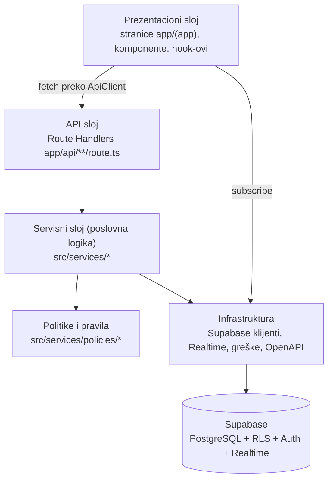
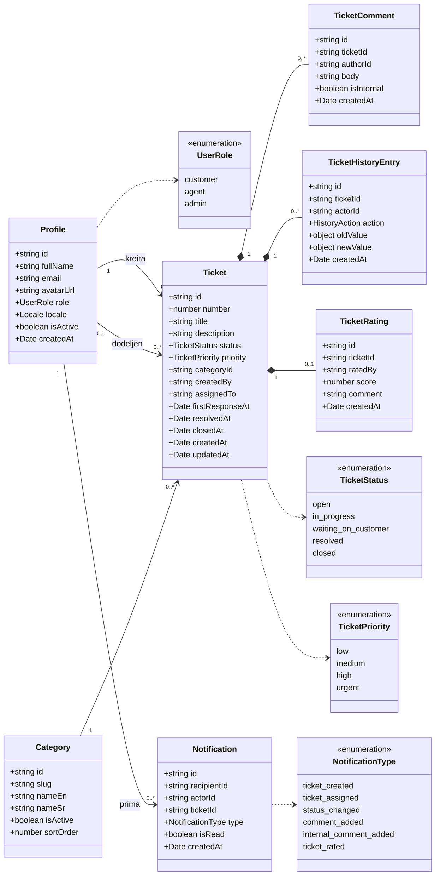

# 03 — Dijagram klasa

Ovaj dokument definiše klase, interfejse i tipove aplikacije, podeljene po slojevima. Služi za poglavlje _Arhitektura projekta_ i kao ugovor za implementaciju: nazivi klasa, metoda i fajlova ovde su obavezujući, osim ako se Milutin ne dogovori drugačije.

## 1. Slojevi i pravila zavisnosti

Pravila:

- UI **nikad** ne piše direktno u bazu; svi upisi idu kroz API rute.
- API rute su tanke: autentifikacija, validacija ulaza (Zod), poziv servisa, mapiranje greške u HTTP odgovor. Bez poslovne logike.
- Servisi sadrže poslovnu logiku i ne znaju za HTTP (`Request`/`Response`); bacaju `AppError`.
- Politike (`StatusTransitionPolicy`, `TicketAccessPolicy`) su čiste klase bez pristupa bazi — lako se testiraju unit testovima.
- Servisi dobijaju zavisnosti kroz konstruktor (Supabase klijent, `AuthContext`, `RealtimePublisher`), da bi se u testovima mogli zameniti.

## 2. Domenski model (tipovi)

Tipovi u `src/types/domain.ts`. Generisani tipovi baze (`supabase gen types`) su u `src/types/database.ts`; domenski tipovi su čitljiviji `camelCase` oblik tih redova, a mapiranje radi `src/lib/mappers.ts`.

Pomoćni tipovi (u istom fajlu):

| Tip                   | Sadržaj                                                                                                                           |
| --------------------- | --------------------------------------------------------------------------------------------------------------------------------- |
| `Locale`              | `'en' \| 'sr'`                                                                                                                    |
| `TicketWithRelations` | `Ticket` + `category: Category` + `creator: ProfileSummary` + `assignee: ProfileSummary \| null` + `rating: TicketRating \| null` |
| `ProfileSummary`      | `id`, `fullName`, `avatarUrl`, `role` (bez emaila za korisnike)                                                                   |
| `TicketListFilters`   | `status?`, `priority?`, `categoryId?`, `assigneeId?` (`'me'` \| `'unassigned'` \| id), `q?`, `page`, `pageSize`, `sort`           |
| `Paginated<T>`        | `items: T[]`, `page`, `pageSize`, `total`                                                                                         |
| `DateRange`           | `from: Date`, `to: Date`                                                                                                          |

## 3. Servisni sloj

```mermaid
classDiagram
    direction TB

    class ServiceContext {
        +SupabaseClient db
        +AuthContext auth
        +RealtimePublisher publisher
    }
    class AuthContext {
        +string userId
        +UserRole role
        +Locale locale
        +isStaff() boolean
        +isAdmin() boolean
    }

    class AuthService {
        +register(input: RegisterInput) Promise~void~
        +login(input: LoginInput) Promise~Session~
        +logout() Promise~void~
        +getGoogleOAuthUrl(redirectTo: string) Promise~string~
        +exchangeCodeForSession(code: string) Promise~void~
        +requestPasswordReset(email: string) Promise~void~
        +resetPassword(newPassword: string) Promise~void~
    }
    class ProfileService {
        +getMe() Promise~Profile~
        +updateMe(input: UpdateProfileInput) Promise~Profile~
    }
    class TicketService {
        +list(filters: TicketListFilters) Promise~Paginated~
        +getById(id: string) Promise~TicketWithRelations~
        +create(input: CreateTicketInput) Promise~Ticket~
        +update(id: string, input: UpdateTicketInput) Promise~Ticket~
        +changeStatus(id: string, to: TicketStatus) Promise~Ticket~
        +assign(id: string, assigneeId: string) Promise~Ticket~
        +getAllowedTransitions(ticket: Ticket) TicketStatus[]
        +getHistory(id: string) Promise~TicketHistoryEntry[]~
    }
    class CommentService {
        +list(ticketId: string) Promise~TicketComment[]~
        +add(ticketId: string, input: AddCommentInput) Promise~TicketComment~
    }
    class RatingService {
        +rate(ticketId: string, input: RateTicketInput) Promise~TicketRating~
    }
    class NotificationService {
        +list(page: number) Promise~Paginated~
        +countUnread() Promise~number~
        +markRead(id: string) Promise~void~
        +markAllRead() Promise~void~
    }
    class CategoryService {
        +listActive() Promise~Category[]~
        +listAll() Promise~Category[]~
        +create(input: CategoryInput) Promise~Category~
        +update(id: string, input: CategoryInput) Promise~Category~
    }
    class UserAdminService {
        +list(filters: UserListFilters) Promise~Paginated~
        +update(id: string, input: AdminUpdateUserInput) Promise~Profile~
        +listAgents() Promise~ProfileSummary[]~
    }
    class AnalyticsService {
        +overview(range: DateRange) Promise~AnalyticsOverview~
        +byDimension(range: DateRange, dim: Dimension) Promise~CountItem[]~
        +agents(range: DateRange) Promise~AgentStats[]~
        +trend(range: DateRange, bucket: Bucket) Promise~TrendPoint[]~
    }
    class DashboardService {
        +getForCurrentUser() Promise~DashboardData~
    }

    class StatusTransitionPolicy {
        <<policy>>
        +canTransition(from, to, actor: TransitionActor) boolean
        +allowedTargets(from, actor: TransitionActor) TicketStatus[]
        +assertTransition(from, to, actor) void
    }
    class TicketAccessPolicy {
        <<policy>>
        +canView(ticket, auth) boolean
        +canComment(ticket, auth, isInternal) boolean
        +canAssign(ticket, auth, assigneeId) boolean
        +canRate(ticket, auth) boolean
        +canEdit(ticket, auth) boolean
    }

    ServiceContext o-- AuthContext
    TicketService o-- ServiceContext
    CommentService o-- ServiceContext
    RatingService o-- ServiceContext
    NotificationService o-- ServiceContext
    CategoryService o-- ServiceContext
    UserAdminService o-- ServiceContext
    AnalyticsService o-- ServiceContext
    DashboardService o-- ServiceContext
    ProfileService o-- ServiceContext
    TicketService ..> StatusTransitionPolicy
    TicketService ..> TicketAccessPolicy
    CommentService ..> TicketAccessPolicy
    RatingService ..> TicketAccessPolicy
```

Svaki servis je klasa u `src/services/<domen>/<domen>-service.ts`. Konstruktor prima `ServiceContext`.

Odgovornosti:

| Klasa                    | Fajl                                             | Ko sme da koristi         | Ključna pravila                                                                                                                                                      |
| ------------------------ | ------------------------------------------------ | ------------------------- | -------------------------------------------------------------------------------------------------------------------------------------------------------------------- |
| `AuthService`            | `services/auth/auth-service.ts`                  | gost                      | Nalog se uvek pravi kao `customer`; greške Supabase Auth mapira u `ErrorCode`. Jedini servis koji radi bez `AuthContext`.                                            |
| `ProfileService`         | `services/profile/profile-service.ts`            | svi prijavljeni           | Ne dozvoljava izmenu `role`, `isActive`, `email`.                                                                                                                    |
| `TicketService`          | `services/tickets/ticket-service.ts`             | svi prijavljeni           | `list` vraća samo vidljive zahteve (RLS + filter); `changeStatus` i `assign` idu kroz `StatusTransitionPolicy` i RPC funkcije; posle uspeha šalje real-time događaj. |
| `CommentService`         | `services/comments/comment-service.ts`           | svi prijavljeni           | Korisnik ne može interni komentar; poziva RPC `add_comment` (upis + `first_response_at` + automatski prelaz `waiting_on_customer → in_progress` + obaveštenja).      |
| `RatingService`          | `services/ratings/rating-service.ts`             | korisnik                  | Samo vlasnik, samo `resolved`/`closed`, samo jednom.                                                                                                                 |
| `NotificationService`    | `services/notifications/notification-service.ts` | svi prijavljeni           | Samo sopstvena obaveštenja. Obaveštenja **ne kreira** ovaj servis nego RPC funkcije u bazi, atomično sa promenom.                                                    |
| `CategoryService`        | `services/categories/category-service.ts`        | čitanje svi, izmena admin | Kategorija se ne briše nego deaktivira.                                                                                                                              |
| `UserAdminService`       | `services/admin/user-admin-service.ts`           | admin                     | Ne može sebi da promeni ulogu ni da se deaktivira (`CANNOT_MODIFY_SELF`).                                                                                            |
| `AnalyticsService`       | `services/analytics/analytics-service.ts`        | admin                     | Poziva RPC funkcije `analytics_*`; period max 1 godina.                                                                                                              |
| `DashboardService`       | `services/dashboard/dashboard-service.ts`        | svi prijavljeni           | Vraća različit oblik podataka po ulozi (UC-25).                                                                                                                      |
| `StatusTransitionPolicy` | `services/policies/status-transitions.ts`        | servisi                   | Jedini izvor istine za tabelu prelaza (`02-baza-podataka.md`, sekcija 4).                                                                                            |
| `TicketAccessPolicy`     | `services/policies/ticket-access.ts`             | servisi                   | Ista pravila kao RLS, ali u kodu — za jasne greške (`403`) i za UI (koja dugmad prikazati).                                                                          |

## 4. Infrastruktura

```mermaid
classDiagram
    direction TB

    class RealtimeProvider {
        <<interface>>
        +subscribe(channel: string, event: RealtimeEvent, handler) Unsubscribe
    }
    class RealtimePublisher {
        <<interface>>
        +publish(channel: string, event: RealtimeEvent, payload: RealtimePayload) Promise~void~
    }
    class SupabaseRealtimeProvider {
        -SupabaseClient client
        +subscribe(channel, event, handler) Unsubscribe
    }
    class WebSocketRealtimeProvider {
        <<rezerva, pravi se samo na zahtev mentora>>
        -WebSocket socket
        +subscribe(channel, event, handler) Unsubscribe
    }
    class SupabaseRealtimePublisher {
        -SupabaseClient client
        +publish(channel, event, payload) Promise~void~
    }
    class WebSocketRealtimePublisher {
        <<rezerva>>
        -string serverUrl
        +publish(channel, event, payload) Promise~void~
    }
    class RealtimeEvents {
        <<constants>>
        TICKET_UPDATED
        TICKET_COMMENT_ADDED
        TICKET_ASSIGNED
        NOTIFICATION_CREATED
        +ticketChannel(id) string
        +userChannel(id) string
        +staffChannel() string
    }
    class RealtimePayload {
        +string ticketId
        +RealtimeEvent event
        +string actorId
    }

    RealtimeProvider <|.. SupabaseRealtimeProvider
    RealtimeProvider <|.. WebSocketRealtimeProvider
    RealtimePublisher <|.. SupabaseRealtimePublisher
    RealtimePublisher <|.. WebSocketRealtimePublisher
    RealtimePublisher ..> RealtimePayload
    RealtimeProvider ..> RealtimeEvents

    class AppError {
        +ErrorCode code
        +number httpStatus
        +object details
        +constructor(code, details?)
    }
    class ErrorCode {
        <<enumeration>>
        UNAUTHENTICATED
        FORBIDDEN
        ACCOUNT_DISABLED
        VALIDATION_ERROR
        NOT_FOUND
        TICKET_NOT_FOUND
        INVALID_STATUS_TRANSITION
        NOT_ASSIGNED_AGENT
        TICKET_ALREADY_ASSIGNED
        ASSIGNEE_NOT_AGENT
        TICKET_CLOSED
        FORBIDDEN_INTERNAL_COMMENT
        ALREADY_RATED
        TICKET_NOT_RESOLVED
        EMAIL_ALREADY_REGISTERED
        INVALID_CREDENTIALS
        EMAIL_NOT_CONFIRMED
        CANNOT_MODIFY_SELF
        RATE_LIMITED
        INTERNAL_ERROR
    }
    class ApiErrorHandler {
        +toResponse(error: unknown) Response
    }
    AppError --> ErrorCode
    ApiErrorHandler ..> AppError

    class SupabaseClientFactory {
        +createServerClient() SupabaseClient
        +createBrowserClient() SupabaseClient
        +createClientFromBearer(token: string) SupabaseClient
    }
    class AuthGuard {
        +getAuthContext(request) Promise~AuthContext~
        +requireAuth(request) Promise~AuthContext~
        +requireRole(request, roles: UserRole[]) Promise~AuthContext~
    }
    class ApiRoute {
        <<helper withApi>>
        +withApi(options, handler) RouteHandler
    }
    class ApiRouteOptions {
        +UserRole[] roles
        +ZodSchema body
        +ZodSchema query
        +ZodSchema params
    }
    class OpenApiRegistry {
        +registerRoute(definition: RouteDoc) void
        +registerSchema(name, schema) void
        +generateDocument() OpenAPIObject
    }
    class ApiClient {
        <<frontend>>
        +get(path, query?) Promise~T~
        +post(path, body?) Promise~T~
        +patch(path, body?) Promise~T~
    }
    class ApiClientError {
        +ErrorCode code
        +number status
    }

    AuthGuard ..> SupabaseClientFactory
    ApiRoute ..> AuthGuard
    ApiRoute ..> ApiErrorHandler
    ApiRoute ..> ApiRouteOptions
    ApiClient ..> ApiClientError
```

| Klasa / modul                            | Fajl                                                | Uloga                                                                                                                                                                                                 |
| ---------------------------------------- | --------------------------------------------------- | ----------------------------------------------------------------------------------------------------------------------------------------------------------------------------------------------------- |
| `SupabaseClientFactory`                  | `lib/supabase/server.ts`, `lib/supabase/browser.ts` | Kreira Supabase klijent: iz kolačića (aplikacija), iz `Authorization: Bearer` tokena (Swagger, Postman) ili za browser. **Nikad** ne koristi `service_role` ključ u aplikaciji (samo u seed skripti). |
| `AuthGuard`                              | `lib/auth/auth-guard.ts`                            | Čita sesiju (kolačić ili Bearer), učitava profil, proverava `isActive`, vraća `AuthContext`; baca `UNAUTHENTICATED` / `FORBIDDEN` / `ACCOUNT_DISABLED`.                                               |
| `withApi`                                | `lib/api/with-api.ts`                               | Omotač za svaku API rutu: auth + provera uloge + Zod validacija (body/query/params) + `try/catch` → `ApiErrorHandler`. Smanjuje ponavljanje koda u rutama.                                            |
| `AppError`, `ErrorCode`                  | `lib/errors/app-error.ts`, `lib/errors/codes.ts`    | Jedinstvene greške; svaki kod ima HTTP status i ključ prevoda `errors.<CODE>`.                                                                                                                        |
| `ApiErrorHandler`                        | `lib/errors/handler.ts`                             | `AppError` → `{ error: { code, message, details } }` sa statusom; `ZodError` → `400 VALIDATION_ERROR` sa listom polja; sve ostalo → `500 INTERNAL_ERROR` + log.                                       |
| `RealtimeProvider` / `RealtimePublisher` | `lib/realtime/*`                                    | Zamenljiv real-time sloj (vidi CLAUDE.md). Izbor implementacije: `NEXT_PUBLIC_REALTIME_PROVIDER`.                                                                                                     |
| `OpenApiRegistry`                        | `lib/openapi/registry.ts`                           | Registar svih ruta i Zod šema; `GET /api/openapi` vraća `generateDocument()`. Svaka ruta registruje svoju dokumentaciju u `lib/openapi/routes/<domen>.ts`.                                            |
| `ApiClient`                              | `lib/api/client.ts`                                 | Frontend omotač oko `fetch`: dodaje `Accept-Language`, parsira JSON, pretvara grešku u `ApiClientError` sa `code` koji UI prevodi.                                                                    |

## 5. Frontend: hook-ovi i ključne komponente

Ovo nisu klase, ali su deo arhitekture i treba ih navesti u radu.

| Hook                                    | Fajl                           | Šta radi                                                                                                                  |
| --------------------------------------- | ------------------------------ | ------------------------------------------------------------------------------------------------------------------------- |
| `useCurrentUser()`                      | `hooks/use-current-user.ts`    | Profil i uloga prijavljenog korisnika (iz server komponente prosleđen kroz context).                                      |
| `useNotifications()`                    | `hooks/use-notifications.ts`   | Lista + brojač nepročitanih; pretplata na `notifications` (INSERT za mene); na događaj osvežava brojač i prikazuje toast. |
| `useTicketRealtime(ticketId, onChange)` | `hooks/use-ticket-realtime.ts` | Pretplata na kanal `ticket:<id>`; na događaj poziva `onChange` (ponovno učitavanje kroz API).                             |
| `useTickets(filters)`                   | `hooks/use-tickets.ts`         | Lista zahteva sa filterima i paginacijom (filteri u URL query parametrima).                                               |

| Komponenta                                                                                          | Folder                      | Opis                                                                                              |
| --------------------------------------------------------------------------------------------------- | --------------------------- | ------------------------------------------------------------------------------------------------- |
| `TicketList`, `TicketFilters`, `TicketStatusBadge`, `TicketPriorityBadge`                           | `components/tickets/`       | Lista, filteri i oznake                                                                           |
| `TicketForm`                                                                                        | `components/tickets/`       | Kreiranje/izmena (Zod šema deljena sa API-jem)                                                    |
| `TicketDetail`, `TicketActions`, `StatusSelect`, `AssignSelect`                                     | `components/tickets/`       | Detalji; `TicketActions` prikazuje samo dozvoljene akcije (`allowedTransitions` dolazi iz API-ja) |
| `CommentThread`, `CommentForm`                                                                      | `components/comments/`      | Interni komentari vizuelno odvojeni (druga boja + oznaka „Interno“)                               |
| `TicketHistory`                                                                                     | `components/tickets/`       | Vremenska linija promena                                                                          |
| `RatingForm`, `RatingStars`                                                                         | `components/ratings/`       | CSAT                                                                                              |
| `NotificationBell`, `NotificationList`                                                              | `components/notifications/` | Zvonce sa brojačem u zaglavlju                                                                    |
| `LanguageSwitcher`                                                                                  | `components/layout/`        | Dugme EN/SR                                                                                       |
| `AppShell`, `Sidebar`, `Header`                                                                     | `components/layout/`        | Raspored; meni zavisi od uloge; responzivan (meni se skuplja na telefonu)                         |
| `DashboardCustomer`, `DashboardAgent`, `DashboardAdmin`                                             | `components/dashboard/`     | Tri prikaza dashboard-a                                                                           |
| `AnalyticsFilters`, `KpiCards`, `TicketsTrendChart`, `ByDimensionChart`, `AgentsTable`, `CsatChart` | `components/analytics/`     | Recharts grafikoni                                                                                |
| `UsersTable`, `RoleSelect`, `CategoriesTable`, `CategoryForm`                                       | `components/admin/`         | Administracija                                                                                    |
