# 04 — Sistemski dijagrami sekvenci (SSD)

Sistemski dijagram sekvenci prikazuje sistem kao **crnu kutiju**: samo akter, sistemske operacije koje akter poziva i odgovore sistema. Unutrašnja struktura (API, servisi, baza) prikazana je tek u `05-dijagrami-sekvenci.md`.

Svaka sistemska operacija ovde odgovara jednoj API ruti (u zagradi). Ugovori operacija (preduslovi i postuslovi) su na kraju dokumenta.

## SSD-01 Registracija (UC-01)

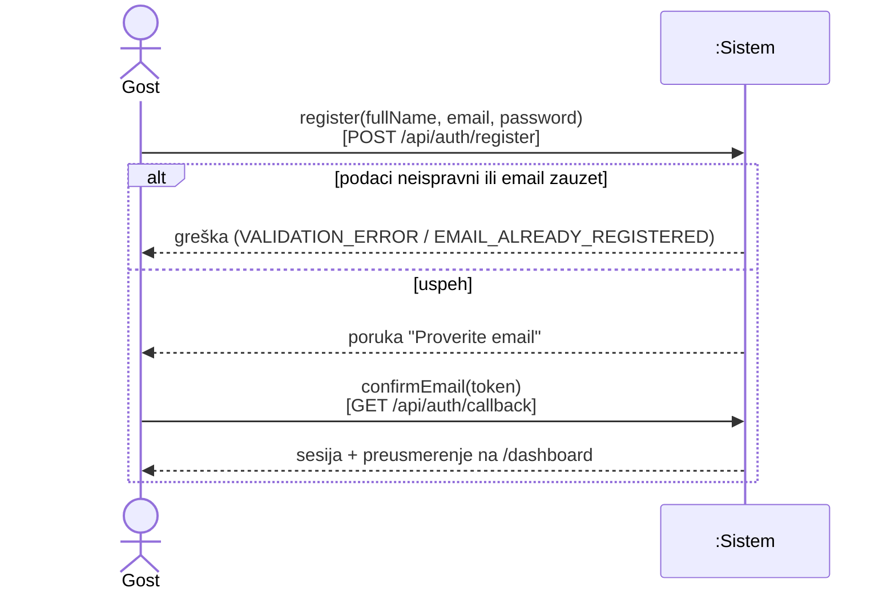

## SSD-02 Prijava email + lozinka (UC-02)

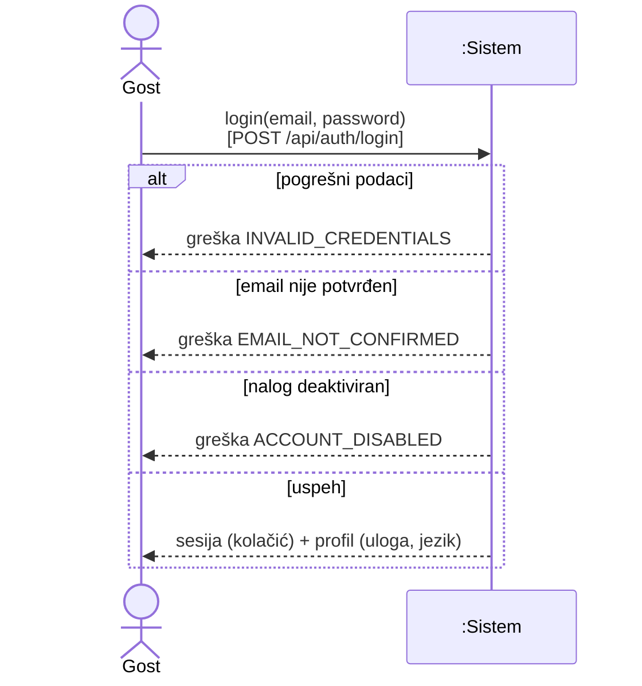

## SSD-03 Prijava Google nalogom (UC-03)

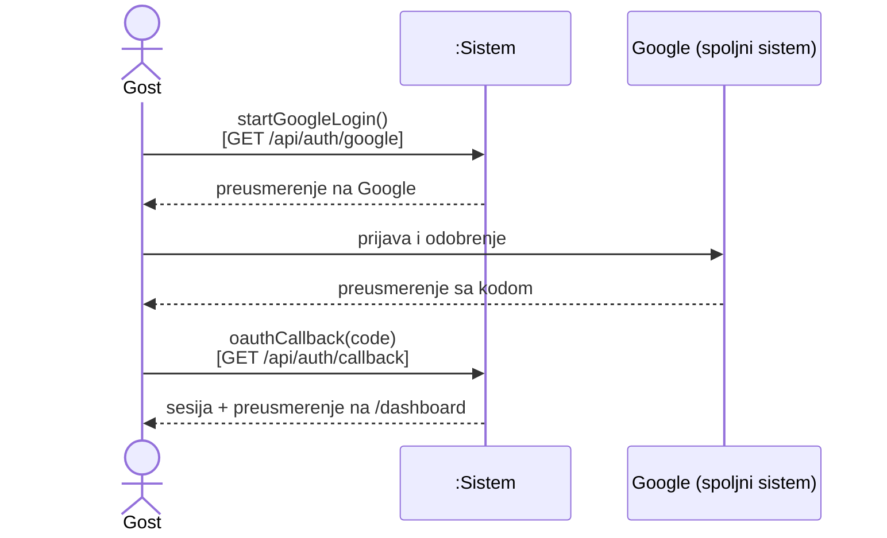

## SSD-04 Kreiranje zahteva (UC-09)

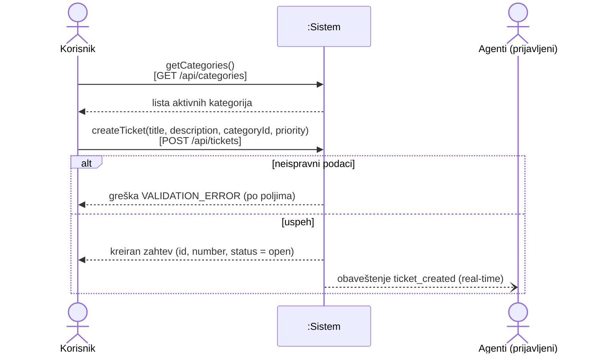

## SSD-05 Pregled i pretraga zahteva (UC-10, UC-15, UC-19)

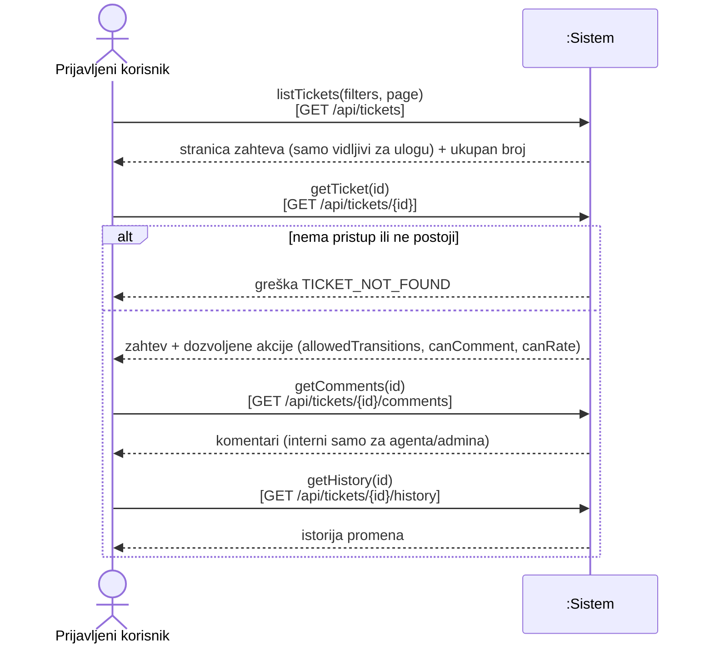

## SSD-06 Dodavanje komentara (UC-12, UC-18)

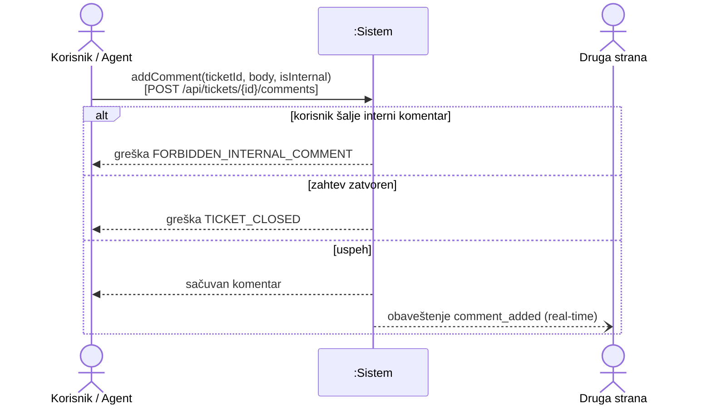

## SSD-07 Preuzimanje i dodela zahteva (UC-16, UC-20)

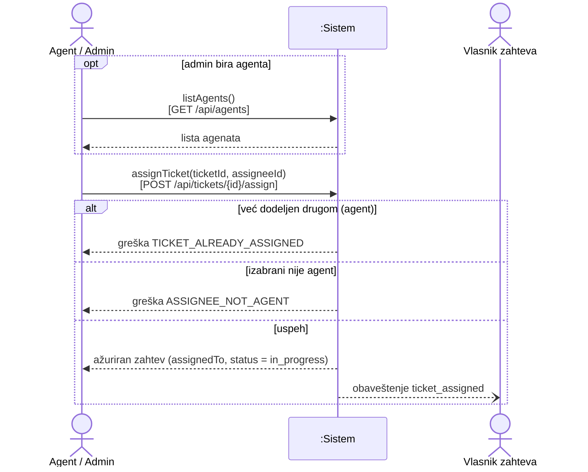

## SSD-08 Promena statusa (UC-13, UC-17)

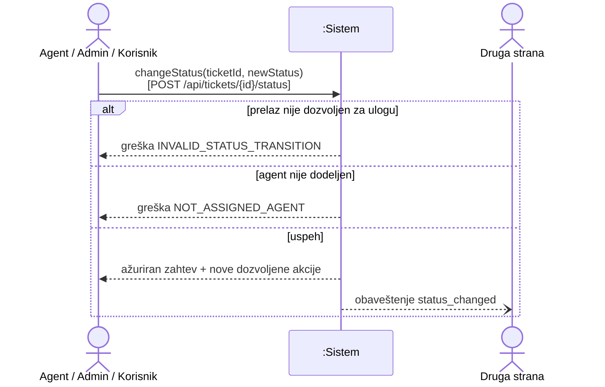

## SSD-09 Ocena rešenog zahteva (UC-14)

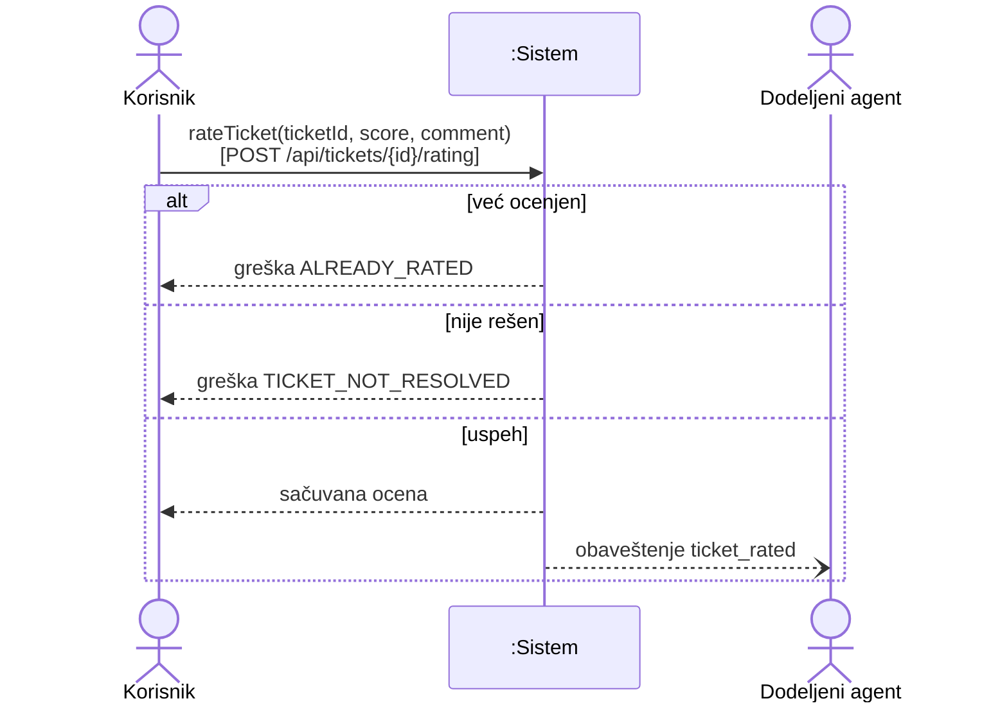

## SSD-10 Obaveštenja (UC-08)

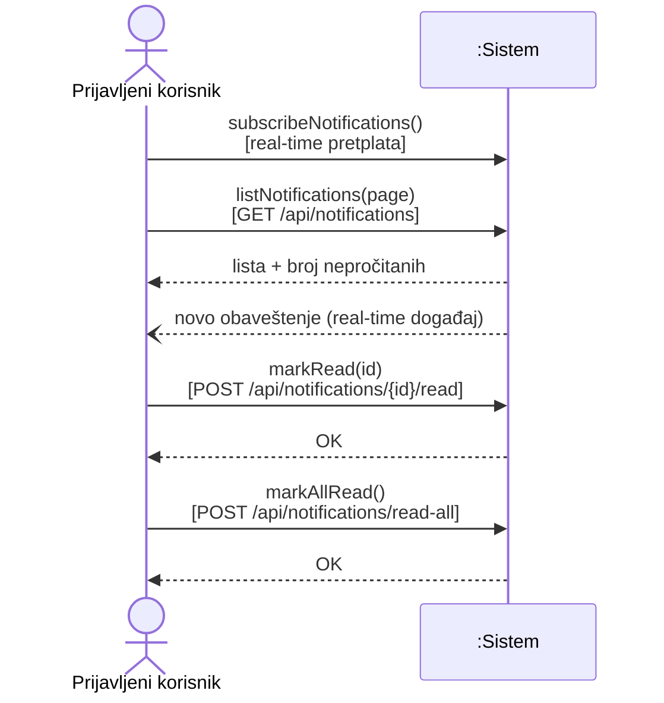

## SSD-11 Upravljanje korisnicima (UC-21)

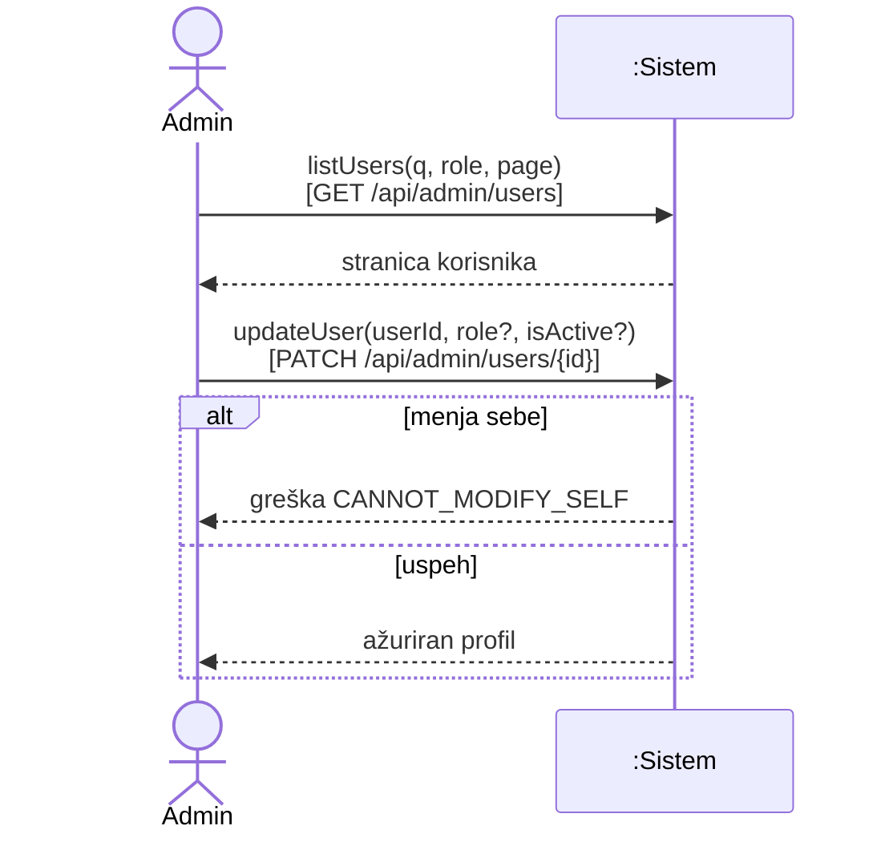

## SSD-12 Analitika (UC-23)

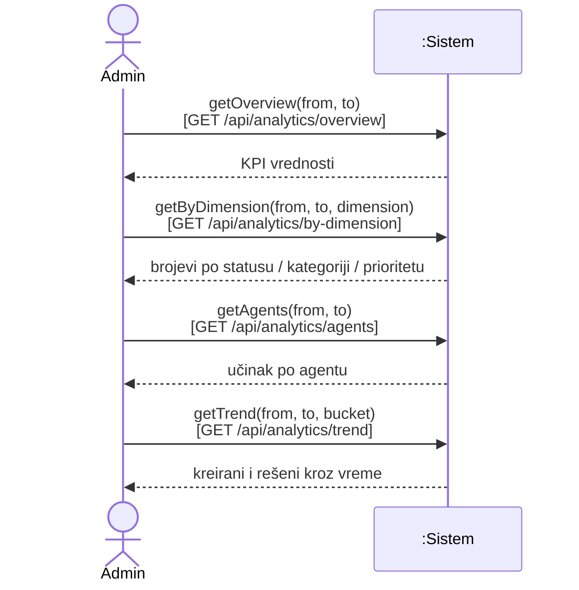

## Ugovori sistemskih operacija

| Operacija          | Preduslovi                                                                | Postuslovi                                                                                                                    |
| ------------------ | ------------------------------------------------------------------------- | ----------------------------------------------------------------------------------------------------------------------------- |
| `register`         | Gost nije prijavljen; email ne postoji                                    | Kreiran `auth.users` red i `profiles` sa ulogom `customer`; poslat email za potvrdu                                           |
| `login`            | Nalog postoji, potvrđen, aktivan                                          | Postavljen kolačić sesije                                                                                                     |
| `oauthCallback`    | Validan kod od Google-a                                                   | Sesija postavljena; profil postoji (kreiran ili povezan)                                                                      |
| `createTicket`     | Prijavljen `customer`, potvrđen email; kategorija aktivna                 | Kreiran `tickets` red (`open`); `ticket_history` `created`; `notifications` za sve agente/admine                              |
| `addComment`       | Akter vidi zahtev; zahtev nije `closed`; korisnik samo javni              | Kreiran `ticket_comments`; eventualno `first_response_at`; eventualno status `waiting_on_customer → in_progress`; obaveštenja |
| `assignTicket`     | Akter `agent` (sebi, nedodeljen) ili `admin`; `assigneeId` je agent/admin | `assigned_to` postavljen; status `open → in_progress`; istorija; obaveštenja vlasniku i agentu                                |
| `changeStatus`     | Prelaz dozvoljen po tabeli prelaza za ulogu akteru                        | Novi status; `resolved_at`/`closed_at` ažurirani; istorija; obaveštenje                                                       |
| `rateTicket`       | Akter je vlasnik; status `resolved`/`closed`; nema ocene                  | Kreiran `ticket_ratings`; istorija `rated`; obaveštenje agentu                                                                |
| `markRead`         | Obaveštenje pripada akteru                                                | `is_read = true`                                                                                                              |
| `updateUser`       | Akter `admin`; ne menja sebe                                              | `role`/`is_active` ažurirani; pri oduzimanju uloge agentu njegovi otvoreni zahtevi postaju nedodeljeni                        |
| `getOverview` itd. | Akter `admin`; period ≤ 1 godina                                          | Nema promene stanja                                                                                                           |
