# 05 — Dijagrami sekvenci (detaljni)

Za razliku od sistemskih dijagrama (`04`), ovde se vidi kako objekti unutar sistema sarađuju: stranica → `ApiClient` → API ruta (`withApi`) → `AuthGuard` → servis → politika → Supabase (RPC/RLS) → real-time → klijent. Nazivi klasa i metoda odgovaraju `03-dijagram-klasa.md`.

## SD-01 Zajednički tok svake zaštićene API rute

Ovaj obrazac važi za **sve** rute ispod; u ostalim dijagramima je skraćen na „withApi (auth + validacija)“.

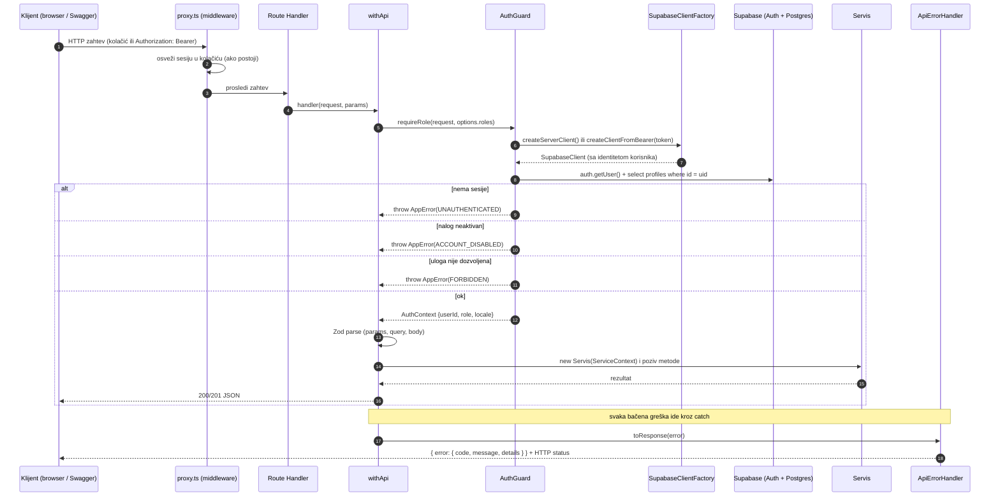

## SD-02 Registracija (UC-01)

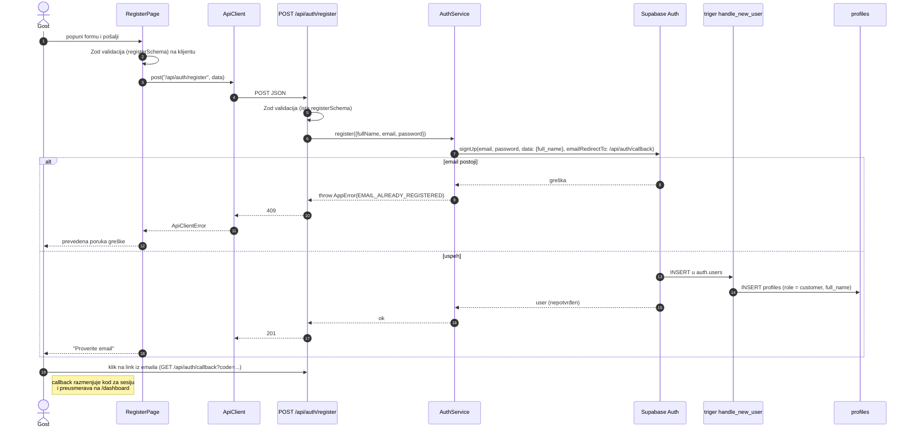

## SD-03 Prijava Google nalogom i povezivanje naloga (UC-03)

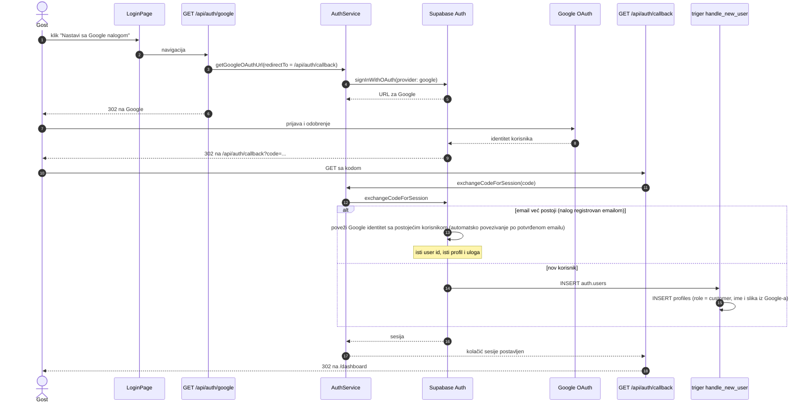

## SD-04 Kreiranje zahteva (UC-09)

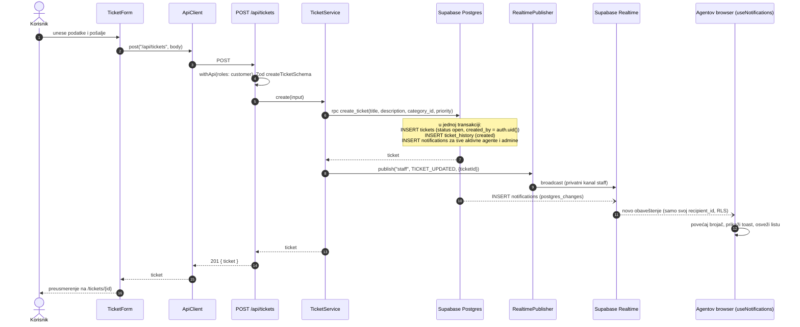

## SD-05 Prikaz detalja zahteva i real-time osvežavanje (UC-11)

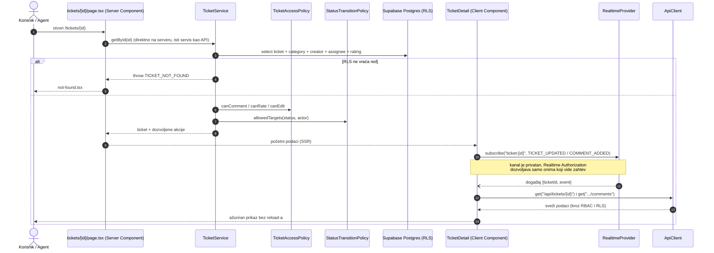

Napomena: Server Component sme da pozove servis direktno (čitanje, bez upisa) — pravilo „sve kroz API rute“ važi za **promene podataka**. Isti servis koristi i `GET /api/tickets/{id}`, pa je ponašanje identično i vidljivo u Swaggeru.

## SD-06 Dodavanje komentara (UC-12, UC-18)

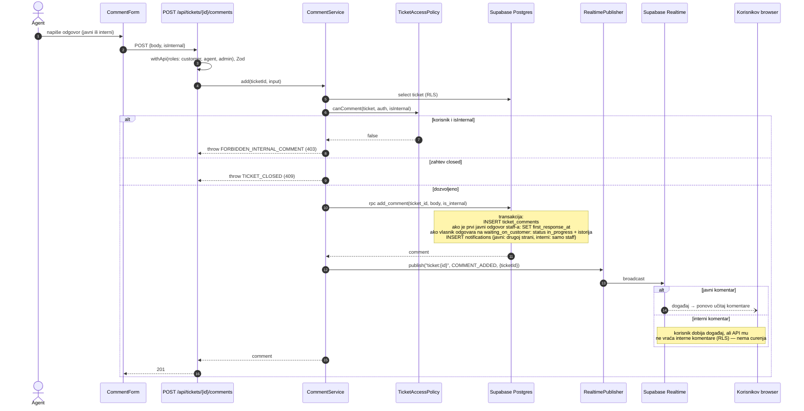

## SD-07 Preuzimanje zahteva (UC-16) i dodela (UC-20)

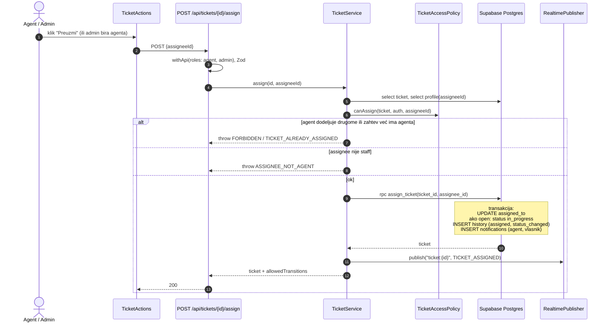

## SD-08 Promena statusa (UC-17, UC-13)

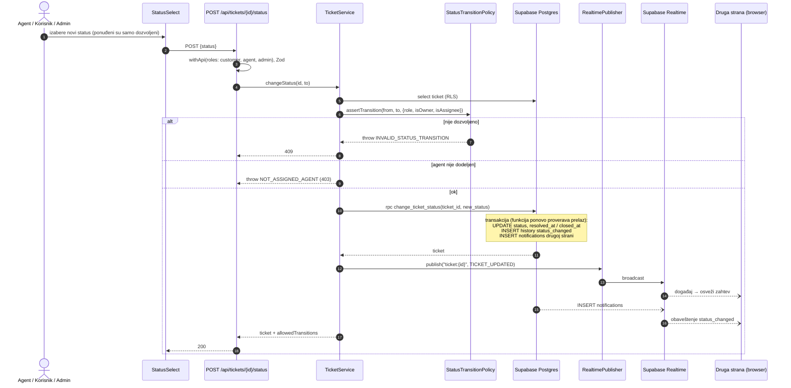

**Dvostruka provera prelaza** (u `StatusTransitionPolicy` i u RPC funkciji) je namerna: TypeScript provera daje jasnu grešku i služi UI-u, a provera u bazi garantuje pravilo i ako neko zaobiđe API.

## SD-09 Ocena zahteva (UC-14)

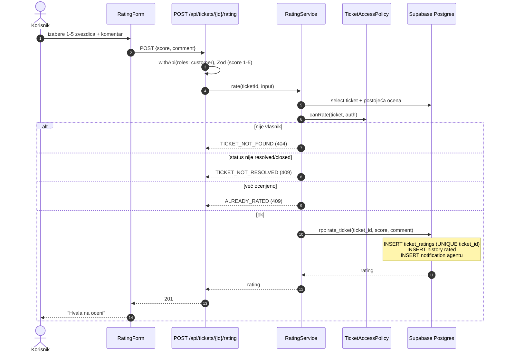

## SD-10 Analitika (UC-23)

Stranica čita podatke na serveru preko istog servisa kao API rute (kao i ostale stranice), pa nema praznog ekrana dok se grafikoni učitavaju. Rute `/api/analytics/*` ostaju za Swagger i Postman i vraćaju iste podatke.

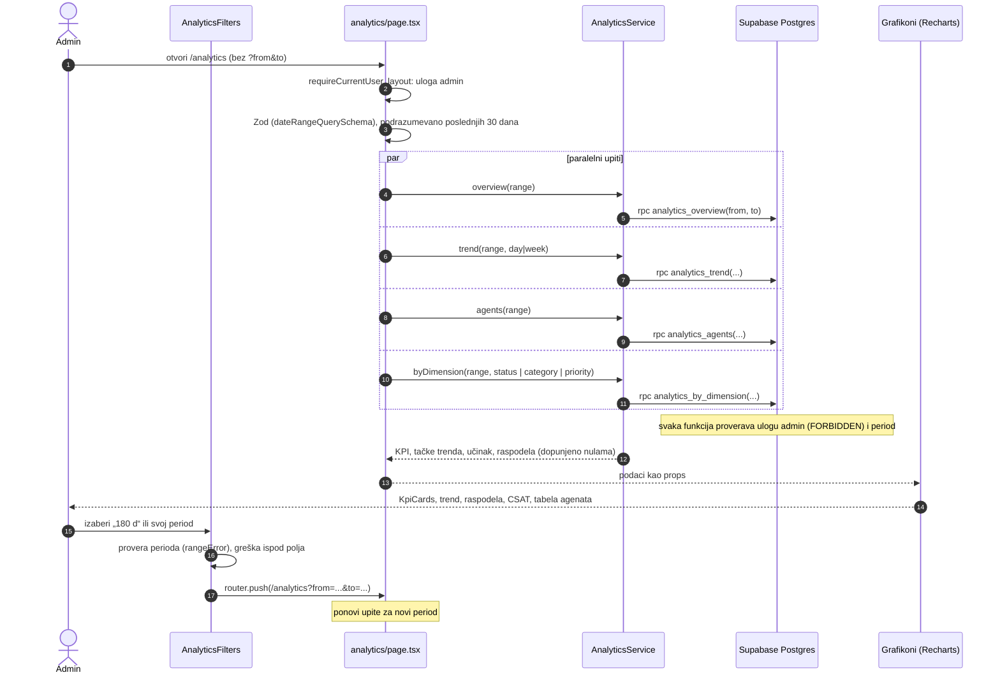

## SD-11 Promena jezika (UC-07)

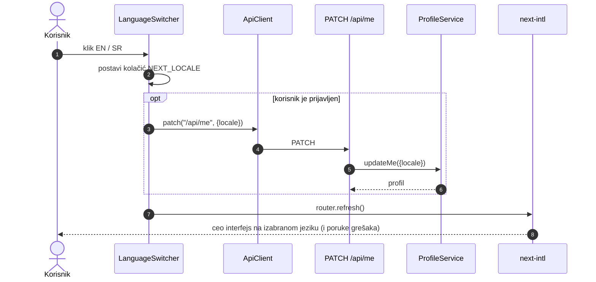

## SD-12 Zamena real-time provajdera (arhitektonski scenario)

Pokazuje zašto je real-time sloj zamenljiv: komponente se ne menjaju, menja se samo env promenljiva i implementacija.

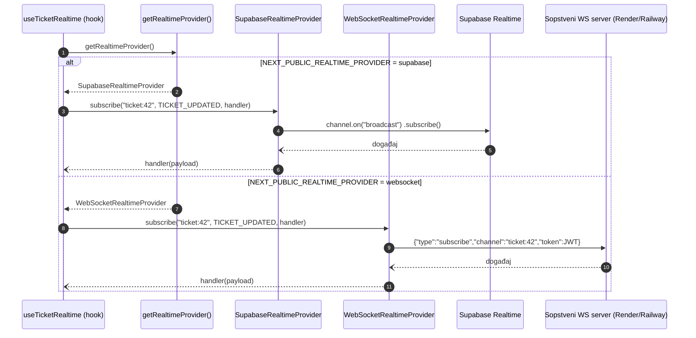

## SD-13 Zvonce: novo obaveštenje u realnom vremenu (UC-08, FZ-12, FZ-13)

Agent menja status Aninog zahteva; Anino zvonce i otvorena stranica se ažuriraju bez reload-a. Poruka kroz WebSocket nosi samo ID-jeve; tekst se sastavlja iz prevoda posle učitavanja kroz API.

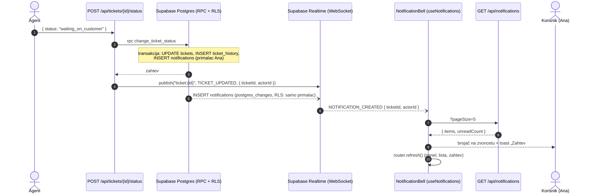
