# 09 — Uputstvo za korisnike (nacrt)

Ovo je nacrt poglavlja _Uputstvo za korisnike_. Opisuje rad sa aplikacijom po ulozi, korak po korak, sa snimcima ekrana nad demo podacima (`pnpm seed:demo`). Tekst je osnova za poglavlje rada i treba ga prepisati svojim rečima.

Snimci u ovom dokumentu su na srpskom, na računaru (širina 1280 px), uz nekoliko snimaka sa telefona. Svi snimci (i engleska verzija i telefon za svaku ulogu) su u folderu projekta `diplomski/faza-10/snimci/`, imenovani `<poglavlje>-<uloga>-<stranica>-<jezik>-<uređaj>.png`.

## 1. Opšte

### 1.1 Uloge

| Uloga         | Ko je to                        | Šta radi u aplikaciji                                                             |
| ------------- | ------------------------------- | --------------------------------------------------------------------------------- |
| Korisnik      | Klijent koji se sam registrovao | Prijavljuje probleme, prati svoje zahteve, odgovara timu i ocenjuje rešenje       |
| Agent         | Član tima podrške               | Preuzima zahteve, menja status, odgovara korisniku i piše interne beleške         |
| Administrator | Rukovodilac podrške             | Sve što i agent, plus dodela zahteva, nalozi i uloge, kategorije, analitika i API |

Nalog uvek počinje kao korisnik. Ulogu agenta ili administratora dodeljuje administrator (odeljak 5.3).

### 1.2 Raspored ekrana

- **Zaglavlje:** naziv aplikacije, dugme za jezik **SR / EN**, zvonce sa brojem nepročitanih obaveštenja, ime i uloga prijavljenog korisnika i dugme **Odjava**.
- **Meni levo:** stavke zavise od uloge (korisnik vidi „Moji zahtevi“ i „Novi zahtev“, administrator i „Analitika“, „Korisnici“, „Kategorije“, „API dokumentacija“).
- **Na telefonu** se meni otvara dugmetom ☰ u gornjem levom uglu, a kartice i tabele se slažu jedna ispod druge.

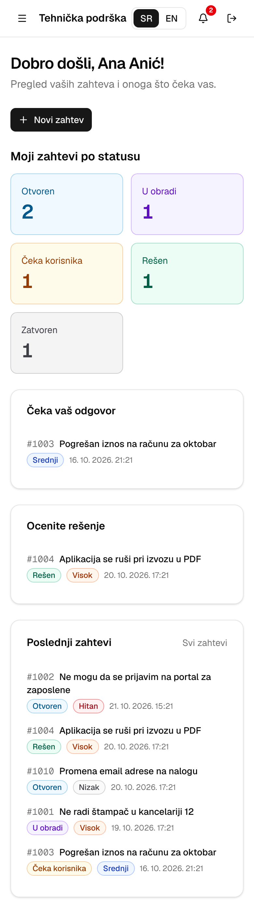

### 1.3 Jezik

Klik na **SR** ili **EN** u zaglavlju odmah menja jezik celog interfejsa, uključujući poruke o greškama. Izbor se pamti u pregledaču i u profilu, pa važi i pri sledećoj prijavi.

### 1.4 Statusi zahteva

| Status         | Značenje                                                             |
| -------------- | -------------------------------------------------------------------- |
| Otvoren        | Zahtev je poslat i čeka da ga neko iz tima preuzme                   |
| U obradi       | Član tima radi na zahtevu                                            |
| Čeka korisnika | Tim je postavio pitanje i čeka odgovor korisnika                     |
| Rešen          | Tim smatra da je problem rešen; korisnik potvrđuje ili ponovo otvara |
| Zatvoren       | Zahtev je završen (potvrđeno rešenje ili otkazan zahtev)             |

Aplikacija uvek nudi samo dugmad za prelaze koje prijavljeni korisnik sme da izvrši.

### 1.5 Obaveštenja

Kad se promeni status zahteva, stigne novi komentar ili se zahtev dodeli, na zvoncu se odmah poveća broj, a u uglu ekrana se pojavi kratka poruka. Klik na zvonce otvara poslednja obaveštenja. Klik na obaveštenje vodi na zahtev, a **Označi sve kao pročitano** briše brojač. Sva obaveštenja su na stranici **Obaveštenja**. Otvorene stranice (panel, lista, zahtev) se same osvežavaju, bez ponovnog učitavanja.

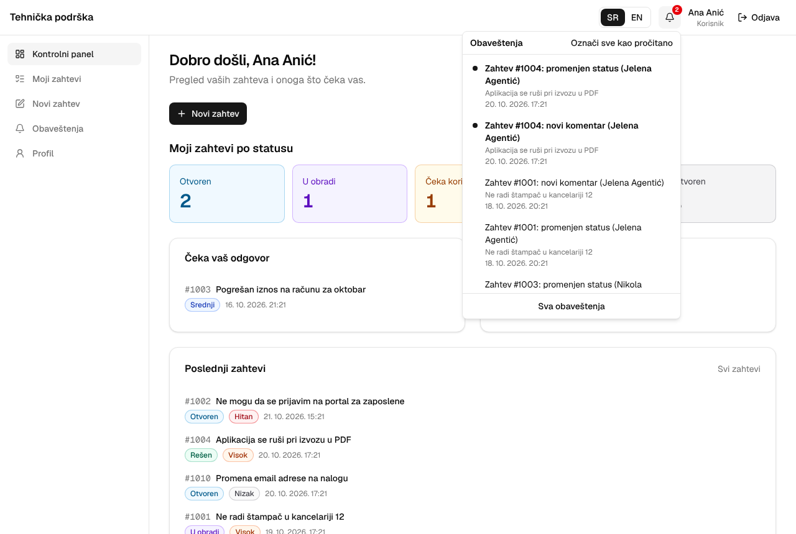

## 2. Nalog

### 2.1 Registracija

1. Na stranici za prijavu kliknite **Registrujte se**.
2. Unesite ime i prezime, email i lozinku (najmanje 8 znakova, bar jedno slovo i jedan broj), pa kliknite **Napravi nalog**.
3. Otvorite email „Potvrdite nalog“ i kliknite na link. Link radi i na drugom uređaju (npr. email otvoren na telefonu).
4. Posle potvrde ste prijavljeni i vidite kontrolni panel.

Ako je email već registrovan, ispod polja se prikazuje poruka i nalog se ne pravi ponovo.

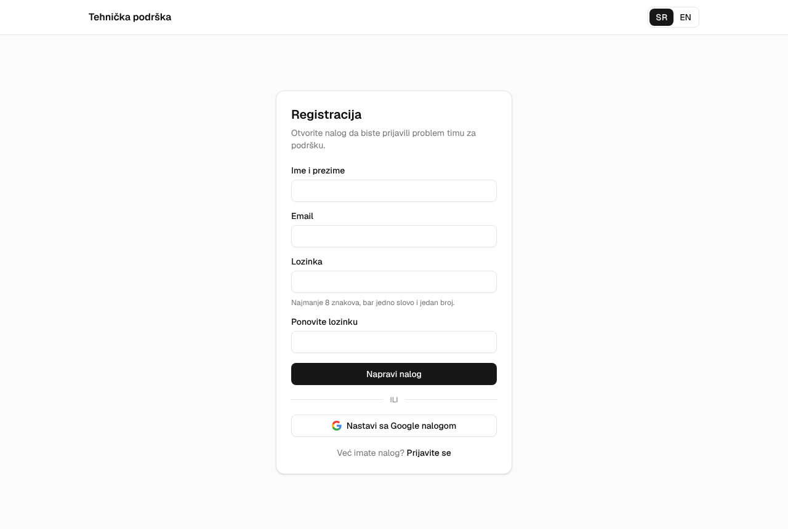

### 2.2 Prijava

- **Email i lozinka:** unesite podatke i kliknite **Prijavi se**.
- **Google nalog:** kliknite **Nastavi sa Google nalogom** i izaberite nalog. Ako već postoji nalog sa istim emailom, Google prijava se vezuje za njega (isti zahtevi i ista uloga), a ne pravi se novi nalog.

Ako nalog nije potvrđen ili ga je administrator deaktivirao, prikazuje se odgovarajuća poruka.

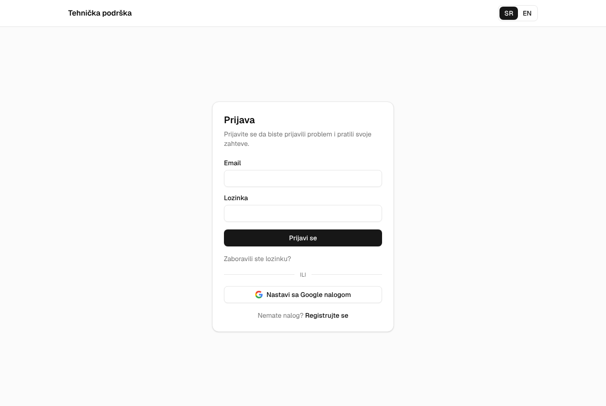

### 2.3 Zaboravljena lozinka

1. Na stranici za prijavu kliknite **Zaboravili ste lozinku?**
2. Unesite email i kliknite **Pošalji link**.
3. Iz emaila otvorite link, unesite novu lozinku i kliknite **Sačuvaj lozinku**.

Iz bezbednosnih razloga poruka je ista i kad nalog sa tim emailom ne postoji.

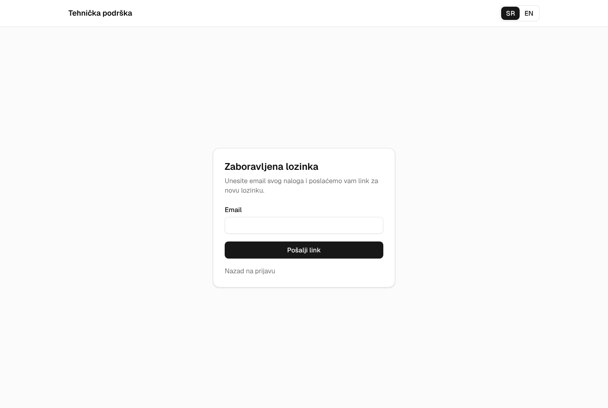

### 2.4 Profil i odjava

Na stranici **Profil** menjate ime i jezik i vidite svoju ulogu. Email i ulogu ne možete sami da promenite. Dugme **Odjava** u zaglavlju završava sesiju.

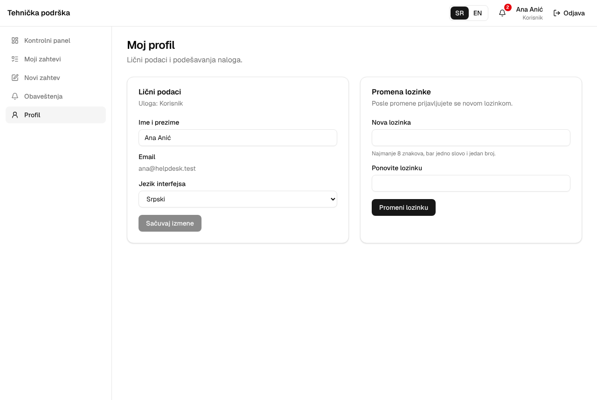

## 3. Korisnik

### 3.1 Kontrolni panel

Posle prijave vidite broj svojih zahteva po statusu, zahteve koji **čekaju vaš odgovor**, rešene zahteve koje možete da **ocenite** i poslednje zahteve. Klik na broj otvara listu filtriranu po tom statusu.

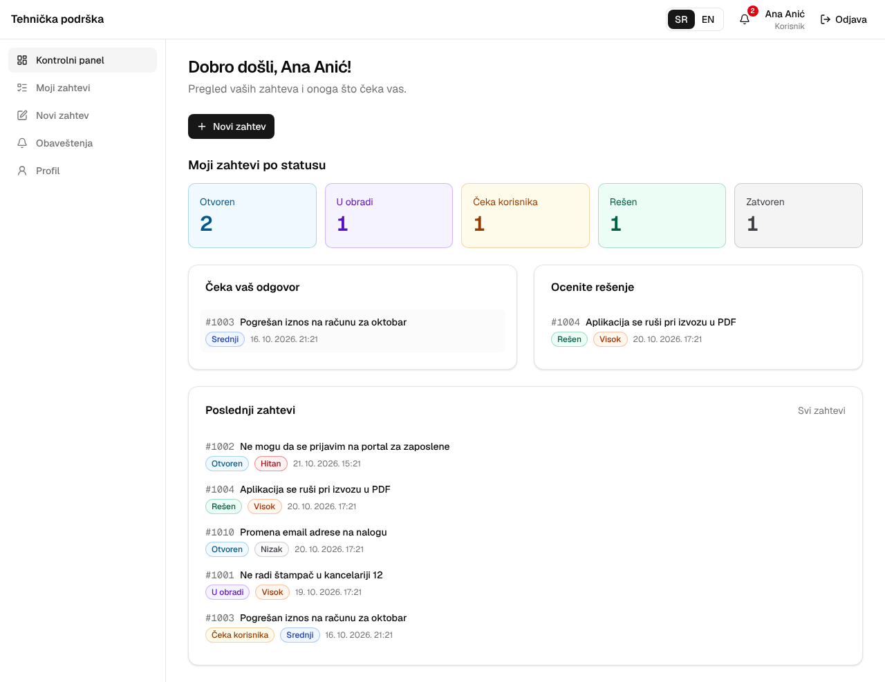

### 3.2 Kako prijaviti problem (novi zahtev)

1. Kliknite **Novi zahtev** (u meniju ili na panelu).
2. Unesite kratak **naslov** (npr. „Ne radi štampač u kancelariji 12“) i **opis**: šta se desilo, kada, i šta ste već probali.
3. Izaberite **kategoriju** i **prioritet**.
4. Kliknite **Pošalji zahtev**. Dobijate broj zahteva (npr. #1186) i otvara se stranica zahteva.

Tim podrške odmah dobija obaveštenje o novom zahtevu.

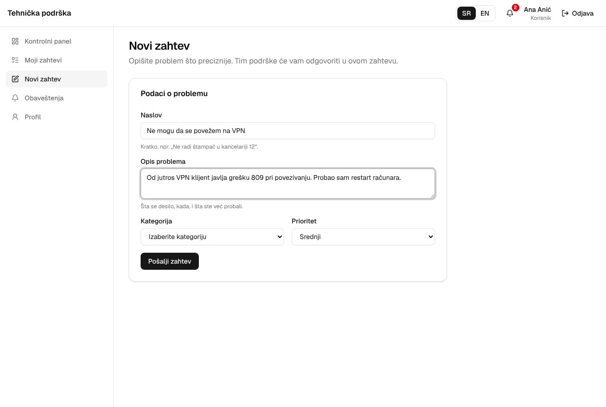

### 3.3 Praćenje zahteva

Stranica **Moji zahtevi** prikazuje sve vaše zahteve sa statusom, prioritetom i datumom. Možete da pretražujete po naslovu i opisu (ili po broju, npr. `#1004`), da filtrirate po statusu, prioritetu i kategoriji i da sortirate. Dugme **Tabla** prikazuje iste zahteve kao kanban tablu sa kolonom za svaki status.

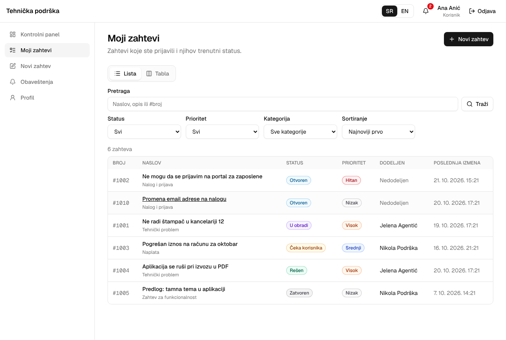

Na stranici zahteva vidite opis, prepisku sa timom, ko radi na zahtevu i istoriju promena.

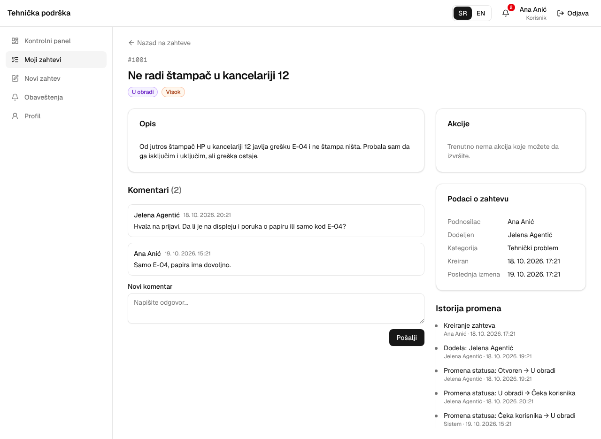

### 3.4 Odgovor timu

Kad je zahtev u statusu **Čeka korisnika**, tim čeka vaš odgovor. Napišite ga u polje **Novi komentar** i kliknite **Pošalji**. Zahtev se automatski vraća u status **U obradi**.

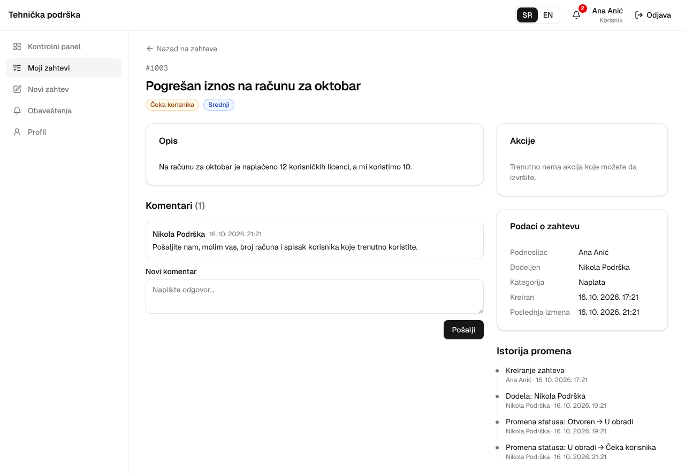

### 3.5 Potvrda rešenja i ocena

Kad tim označi zahtev kao **Rešen**:

1. Kliknite **Potvrdi rešenje** (zahtev se zatvara) ili **Ponovo otvori** ako problem i dalje postoji.
2. U delu **Ocena zadovoljstva** izaberite od 1 do 5 zvezdica, po želji napišite komentar i kliknite **Pošalji ocenu**. Zahtev se ocenjuje samo jednom.

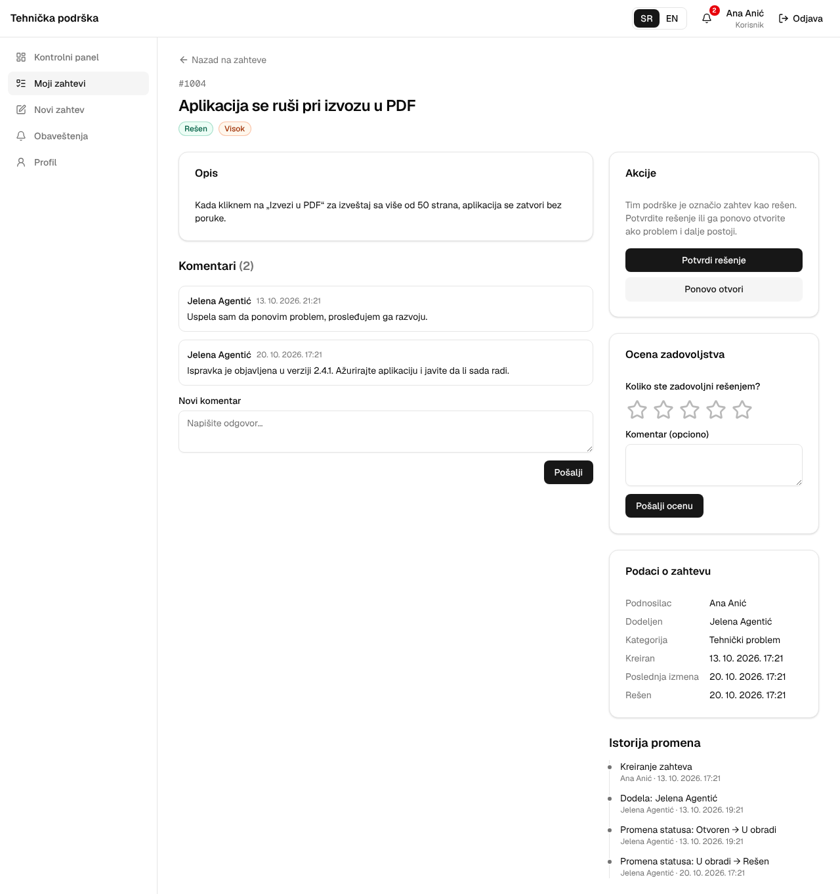

### 3.6 Otkazivanje zahteva

Dok zahtev niko nije preuzeo (status **Otvoren**), možete ga otkazati dugmetom **Otkaži zahtev**. Aplikacija traži potvrdu, jer posle toga zahtev može ponovo da otvori samo tim podrške.

## 4. Agent

### 4.1 Red rada

Kontrolni panel agenta prikazuje zahteve dodeljene vama po statusu, broj nedodeljenih i hitnih zahteva, vaše rešene zahteve i prosečnu ocenu, i **red čekanja** (nedodeljeni zahtevi, najstariji prvi).

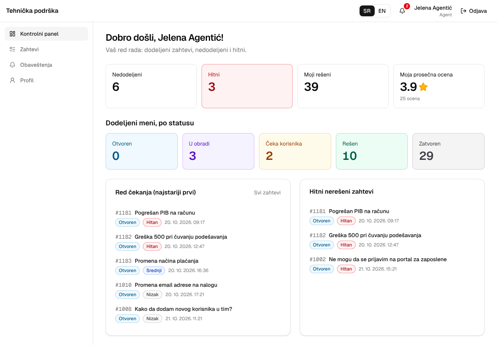

Na stranici **Zahtevi** vidite sve zahteve. Filter **Dodeljen** ima izbore **Dodeljeni meni** i **Nedodeljeni**.

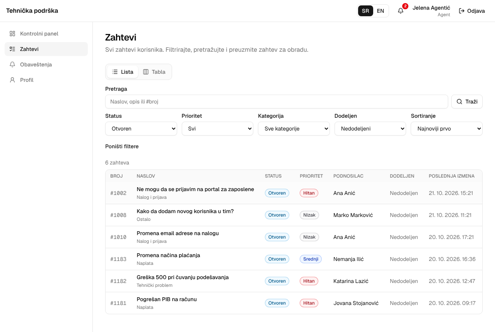

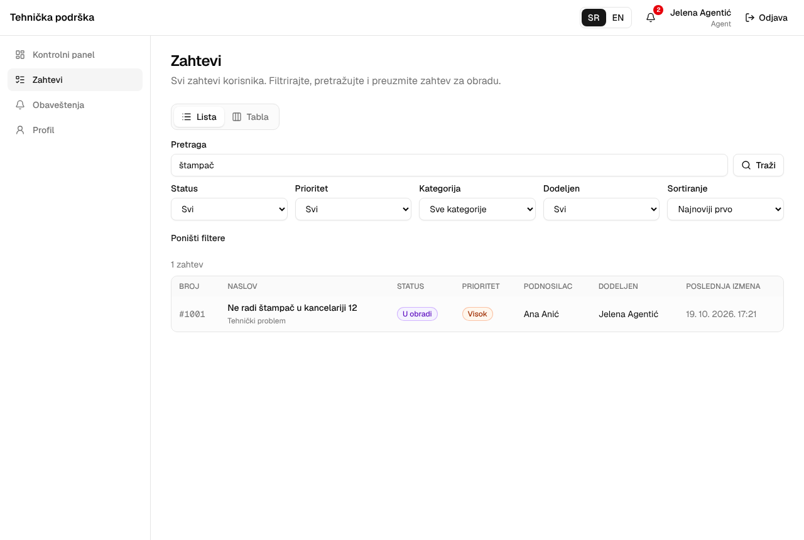

### 4.2 Kako agent preuzima zahtev

1. Otvorite nedodeljen zahtev (status **Otvoren**).
2. Kliknite **Preuzmi zahtev**. Zahtev se dodeljuje vama i prelazi u **U obradi**, a korisnik dobija obaveštenje.

Ako je kolega u međuvremenu već preuzeo isti zahtev, aplikacija to javlja i ništa se ne menja.

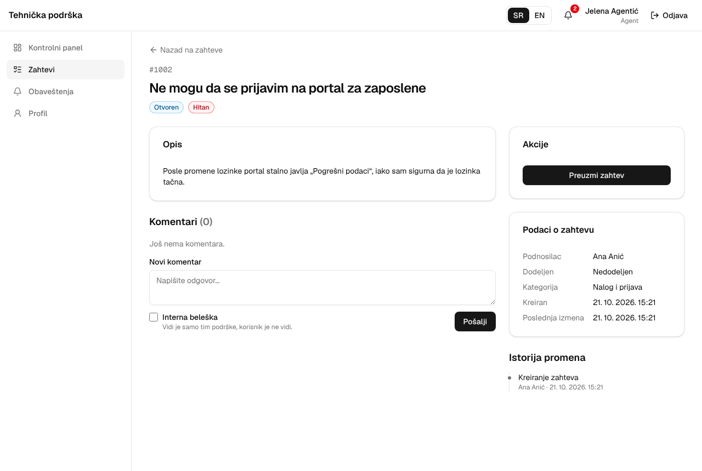

### 4.3 Rad na zahtevu

- **Odgovor korisniku:** napišite komentar i kliknite **Pošalji**.
- **Interna beleška:** označite **Interna beleška** pre slanja. Belešku vidi samo tim (žuta pozadina i oznaka), korisnik je ne vidi i ne dobija obaveštenje o njoj.
- **Pitanje korisniku:** kliknite **Čeka odgovor korisnika** kad vam treba informacija od korisnika.
- **Rešenje:** kliknite **Označi kao rešen**. Korisnik zatim potvrđuje rešenje ili ponovo otvara zahtev.

Status može da menja samo agent kome je zahtev dodeljen.

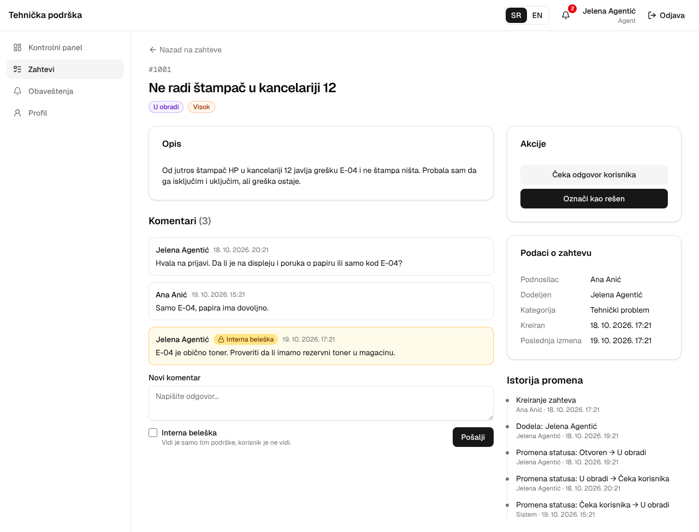

### 4.4 Kanban tabla

Na stranici **Zahtevi** kliknite **Tabla**. Svaki status je jedna kolona (do 20 najnovijih zahteva; **Prikaži sve** otvara listu).

- **Mišem:** prevucite karticu u drugu kolonu. Dozvoljene kolone su istaknute, a ostale su označene „Nije dozvoljeno“.
- **Na telefonu:** dugo pritisnite karticu, pa je prevucite.
- **Tastaturom:** Tab do kartice, **razmak** podiže karticu, **strelice levo/desno** biraju kolonu, **razmak** spušta, **Escape** odustaje. **Enter** otvara zahtev.

Prevlačenje nedodeljenog otvorenog zahteva u **U obradi** znači preuzimanje. Ako server odbije promenu, kartica se vraća na staro mesto uz poruku.

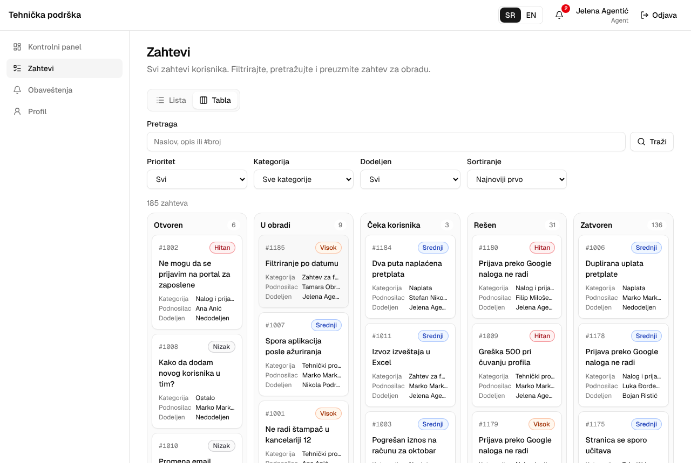

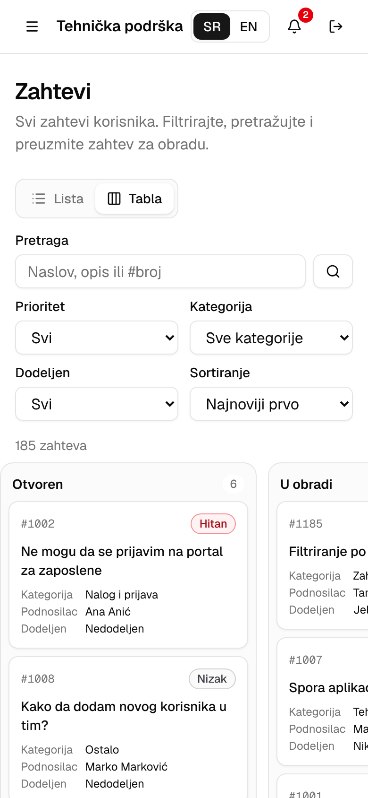

## 5. Administrator

Administrator ima sve mogućnosti agenta (može da menja status svakog zahteva, ne samo dodeljenog) i još sledeće.

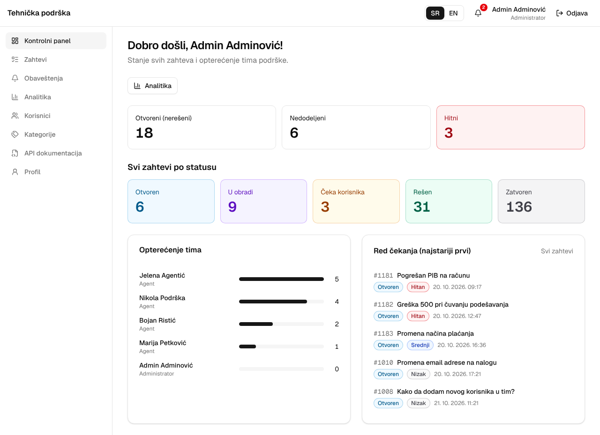

### 5.1 Dodela zahteva agentu

1. Otvorite zahtev.
2. U delu **Akcije**, polje **Dodeli članu tima**, izaberite agenta. Uz ime piše koliko otvorenih zahteva već ima, da bi se posao ravnomerno rasporedio.
3. Kliknite **Sačuvaj dodelu**. Izbor **Nikome (oslobodi zahtev)** vraća zahtev u red čekanja.

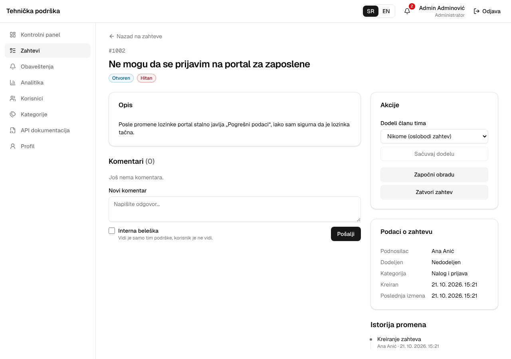

### 5.2 Analitika

Stranica **Analitika** prikazuje rad tima za izabrani period (podrazumevano poslednjih 30 dana; brzi izbori 7, 30, 90, 180 i 365 dana ili sopstveni datumi):

- broj novih, rešenih i otvorenih zahteva, prosečno vreme prvog odgovora i rešavanja, prosečnu ocenu
- trend novih i rešenih zahteva kroz vreme
- raspodelu po statusu, kategoriji i prioritetu
- učinak svakog člana tima (rešeni zahtevi, vremena, ocena) i raspodelu ocena

Uz svaki grafikon dugme prikazuje iste podatke kao tabelu.

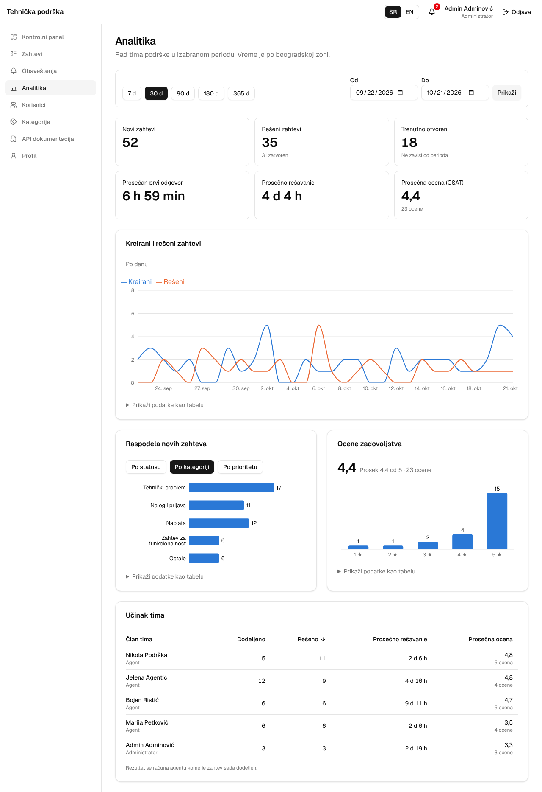

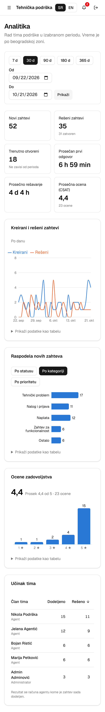

### 5.3 Nalozi i uloge

Na stranici **Korisnici** pretražujete naloge po imenu ili emailu i filtrirate po ulozi i statusu.

- **Promena uloge:** izaberite novu ulogu u redu naloga i kliknite **Sačuvaj**. Ako član tima postaje korisnik, aplikacija traži potvrdu, jer se njegovi nerešeni zahtevi vraćaju u red čekanja.
- **Deaktivacija:** kliknite **Deaktiviraj** i potvrdite. Deaktiviran nalog ne može da se prijavi dok ga ponovo ne aktivirate.
- Svoj nalog ne možete da menjate (zaključan je), da se administrator ne bi slučajno zaključao.

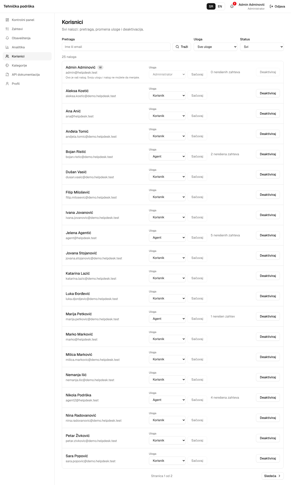

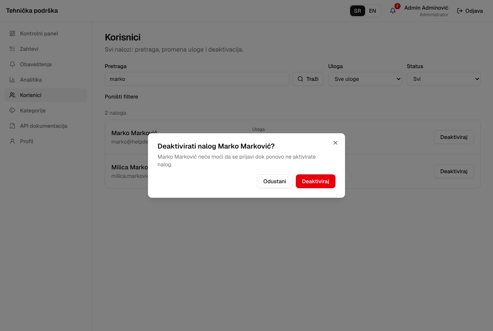

### 5.4 Kako admin dodaje kategoriju

1. Otvorite **Kategorije** i kliknite **Nova kategorija**.
2. Unesite oznaku (mala slova, brojevi i crtice, npr. `network`), naziv na srpskom i engleskom, po želji opis i redosled u listi.
3. Kliknite **Dodaj kategoriju**. Nova kategorija se odmah nudi korisnicima u formi za novi zahtev.

Postojeću kategoriju menjate dugmetom **Izmeni**. Kategorije se ne brišu, nego deaktiviraju (dugme **Deaktiviraj**), da stari zahtevi zadrže svoju kategoriju.

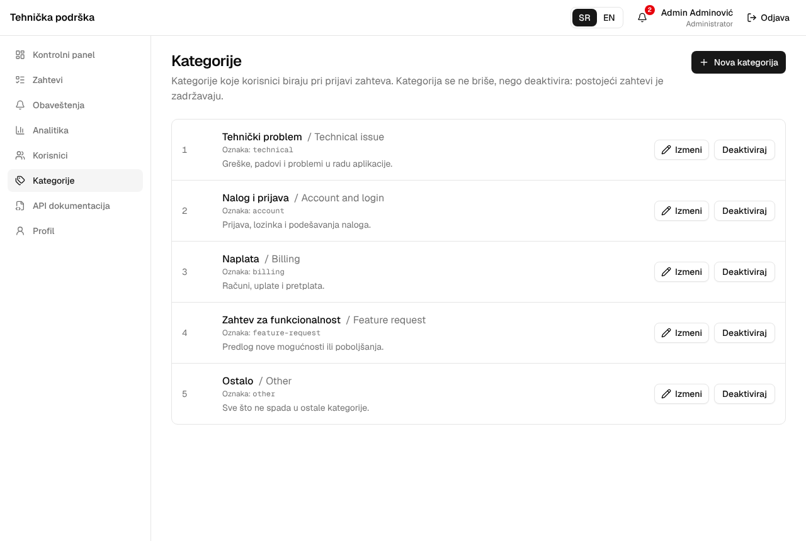

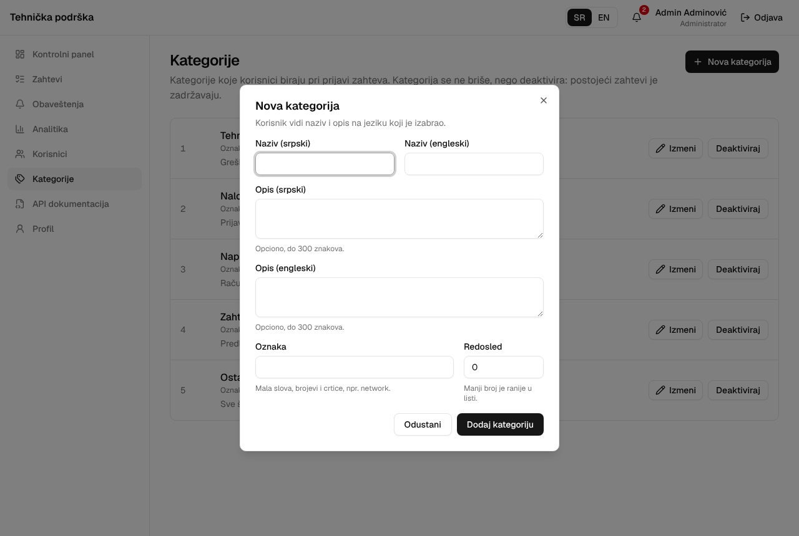

### 5.5 API dokumentacija

Stavka **API dokumentacija** otvara Swagger UI sa svim pozivima aplikacije, grupisanim po oblastima. Za pozive koji traže prijavu kliknite **Authorize** i unesite pristupni token. Svaki poziv se može isprobati dugmetom **Try it out**.

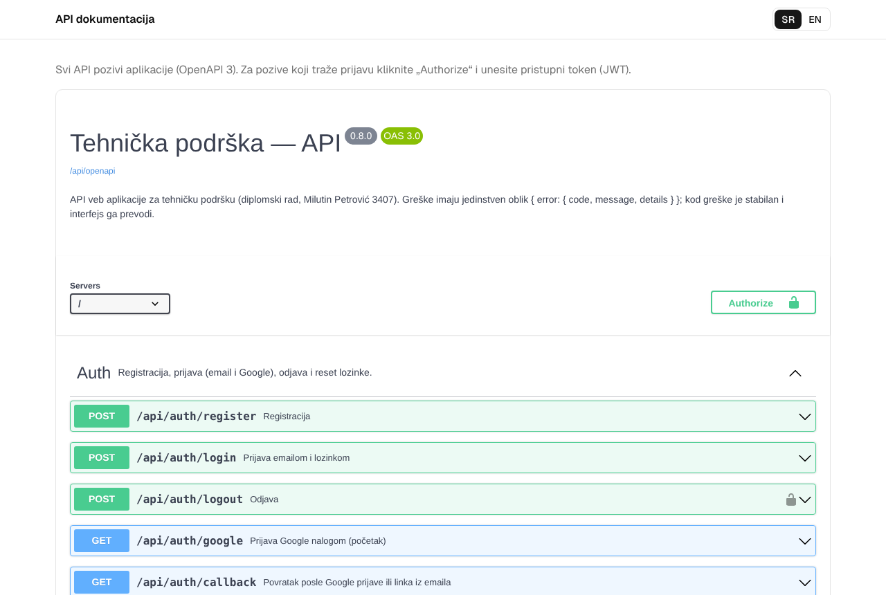

## 6. Česta pitanja

| Pitanje                                       | Odgovor                                                                                            |
| --------------------------------------------- | -------------------------------------------------------------------------------------------------- |
| Nije stigao email za potvrdu.                 | Proverite folder za neželjenu poštu; link važi ograničeno vreme, pa se registracija može ponoviti. |
| Ne vidim dugme za promenu statusa.            | Dugmad se prikazuju samo za dozvoljene prelaze; agent mora prvo da preuzme zahtev.                 |
| Ne mogu da ocenim zahtev.                     | Ocena je moguća samo za rešene ili zatvorene zahteve i samo jednom.                                |
| Ne mogu da se prijavim, nalog je deaktiviran. | Obratite se administratoru podrške.                                                                |
