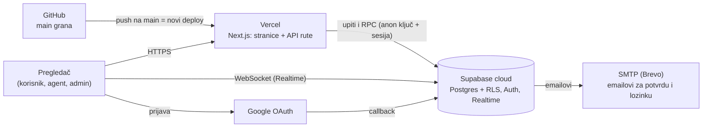

# 10 — Postavljanje na internet (Vercel + Supabase)

Uputstvo korak po korak za demo okruženje za odbranu. Aplikacija ide na **Vercel**, a baza, prijava i real-time na **Supabase cloud**. Kod ne koristi ništa specifično za Vercel (nema `@vercel/*` paketa ni `vercel.json`), pa se ista aplikacija može postaviti i na Netlify (odeljak 10).

Potrebno: nalog na GitHub-u (repozitorijum već postoji), **Supabase**, **Vercel** i **Google Cloud** (za Google prijavu); po preporuci i **Brevo** (slanje emailova, odeljak 4.3). Ukupno oko 30–45 minuta.

U uputstvu su vrednosti koje se razlikuju po projektu napisane ovako:

| Oznaka           | Šta je                        | Primer                                  |
| ---------------- | ----------------------------- | --------------------------------------- |
| `<ref>`          | ID Supabase projekta          | `abcdefghijklmnop`                      |
| `<supabase-url>` | Adresa Supabase projekta      | `https://abcdefghijklmnop.supabase.co`  |
| `<app-url>`      | Adresa aplikacije na Vercel-u | `https://diplomski-helpdesk.vercel.app` |



## 1. Supabase projekat

1. Na [supabase.com/dashboard](https://supabase.com/dashboard) kliknite **New project**.
2. Ime: npr. `diplomski-helpdesk`. **Region: Central EU (Frankfurt)** (najbliže Srbiji). Izmislite **lozinku baze** i sačuvajte je (treba u koraku 2).
3. Kad se projekat napravi, u **Project Settings → API Keys** otvorite karticu **Legacy API Keys** i zapišite:
   - `anon` `public` ključ → ide na Vercel (javni je, štite ga RLS politike),
   - `service_role` `secret` ključ → **samo** za skriptu `seed:demo` na vašem računaru; nikad na Vercel, nikad u git.
4. `<supabase-url>` piše u **Project Settings → Data API** (Project URL), a `<ref>` je deo te adrese.

> Koriste se „legacy“ `anon`/`service_role` ključevi jer je sa njima aplikacija testirana lokalno (Supabase CLI daje iste). Novi `publishable`/`secret` ključevi bi trebalo da rade isto, ali nisu provereni.

## 2. Šema baze i osnovni podaci

Iz foldera projekta na svom računaru (Supabase CLI je već u `devDependencies`):

```bash
pnpm exec supabase login                       # otvara pregledač za prijavu
pnpm exec supabase link --project-ref <ref>    # traži lozinku baze iz koraka 1
pnpm exec supabase db push --include-seed      # sve migracije + supabase/seed.sql
```

- `db push` pravi sve tabele, RLS politike, RPC funkcije i dozvole za real-time kanale iz `supabase/migrations/`.
- `--include-seed` pokreće `supabase/seed.sql`: 5 kategorija, 5 demo naloga (lozinka `Lozinka123!`) i 12 demo zahteva #1001–#1012.
- Provera: **Table Editor** u Supabase-u treba da prikaže tabele `profiles`, `tickets`, `categories`... sa podacima.

Ako `--include-seed` ne uspe, isti rezultat daje **SQL Editor → New query**: nalepiti ceo sadržaj `supabase/seed.sql` i kliknuti **Run**.

## 3. Realni demo podaci (za analitiku)

Na svom računaru, sa `service_role` ključem iz koraka 1 (ključ se ne upisuje ni u jedan fajl u git-u):

```bash
NEXT_PUBLIC_SUPABASE_URL=<supabase-url> SUPABASE_SERVICE_ROLE_KEY=<service_role ključ> pnpm seed:demo
```

Skripta dodaje 20 naloga (2 agenta i 18 korisnika) i oko 170 zahteva kroz poslednjih 6 meseci, sa komentarima, istorijom i ocenama. Vremena su relativna u odnosu na trenutak pokretanja, pa je **pre odbrane dobro pokrenuti je ponovo** (briše i ponovo pravi samo svoje zahteve), da bi grafikoni „poslednjih 30 dana“ bili puni.

Na Windows-u (PowerShell):

```powershell
$env:NEXT_PUBLIC_SUPABASE_URL="<supabase-url>"; $env:SUPABASE_SERVICE_ROLE_KEY="<service_role ključ>"; pnpm seed:demo
```

## 4. Supabase Auth podešavanja

### 4.1 Adrese (Authentication → URL Configuration)

- **Site URL:** `<app-url>`
- **Redirect URLs:** dodati `<app-url>/**`. Za probne adrese Vercel-a (svaki PR dobija svoju) može se dodati i `https://*-<vercel-tim>.vercel.app/**`.

Bez ovoga linkovi iz emailova i Google prijava vraćaju na `localhost`.

### 4.2 Šabloni emailova (Authentication → Emails → Templates)

Lokalno se šabloni čitaju iz `supabase/config.toml`; na cloud-u se jednom nalepe ručno. Linkovi u njima koriste `token_hash`, pa rade i kad se email otvori na drugom uređaju.

| Šablon             | Subject                                  | Body (ceo HTML iz fajla)               |
| ------------------ | ---------------------------------------- | -------------------------------------- |
| **Confirm signup** | `Potvrdite nalog / Confirm your account` | `supabase/templates/confirmation.html` |
| **Reset Password** | `Nova lozinka / Reset your password`     | `supabase/templates/recovery.html`     |

U **Authentication → Sign In / Providers → Email** proveriti da je **Confirm email** uključeno (podrazumevano jeste).

### 4.3 Slanje emailova (preporuka: sopstveni SMTP)

Ugrađeni Supabase servis za email šalje **samo na adrese članova Supabase tima** (vaš email) i najviše nekoliko emailova na sat. Za demo to znači: registracija i reset lozinke rade samo sa vašim emailom, a za ostale adrese API vraća grešku.

Za odbranu je zato preporuka besplatan SMTP, npr. **Brevo** (300 emailova dnevno, ne traži sopstveni domen):

1. Napraviti nalog na [brevo.com](https://www.brevo.com) i potvrditi svoj email kao pošiljaoca (**Senders**).
2. **SMTP & API → SMTP**: zapisati server (`smtp-relay.brevo.com`), port `587`, login i generisati **SMTP key**.
3. Supabase → **Authentication → Emails → SMTP Settings** → **Enable custom SMTP**: upisati te podatke; **Sender email** = potvrđeni email iz koraka 1, **Sender name** = `Tehnička podrška`.
4. U **Authentication → Rate Limits** po potrebi povećati broj emailova na sat (npr. 30).

Ovo je jedini dodatni servis u odnosu na plan; ako se preskoči, sve ostalo radi, a registracija se na odbrani pokazuje sopstvenim emailom.

## 5. Vercel projekat

1. Na [vercel.com/new](https://vercel.com/new) izaberite **Import Git Repository** → `milutinpetrovic/diplomski-helpdesk` (Vercel traži dozvolu za GitHub nalog).
2. **Project Name:** `diplomski-helpdesk` (od toga zavisi `<app-url>`; ako je ime zauzeto, Vercel predloži drugo — tada svuda koristiti tu adresu).
3. Framework se prepoznaje sam (**Next.js**), kao i `pnpm` (iz `packageManager` u `package.json`). Build komande ne treba menjati.
4. **Environment Variables** (sve za _Production_ i _Preview_):

   | Promenljiva                     | Vrednost                 |
   | ------------------------------- | ------------------------ |
   | `NEXT_PUBLIC_SUPABASE_URL`      | `<supabase-url>`         |
   | `NEXT_PUBLIC_SUPABASE_ANON_KEY` | `anon` ključ iz koraka 1 |
   | `NEXT_PUBLIC_SITE_URL`          | `<app-url>`              |
   | `NEXT_PUBLIC_REALTIME_PROVIDER` | `supabase`               |
   | `SWAGGER_ENABLED`               | `true`                   |

   `SUPABASE_SERVICE_ROLE_KEY` se **ne** dodaje: aplikacija ga ne koristi (sva prava proverava baza preko RLS-a).

5. Kliknite **Deploy** (2–3 minuta). Na kraju Vercel prikaže `<app-url>`.
6. **Settings → Functions → Function Region:** izabrati **Frankfurt, Germany (fra1)**, isti region kao baza (manje kašnjenje), pa **Deployments → … → Redeploy**.

Promenljive sa `NEXT_PUBLIC_` se ugrađuju u kod pri build-u: posle svake izmene promenljive potreban je **Redeploy**.

Od tada svaki push na `main` automatski pravi novu verziju sajta, a svaki PR dobija svoju probnu adresu (komentar Vercel bota na PR-u).

## 6. Google prijava

1. [Google Cloud Console](https://console.cloud.google.com) → napraviti projekat (npr. `diplomski-helpdesk`).
2. **APIs & Services → OAuth consent screen** (Google Auth Platform):
   - tip **External**, naziv aplikacije `Tehnička podrška`, email za podršku = vaš email;
   - **Audience → Publish app** (status _In production_). Za osnovne podatke (email, ime, slika) Google ne traži proveru, a u statusu _Testing_ prijava radi samo za ručno dodate test korisnike.
3. **Credentials → Create credentials → OAuth client ID**, tip **Web application**:
   - **Authorized JavaScript origins:** `<app-url>`
   - **Authorized redirect URIs:** `<supabase-url>/auth/v1/callback` (tačna adresa piše i u Supabase-u na stranici Google provajdera)
4. Google prikaže **Client ID** i **Client secret**.
5. Supabase → **Authentication → Sign In / Providers → Google**: uključiti, upisati Client ID i Client secret, **Save**.

Povezivanje naloga radi samo od sebe: Google prijava sa emailom koji već ima potvrđen nalog ulazi u isti nalog (isti profil i uloga).

## 7. Provera posle postavljanja

| #   | Provera                                                                                   | Očekivano                                              |
| --- | ----------------------------------------------------------------------------------------- | ------------------------------------------------------ |
| 1   | Otvoriti `<app-url>` i prijaviti se kao `admin@helpdesk.test` / `Lozinka123!`             | Kontrolni panel administratora                         |
| 2   | **Analitika**, period 180 dana                                                            | Puni grafikoni (demo podaci iz koraka 3)               |
| 3   | Registracija sa pravim emailom, link iz emaila                                            | Nalog potvrđen, prijava, uloga Korisnik                |
| 4   | **Nastavi sa Google nalogom**                                                             | Prijava, novi nalog (ili isti, ako email već postoji)  |
| 5   | Real-time: dva prozora (jedan anonimni), Ana i Jelena; Jelena menja status Aninog zahteva | Kod Ane se odmah poveća broj na zvoncu i osveži zahtev |
| 6   | `<app-url>/api-docs`, **Authorize** sa tokenom iz `POST /api/auth/login`                  | Swagger radi i pozivi vraćaju podatke                  |
| 7   | Postman/newman nad okruženjem `demo` (ispod)                                              | Svi testovi prolaze                                    |
| 8   | Telefon: otvoriti `<app-url>` na telefonu                                                 | Meni ☰, kartice jedna ispod druge                     |

Postman kolekcija nad demo serverom (posle upisa adrese u `postman/demo.postman_environment.json`):

```bash
pnpm exec newman run postman/helpdesk.postman_collection.json -e postman/demo.postman_environment.json
```

Kolekcija pravi nov zahtev, nalog i kategoriju pri svakom pokretanju (detalji u `postman/README.md`). Poziv „Registracija novog korisnika“ šalje email na nepostojeću `@helpdesk.test` adresu, pa radi samo uz sopstveni SMTP (odeljak 4.3).

## 8. Kad nešto ne radi

| Simptom                                                     | Uzrok i rešenje                                                                                                         |
| ----------------------------------------------------------- | ----------------------------------------------------------------------------------------------------------------------- |
| Build ili stranice javljaju grešku o Supabase promenljivama | Nije upisana neka `NEXT_PUBLIC_SUPABASE_*` promenljiva (korak 5.4); upisati i **Redeploy**.                             |
| Link iz emaila ili Google prijava vodi na `localhost`       | **Site URL** i **Redirect URLs** u Supabase-u (4.1) i `NEXT_PUBLIC_SITE_URL` na Vercel-u (pa Redeploy).                 |
| Google: `redirect_uri_mismatch`                             | U Google Cloud-u redirect URI mora biti tačno `<supabase-url>/auth/v1/callback` (6.3).                                  |
| Google prijava radi samo za vaš nalog                       | OAuth aplikacija je u statusu _Testing_; **Publish app** (6.2).                                                         |
| Registracija daje grešku servera, email ne stiže            | Ugrađeni Supabase email šalje samo članovima tima; podesiti SMTP (4.3).                                                 |
| Prijava demo naloga: „Pogrešan email ili lozinka“           | `seed.sql` nije pokrenut (korak 2).                                                                                     |
| Analitika prazna za poslednjih 30 dana                      | Demo podaci su stari; ponovo pokrenuti `seed:demo` (korak 3).                                                           |
| Zvonce se ne osvežava samo                                  | Proveriti `NEXT_PUBLIC_REALTIME_PROVIDER=supabase`; u Supabase-u **Realtime** mora biti uključen (podrazumevano jeste). |
| Spore stranice                                              | Region funkcija na Vercel-u nije Frankfurt (5.6).                                                                       |

## 9. Bezbednost demo okruženja

- Demo nalozi imaju javno poznatu lozinku (`Lozinka123!`, piše u README-u). To je namerno za odbranu, ali znači da svako može da se prijavi kao demo admin. Posle odbrane promeniti lozinke (Supabase → **Authentication → Users**) ili pauzirati projekat.
- `service_role` ključ postoji samo na vašem računaru, u komandi iz koraka 3. Ako procuri: **Project Settings → API Keys → Legacy → Reset**.
- Supabase besplatni projekat se **pauzira posle 7 dana bez aktivnosti**. Nekoliko dana pre odbrane otvoriti sajt (ili u Supabase-u kliknuti **Restore**), pa ponovo pokrenuti `seed:demo`.

## 10. Netlify kao alternativa

Kod radi i na Netlify-ju bez izmena (Next.js podrška preko OpenNext adaptera koji Netlify sam uključuje): **Add new site → Import from Git**, iste promenljive iz koraka 5.4 (sa Netlify adresom u `NEXT_PUBLIC_SITE_URL`), a u Supabase-u (4.1) i Google-u (6.3) Netlify adresa umesto Vercel adrese. Ostali koraci su isti.
